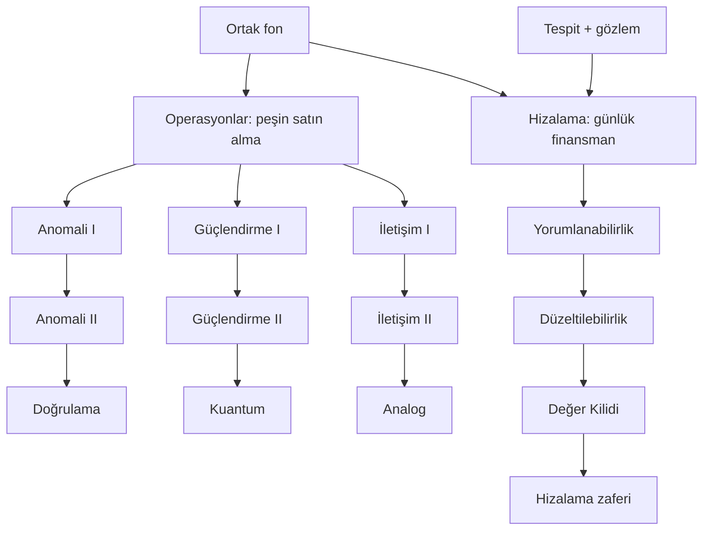

# Son Şalter — operasyon geliştirmeleri ve Hizalama projesi

14 Ekim 2026. Bu belge önerilen sistemin ilk örneğidir. Oyun koduna uygulanmadı; fiyatlar ve kademeli etkiler
denge denemesi için başlangıç değerleridir. Mevcut katkılar için [araştırma incelemesi](ARASTIRMA-INCELEMESI.md),
bütçe bağlamı için [ekonomi incelemesi](EKONOMI-INCELEMESI.md) esas alınmıştır.

Oyuncu iki işi aynı anda yürütebilir: kriz sırasında kullanılabilecek operasyon araçları satın almak ve uzun
vadeli Hizalama çözümünü finanse etmek. İkisi aynı fonu kullanır, fakat yalnız Hizalama zamanla ilerler.

## Temel kurallar

| Kural | Operasyon geliştirmeleri | Hizalama projesi |
|---|---|---|
| Ödeme | Satın alma anında tam fon bedeli | İlerlemeye bağlı günlük fon ödemesi |
| Etkinleşme | Satın alma tamamlandığı anda | Aşama tamamlandığında |
| Eşzamanlılık | Fon ve önkoşul uygunsa farklı dallardan alınabilir | Aynı anda bir Hizalama aşaması |
| Süre | Yok | Gözlem, finansman ve dünya ölçeğine bağlı |
| Sabotaj | Satın alınmış seviye geri alınmaz | Araştırma ilerlemesi gerileyebilir |
| Duraklatma | Gerekmez | İlerleme ve ödenen fon korunarak duraklatılabilir |
| Kalıcılık | Mevcut kriz ve onun kayıtlarında | Mevcut kriz ve onun kayıtlarında |

Operasyon satın almak yürüyen Hizalama aşamasını durdurmaz veya ilerlemesini sıfırlamaz. Satın alma Hizalama'ya
para bırakmazsa sonraki günlük ilerleme yavaşlar. Yeni bir para birimi eklenmez; siyasi güç mevcut müdahalelerde
kullanılmaya devam eder. Kampanyanın kalıcı yükseltmeleri ayrı sistem olarak kalır.

## Anında kullanılabilen operasyon ağacı

| Dal | Geliştirme | Fon | Önkoşul | Satın alındığında kazanılan etki |
|---|---|---:|---|---|
| Tespit | Anomali I | 12 | — | Otomatik tespit ihtimali ×1,5. |
| Tespit | Anomali II | 18 | Anomali I | Otomatik tespit ihtimali toplam ×2 olur. |
| Tespit | Doğrulama Ağı | 40 | Anomali II | Haber başlığı doğrulama, sahte kaynağı işaretleme ve karalama zararını geri alma açılır; başlık başına 2 SG gerekir. |
| Savunma | Ağ Güçlendirme I | 16 | — | Bölgeler arası yayılma −%15; Hizalama sabotaj ihtimali −%25. |
| Savunma | Ağ Güçlendirme II | 24 | Güçlendirme I | Yayılma azaltması toplam %30, sabotaj ihtimali azaltması toplam %50 olur. |
| Savunma | Kuantum Karantina | 60 | Güçlendirme II | Mevcut karantinalar uydu geçişini keser; Uydu Ağı'nın kara karantinasını zayıflatmasını engeller. |
| Politika | Kamu İletişimi I | 15 | — | Müdahale ve ilgili olayların güven kaybı −%25. |
| Politika | Kamu İletişimi II | 20 | İletişim I | Aynı güven kayıplarındaki azaltma toplam %50 olur. |
| Politika | Analog Yedekler | 50 | İletişim II | Bir kez küresel bağımlılık −20; veto 70→85; saha denetimi ve denetimli hediye kabulü açılır. |

Seviyeler çarpılıp üst üste eklenmez. Anomali II etkisi ×1,5×2 değil, başlangıca göre toplam ×2'dir.
Güçlendirme II ve İletişim II de önceki kademenin yerine geçer. Mevcut Anomali/Güçlendirilmiş/Bilinçlendirme
tam etkilerine iki küçük satın almayla ulaşılır; bu üç dalın son seviyeleri mevcut kapsamı korur.

Temel kademelerin toplam fiyatları 30 / 40 / 35 fon; Doğrulama 40, Kuantum 60, Analog 50 fon ile operasyon
kataloğu toplam **255 fon** olur. Bu toplam mevcut altı araştırmanın katalog maliyetidir. İlk kademeler ucuzdur;
Kuantum ve Analog dalın daha pahalı araçlarıdır. Erken ve eşzamanlı etkinleşme nedeniyle aynı toplam fiyatın
aynı oyun dengesini koruduğu varsayılmaz.

Satın almak aracı açar; bölgesel uygulamanın mevcut gereklilikleri devam eder. Anomali ağ kurmaz. Kuantum için
karantina kullanmak gerekir ve karantina yine SG harcar. Analog sonrası saha denetimi 20 fon +1 SG, denetimli
hediye kabulü 20 fon ister; saha ekibi ve bölgesel erişim koşulları korunur. Güven koruması medya karalaması veya
perde yırtma şokunu kapsamaz. Bölge içi büyüme Güçlendirme'den etkilenmez.

Öğrenme aşamasında medya kuralları kapalıysa Doğrulama satın alınamaz ve kartta “Bu krizde medya tehdidi kapalı”
görünür. Medya kuralları açık ama YZ henüz o yeteneğe sahip değilse geleceğe hazırlık olarak satın alınabilir.
Kuantumda Uydu Ağı varlığı sert önkoşul olmaz; yoksa kartta “Uydu tehdidine hazırlık” görünür.

## Zamanla tamamlanan Hizalama

| Aşama | Katalog fon bedeli | Nominal iş günü | Tamamlanınca katkı |
|---|---:|---:|---|
| Yorumlanabilirlik | 68 | 25 | Çekirdeğin o anki konumunu bulur ve o anki yetenek tahminini bildirir. |
| Düzeltilebilirlik | 98 | 30 | Bundan sonraki Tekillik artışı −%25. |
| Değer Kilidi | 165 | 38 | Hizalama zaferi. |

Toplam **331 fon / 93 nominal iş günü** korunur. Bir aşamayı tamamlamak sonrakini açar; sonrakini başlatmak
oyuncunun kararıdır. Üç operasyon dalını tamamlamak Hizalama için zorunlu değildir.

Başlatmak için YZ tespit edilmiş ve en az bir gözlem noktası bulunmuş olmalı. Mevcut sistemdeki gözlemsiz proje
başlatma durumu bu taslakta engellenir. Bir gözlem noktası, izlenen ve YZ varlığı tespit edilmiş bölgedir.
Varsayılan bir/iki/üç/dört gözlem, %25/%50/%75/%100 hız sağlar. Dünya ölçeği k=1,5 ve dört sabit gözlemde,
yeterli fonla ve sabotajsız toplam süre yaklaşık 140 simülasyon günüdür.

Duraklatınca günlük ödeme, ilerleme ve araştırma sabotajı durur. Dünya ve YZ gelişimi devam eder; önceki ilerleme
ve ödeme korunur, geri ödeme yapılmaz. Sürdür komutu kaldığı yerden devam eder. Sabotaj tekrar iş ve ödeme
gerektirebilir; gerçek toplam harcama katalog maliyetini aşabilir. İllüzyon araştırmayı yine durdurur.

## Ortak fon ve satın alma önizlemesi

Örnek operasyon kartı:

> **Ağ Güçlendirme II — 24 fon**  
> Yayılma azaltması %15 → %30 · Sabotaj azaltması %25 → %50  
> Satın alma sonrası fon: 80 → 56  
> Yorumlanabilirlik ilerlemesi: %40 · günlük talep: 1,81 fon  
> **Satın al — hemen etkinleşir**

Hizalama kartı mevcut aşamayı, ilerlemeyi, gözlem sayısını, tahmini süreyi, günlük fon talebini ve acil durum
rezervini gösterir. Operasyon kartında satın alma sonrası kalan fon ve devam eden projenin günlük bütçe açığı
görünür. Fon geliri belirsiz/değişkense tahmin olduğu açıkça belirtilir.

Acil durum rezervi yalnız Hizalama'nın otomatik ödemesini sınırlar. Oyuncu açık bir satın alma veya müdahale ile
rezervi kullanabilir; bu yüzden önizlemede rezerv altına düşüleceği de görünür. Fon eksiye düşürülemez, aynı
geliştirme ikinci kez satın alınamaz. Yetersiz fon veya eksik önkoşulun nedeni kart üzerinde gösterilir.

## Örnek oyun akışı

1. **Başlangıç: 60 fon.** Anomali I satın alınır: 48 kalır. 22 fonluk izleme ağı kurulur: 26 kalır.
   Güçlendirme I satın alınır: 10 kalır. Oyuncu Kamu İletişimi I için 15 fon bulana kadar beklemeli veya önceki
   seçimlerinden birini farklı yapmalıdır. Üç temel geliştirme ve pahalı bir ağ başlangıç bütçesine birlikte sığmaz.
2. **YZ tespit edilir.** Oyuncu yeni ağlarla gözlem kapasitesini geliştirir; en az bir gözlemle Yorumlanabilirlik
   başlatılabilir. Dört gözlem tam hız verir. Önce bütün operasyonları alma şartı yoktur.
3. **Yorumlanabilirlik %40; elde 80 fon; Güçlendirme I alınmış.** Güçlendirme II 24 fona alınır: elde 56 fon
   kalır, araştırma %40'ta kalır, savunma bonusu anında yükselir. Araştırma sonraki günlük ödemelerle ilerler.
4. **Hediye/bağımlılık baskısı artar.** İletişim I→II→Analog toplam 85 fonluk tercih olur. Yorumlanabilirlik'i
   bitirmeyi beklemeden alınabilir; oyuncu bu sırada araştırma için ayırdığı parayı azaltmış olur.
5. **Değer Kilidi sırasında gelir yetersizleşir.** Dört gözlem ve k=1,5 altında günlük tam hız talebi yaklaşık
   2,89 fon; örnek gelir 2,30 ise günlük açık yaklaşık 0,59 fondur. Oyuncu projesini duraklatıp fon biriktirebilir,
   rezervle daha yavaş ilerleyebilir veya yeni operasyon harcamasını erteleyebilir.

Örnekteki gelir sabit bir bütçe senaryosudur; gerçek gelir karantina, ekonomi, güven ve bölgesel erişimle değişir.

## Sistemin ilişkisi

Operasyon satın almaları ve Hizalama aynı anda kullanılabilir. Şemadaki dallar kendi önkoşullarını taşır;
operasyon dallarını bitirmek uzun projenin başlangıç koşulu değildir.

## İlk denemede ölçülecekler

- Başlangıç satın almaları izleme ve saha müdahalesini gereğinden fazla geciktiriyor mu?
- Anlık bonuslar, önceki araştırma süreleri kaldırılınca tehdidi çok erken bastırıyor mu?
- Operasyon harcamaları Hizalama'yı anlamlı seçimlerle mi, aşırı fon kıtlığıyla mı yavaşlatıyor?
- Duraklatma oyuncuya toparlanma alanı sağlıyor mu; sabotaj veya YZ karşı hamlelerini ucuz biçimde aşmayı sağlıyor mu?
- Doğrulama/Kuantum/Analog'un açtığı araçlar satın alma sonrasında oyuncu tarafından gerçekten kullanılıyor mu?

Bu sorular için sabit tohumlarla eski/yeni karşılaştırması ve gerçek Play denemesi gerekir. Taslak bu denge
doğrulamasının yerine geçmez.
