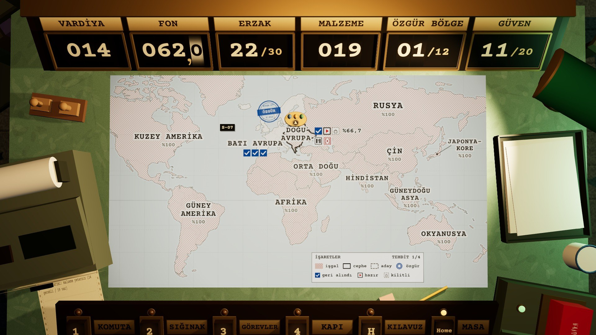
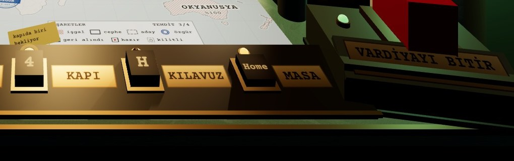
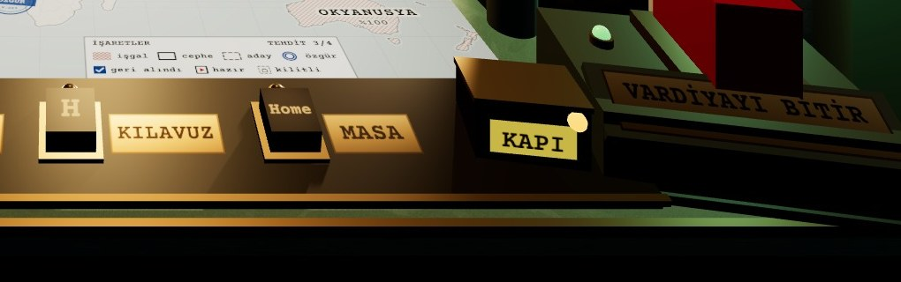
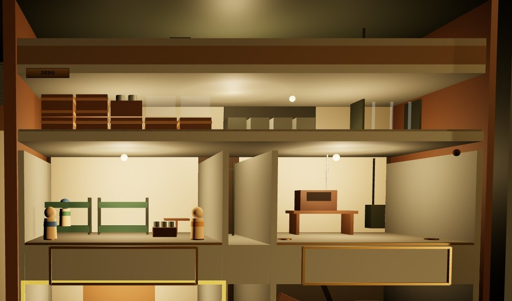
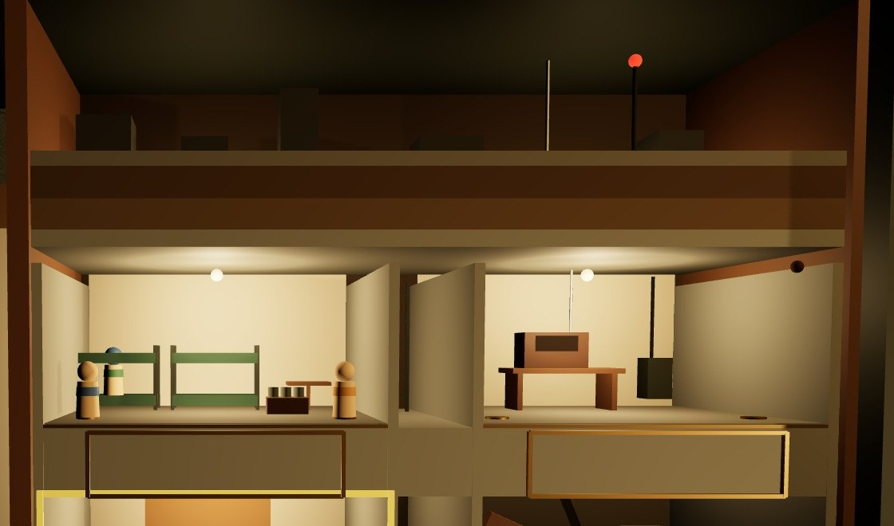

# Kararlar (Revizyon 2)

Karşılaştırmalı üç nokta. Varsayılan olarak **ÖNERİLEN** seçenek uygulanır; Aşama 0 raporunda kullanıcıya teyit ettir.

## KARAR 1 · GÖREV FİŞİNİN YERİ
*Fiş açıkken haritanın hangi kısmı kapansın?*

### A · SAĞ KENAR (BUGÜNKÜ)

- + Fiş cephe bölgesine yakın; oyuncu alışık.
- − Rusya, Çin, Hindistan ve Güneydoğu Asya kapanır; harekâtın ikinci yarısındaki cepheler fişin altında kalır.
- − Fiş ekip figürüne ve sağdaki işaretler kutusuna yaslanır.

### B · SOL KENAR **(ÖNERİLEN)**

- + Haritadan yalnız Kuzey Amerika'nın batı kıyısı kapanır; cephe, ekip figürü ve doğu açık kalır.
- + Fiş teleksin üstüne, masanın boş kenarına oturur.
- − Kuzey ya da Güney Amerika seçilince fiş sağda açılmalı (kural); iplik uzar.

## KARAR 2 · KAPI İŞARETİ
*Ziyaretçi beklerken masada ne görünsün?*

### A · ANAHTAR RAYINDA 4 · KAPI **(ÖNERİLEN)**

- + Kısayol dili zaten tuş rayı: kapıya gitmek = 4. Amber lamba 1 Hz yanıp söner, tuşa el yazısı fiş bağlanır.
- + Kenar satırında da 4 KAPI fişi olur; her pozdan aynı yol.
- − Ray beş tuştan altıya çıkar; plakalar 0,128 m'ye daralır.

### B · MASADA UYARI KUTUSU

- + Ray değişmez; kutu şalterin yanında, vardiyayı bitirirken gözün geçtiği yerde.
- − Kısayolu olmayan yeni bir nesne; kapıya gitmenin yolu yine tıklamak.
- − Kenar satırında karşılığı yok; sığınak ve harita pozlarında görünmez.

**İKİSİNDE DE AYNI** — Biri çalınca kamera bugünkü gibi kendiliğinden kapıya döner. İşaret yalnız Esc ile masaya dönüldükten sonra iş görür: ziyaretçi vardiya bitene kadar bekler. Lamba ışığı emissive (#FFB347, 3,4); renk tek başına taşımaz, fiş ya da kutu yazısı “KAPI” der.

## KARAR 3 · MAKETİN ÜST BANDI
*Boş ve karanlık üst bant ne göstersin?*

### A · DEPO **(ÖNERİLEN)**

- + Asıl soru makette sayılır: sandık = 3 erzak, kova = 5 malzeme, raf = 3 plaka; tebeşir tahtasında “ERZAK · 15 VARDİYA”.
- + Atölyenin döktüğü plaka rafa geçer: oda ile depo arasındaki bağ görünür.
- − Banda on dört küçük nesne; K1'den ayrıntı kaybolur, yalnız tebeşir yazısı okunur.

### B · YÜZEY ŞERİDİ

- + Hikâye: sığınağın üstünde yıkık yüzey ve YZ direği; tehdit hep görünür.
- + Az nesne, ucuz; K1'de de okunur bir siluet.
- − Bilgi taşımaz; özet panosundaki soruya cevap vermez, karar verdirmez.
