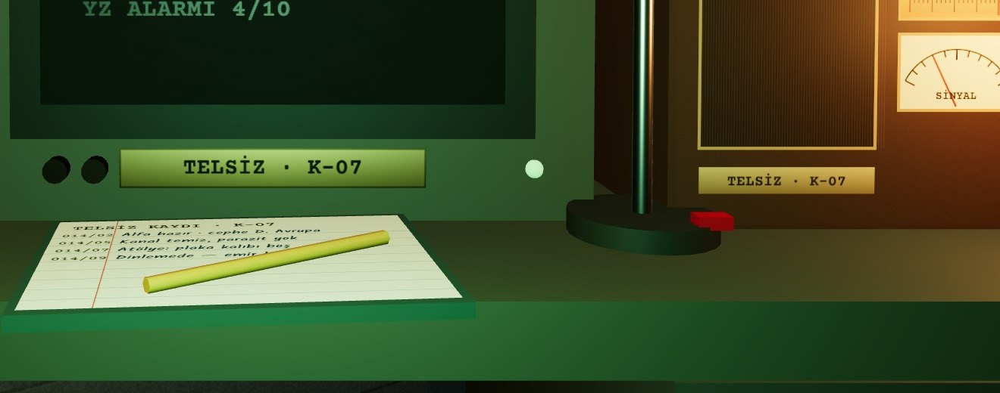

# S1 · BAŞLANGIÇ POZU
*KAMERA AYNI · K1 (0 · 1,52 · −0,15), FOV 56,7°, LENS SHIFT −0,324*

## ESKİ → YENİ

- **harita** — Ad 28 px, her bölgede %100, işaret 26 px, çakışan yerler → ad 40–48 px doku (K1 ortasında ~17 px), %100 ikinci satırda 28 px, sektör işareti 38 px, sabit etiket yerleri. Cephe bloğu: ad + sektör şeridi + yüzde + alan ve imza glifi.
- **FON** — “0620”, kırmızı onda bir çarkı → 062,0 : pirinç virgül ve açık renk onda bir çarkı. Kırmızı yalnız tehdit ve işgalde kalır.
- **teleks** — Masadaki kâğıt K1'de okunmuyordu → son mesaj makinenin önüne asılan ön kâğıtta: kod 50, durum 66, mesaj 50 px doku (K1'de ~14 / 18 / 14 px).
- **CRT** — Yedi küçük satır → boşta dört satır: DİNLEMEDE (ters video), ALFA · HAZIR, cephe / sektör, YZ ALARMI. İlk üçü K1'de okunur; ayrıntı CRT pozunda.
- **oda kartı** — Üç bilgi tek satırda ~10 px → iki satır: ad 84 px, “SV 1 · 2/2” 68 px doku (K1'de ~16 / 14 px).
- **pano** — İçeriksiz mantar pano → KURTARILAN BÖLGELER : başlık kartında sayaç (00/12), her özgür bölgeye mavi damgalı kart, sıradaki hedef kurşun kalemle.
- **kapı** — Bu pozdan görünmüyordu → anahtar rayına 4 · KAPI tuşu (ray beş tuştan altıya). Ziyaretçi bekleyince tuşun lambası yanıp söner, tuşa elle yazılmış fiş bağlanır.
- **harekât izi** — İlk vardiya ile 14. vardiya aynıydı → yedi iz: pano kartları, umut tenekesi (3 aşama), teleks rulosu ve yırtık kâğıt yığını, EVRAK tepsisinin kalınlığı, tebeşir vardiya çentiği, kupalar, maket odaları ve depo bandı.
- **eğitim notu** — Analistin el notu sağ altta, şalter plakasının hemen altında; başlıkta ADIM n/12.

## CRT POZU · AYNI EKRAN

Telsizin yüzü: kanal skalası K-07, SİNYAL göstergesi (HAT AÇILIYOR anındaki sinyalle aynı değer), SES / AYAR düğmeleri, pirinç plaka. Kayıt defteri: son dört kayıt, Kalam 40 px doku.

## NESNELER

- **sayaç rafı** — Ön yüz 1,56 × 0,212 m, 6 modül × 0,247 m · bakalit #24180F, pirinç çerçeve #B8955A · rakam #EFDCAE; onda bir çarkı #E9DDBE üstüne #1C150E.
- **FON virgülü** — Ø 11 mm nokta + kuyruk, pirinç #D4B06E, çarklar arasında 15 mm boşluk.
- **pano** — 0,78 × 0,54 mantar #A27B52, çerçeve #6B4A2E · başlık kartı 0,36 × 0,104 · bölge kartı 0,15 × 0,095 #F6F0DE, damga #1A4789 · boş yer: ahşap raptiye.
- **alarm panosu** — 0,48 × 0,29 bakalit + pirinç · 10 adım ölçek (1–7 #E9DDBE, 8–10 #C0281C) · lamba Ø 9 cm, ≥ 8'de emissive #F0443A 1,8.
- **teleks kâğıdı** — 0,26 × 0,19 #EFE4BC, krom klips 6 cm, 3° öne eğik.
- **anahtar rayı** — 1,40 × 0,15 · 6 tuş, aralık 0,226 m · plaka 0,128 (Home 0,10) · kapı lambası Ø 18 mm #FFB347 emissive 3,4 + sarı halka.
- **çentik, teneke** — Vardiya çentiği 0,5 × 0,125 decal, tebeşir #E6E2D4 α.82 · umut tenekesi Ø 7 cm galvaniz, yaprak 3 → 7 → 11.

## ETKİLEŞİM VE DURUMLAR

- **4 · KAPI** — Normal: lamba sönük. Ziyaretçi var: amber, 1 Hz. Üzerinde: sarı kontur + etiket “KAPI · ZİYARETÇİ VAR”. Basılı: tuş 6 mm iner, kamera kapı pozuna 0,45 s. Devre dışı: baskın sürerken; etiket nedenini yazar. Yetersiz kaynak durumu yok.
- **sayaçlar** — Değer değişince çarklar döner; üzerinde “FON · 62,0” etiketi (sade hoverCard). Tıklanmaz.
- **pano, alarm** — Bilgi; üzerinde: kartın / alarmın etiketi (“YZ ALARMI · 4/10 · 10'da karşı saldırı”).
- **eğitim notu** — Boşluk sonraki adım, Esc kapatır; adımın hedefi yapılınca kendiliğinden ilerler.

## HAREKET VE SES

- **bölge özgür** — Vardiya raporu kapanınca kart üstten düşer (0,35 s), raptiye “tık”, mavi damga 0,1 s “tok”; başlık sayacı 0,35 s döner.
- **ziyaretçi** — Üç vuruş (0,9 s) → kamera kapıya (bugünkü gibi). Esc ile dönünce lamba 1 Hz yanıp söner, fiş 0,2 s sallanır.
- **FON** — Çarklar 0,35 s, çark arası 0,12 s; onda bir çarkı en son, her çarkta hafif “tık”.
- **alarm, teleks** — Alarm ≥ 8: lamba 0,08 s'de yanar, alçak uğultu. Yeni teleks: kâğıt 0,4 s'de yazılır, eski ön kâğıt koparılır ve yığına düşer.
