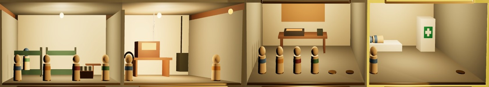
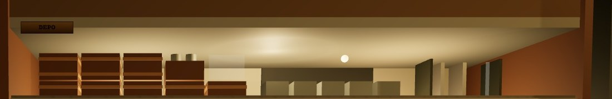

# S3 · SIĞINAK
*KAMERA AYNI · SIĞINAK POZU, FOV 48°*

## ESKİ → YENİ

- **düğmeler** — Taşan “EN ÜST SEVİYE” düğmesi, sıkışık “− PERS.” “+ PERS.” → personel adımlayıcısı [−] 2/6 [+]. En üst seviyede düğme yerine yeşil EN ÜST SEVİYE damgası; “Oda en yüksek seviyede.” tekrarı kalktı.
- **özet** — Dört eşit satır → başta asıl soru: ERZAK YETER · 15 VARDİYA (40 px). Hesap: erzak ÷ son vardiyadaki düşüş, aşağı yuvarlanır. Erzak artıyorsa “ERZAK ARTIYOR”; 3 vardiya ve altı kırmızı + “AZ KALDI”.
- **ipucu** — Sarı kutu (sarı = seçili) → analistin kurşun kalem notu, Kalam 20.
- **üst bant** — Boş ve karanlık → DEPO: erzak sandıkları (1 sandık = 3 erzak; boş yer gölgesi depo sınırı), malzeme kovaları (1 kova = 5), plaka rafı (3 yuva), tebeşir tahtasında “ERZAK · 15 VARDİYA”. Öteki seçenek: Karar 3.
- **maket kartı** — Tek satır ~10 px → iki satır: ad 24 px, “SV 1 · kişi işareti 2/2” 19 px. Aynı kart K1'de rafta da okunur.
- **pano yeri** — Maketin direği kâğıdın sağını, piyonlar altını kesiyordu → pano 6 cm sola, 8 cm yukarı (raf yerel −0,46 · 0,86); altına ahşap ayak. Kamera aynı.
- **kenar satırı** — GÜVEN ve ALARM eklendi; tuş fişlerine 4 KAPI.

## ODALARIN ÇIKTISI · GEÇ HAREKÂT

Yaşam alanı: ranzada yedek uzman (yedek sayısı kadar). Telsiz odası: görevliler cihaz başında. Atölye: kalıpta plaka koyulaşır, bitince depo bandındaki rafa geçer. Revir: yatakta sargılı yaralı uzman. Görevli sayısı = odadaki piyon.

## NESNELER

- **özet panosu** — Kâğıt 0,37 × 0,54 m, World Space Canvas 400 × 594 birim, #F1E9D6. Gövde 0,40 × 0,60 × 0,008 ahşap #8B6B45, krom klips 0,13 m, 8° geriye yatık.
- **maket kartı** — 0,23 × 0,057 m, kâğıt #EAE1C8, kenar #7A6A4C. Seçili: 3 px sarı #F5D646, oda çerçevesiyle birlikte.
- **DEPO bandı** — Sandık 0,06 × 0,042 × 0,07 ahşap; boş yer %22 opak düzlem #D9D2BF. Kova 0,036 × 0,045 × 0,05 galvaniz, doluluk iç kutuyla. Plaka rafı 0,11 m çelik, plaka 0,006 × 0,07 #9A9C98. Tebeşir tahtası 0,20 × 0,072 #2A2C28, yazı #E6E2D4.
- **BOŞTA plakası** — Tepsi önünde pirinç #C2A066, CP 700 18 eşdeğeri.
- **adımlayıcı** — Çerçeve düğme 52 × 46, kenar 2 px #463F34, gölge (0, 3) #8E8166; değer CP 700 26.

## ETKİLEŞİM VE DURUMLAR

- **[−] [+]** — Normal. Üzerinde: zemin #FFFDF6, gölge 4 px. Basılı: 2 px iner, gölge 1 px. Devre dışı (0'da [−], oda doluyken [+]): kenar kesikli #8A8374, simge #8A8374; üzerinde “Oda dolu” / “Görevli yok”. Yetersiz kaynak (boşta kimse yok): [+] devre dışı görünür, not “Boşta kimse yok”.
- **GELİŞTİR** — En üst seviye değilken mürekkep düğme “GELİŞTİR · 20 fon + 14 malzeme”. Yetersiz kaynakta düğme açık kalır, eksik kalem üstü çizik + “yetersiz”; basınca teleks şeridi YAPILAMADI basar (bugünkü 014/08 mesajı).
- **oda** — Üzerinde: oda çerçevesi 1 px açık sarı, kart 2 mm yükselir. Seçili: 3 px sarı. Hasarlı: kırmızı HASARLI damgası + enkaz. Tıklanınca panodaki sayfa o odaya geçer.
- **öneri** — Telsiz odasının alarm etkisi: görevli varken odadaki amber lamba yanar, alarm panosunun altında pirinç fiş “TELSİZ ODASI ETKİN”.

## HAREKET VE SES

- **oda seçimi** — Sarı çerçeve 0,1 s → panonun sayfası 0,15 s'de değişir; kâğıt hışırtısı.
- **personel** — Piyon tepsiden odaya 0,35 s'lik yayla gider, “tok”; değer 0,1 s'de yazılır.
- **geliştirme** — Oda ışığı 0,2 s kısılıp açılır, karttaki SV değişir; çekiç sesi 0,3 s.
- **vardiya sonu** — Sandık ve kova 0,25 s'de eklenir ya da kalkar; tebeşir yazısı silinip 0,3 s'de yeniden yazılır.
