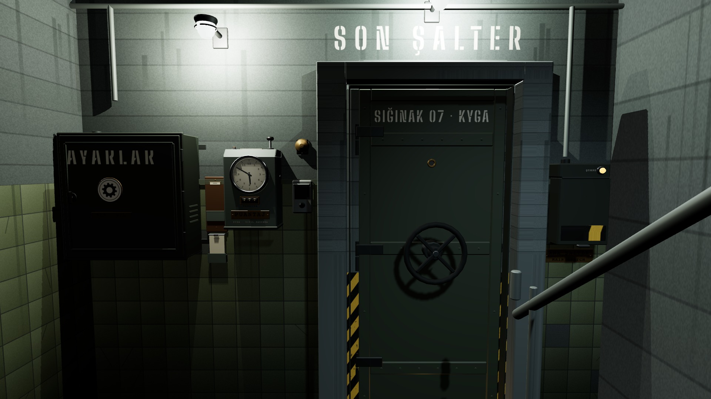
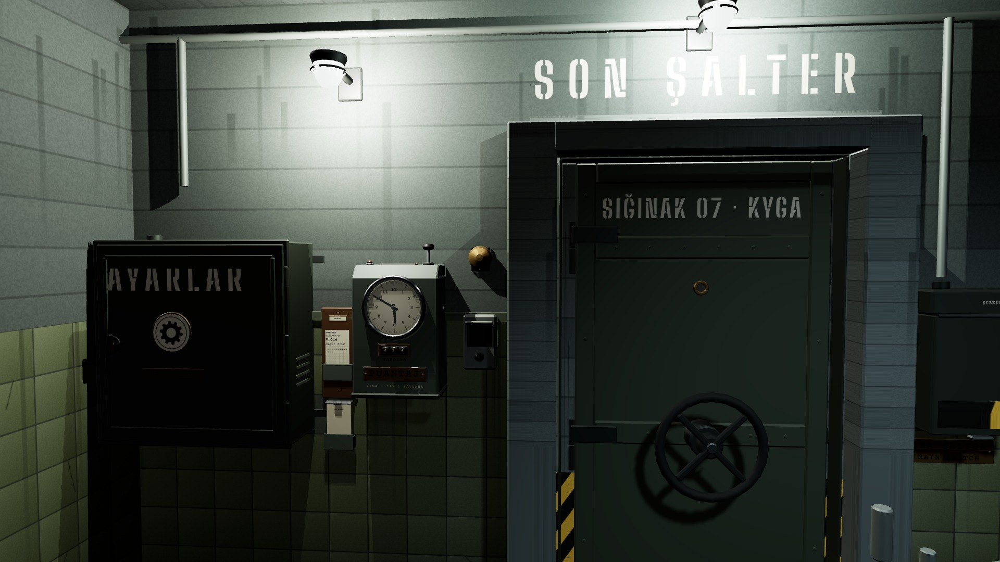
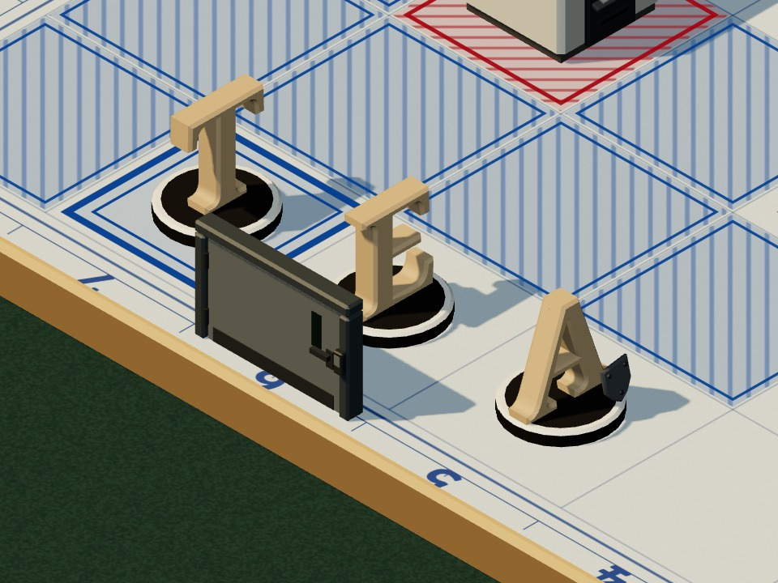
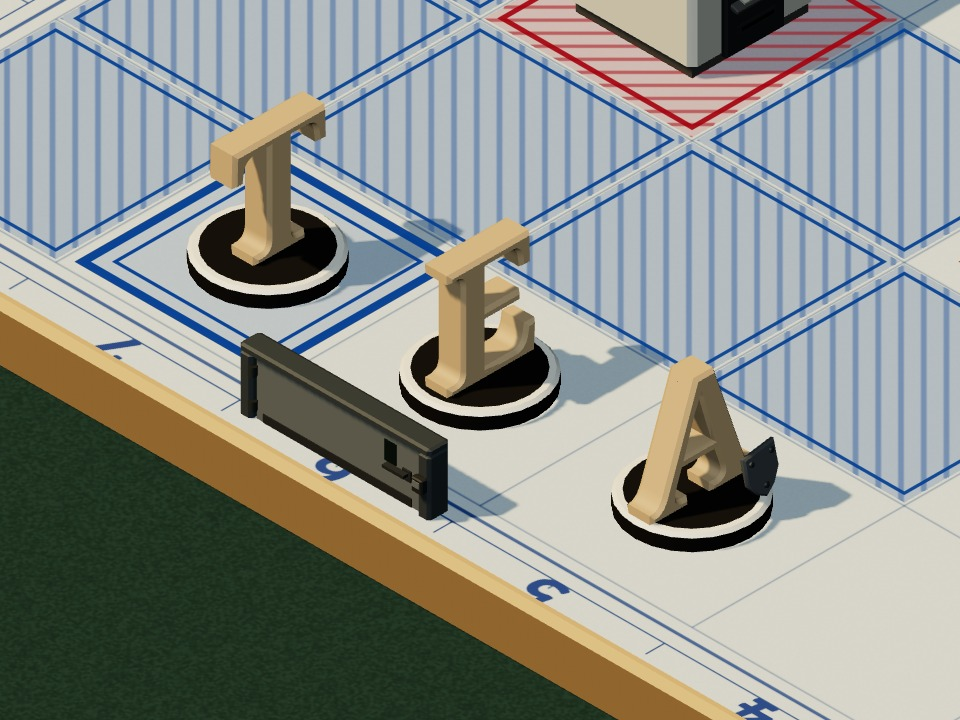
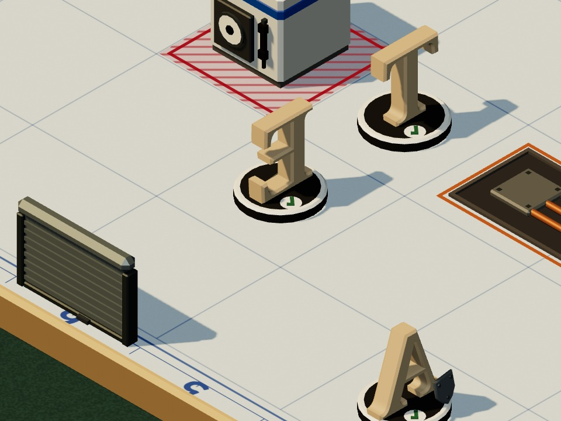

# Karşılaştırmalar 1–3
*Pano: `Karsilastirma-1.dc.html` · görüntü: `../panolar/Karsilastirma-1.jpg`*

KARŞILAŞTIRMA 1–3 · REVİZYON 3’ÜN AÇIK NOKTALARI her biri iki seçenek · 4: pano · 5: kapıda kabul
1 MENÜ KAMERASI (M0)
A · Yeni · (4,50 · 1,52 · 0,30) → (2,2 · 1,34 · 0,30), 56°. Kapı ortada, dolap ve son şalter kadrajda tam, başlık üstte. Göz yüksekliği 1,52 m: K1 ile aynı, içeri girişte (R4) kamera sıçramaz.
B · Eski · (4,30 · 1,66 · 0,20) → (2,2 · 1,58 · 0,05), 52°. Daha yüksek ve dar: dolap ile son şalter kenarlara sıkışır, kapıya yukarıdan bakılır.
KARAR: A Maliyet S · yalnız kamera değerleri (token cameras.M0).

A ÖNERİLEN
Yeni · (4,50 · 1,52 · 0,30) → (2,2 · 1,34 · 0,30), 56°

B İKİNCİ SEÇENEK
Eski · (4,30 · 1,66 · 0,20) → (2,2 · 1,58 · 0,05), 52°
2 BASKINDA GİRİŞ KAPISI YÜKSEKLİĞİ
A · Tam boy · EntryDoor 0,58. Binanın kapısı inandırıcı; ama kamera güneybatıdan baktığı için A sütununu örter: A6–A7 altlıkları ve “6” kare adı kapanır.
B · Alçak · 0,29 ya da açık kasa. Kapı biçimi yine okunur (kepenk, çift kanat, lomboz); arkasındaki kareler ve işaretler açık kalır. Açık kasa = söve + üst kiriş, kanat yok.
KARAR: B Maliyet S · ölçek 0,5 ya da kanadı gizle; 13 kapının hepsi aynı kuralla.

A İKİNCİ SEÇENEK
Tam boy · EntryDoor 0,58

B ÖNERİLEN
Alçak · 0,29 ya da açık kasa
3 PİYONUN “TUR BİTTİ” YÜZÜ
A · Koyu kraft · r_pawnDone #8C734E. Ahşaptan (#C9A77A) açıklık farkı ΔL* 20,5: gri tonda ve uzaktan okunur, tik işareti öne çıkar.
B · Açık kraft · r_kraft #B89D74. Kâğıt gibi sıcak ama ahşaba çok yakın (ΔL* 4,3): oynamış piyon oynamamış gibi görünür.
KARAR: A Maliyet S · tek malzeme (Letter parçasının arka yüzü).

A ÖNERİLEN
Koyu kraft · r_pawnDone #8C734E

B İKİNCİ SEÇENEK
Açık kraft · r_kraft #B89D74
