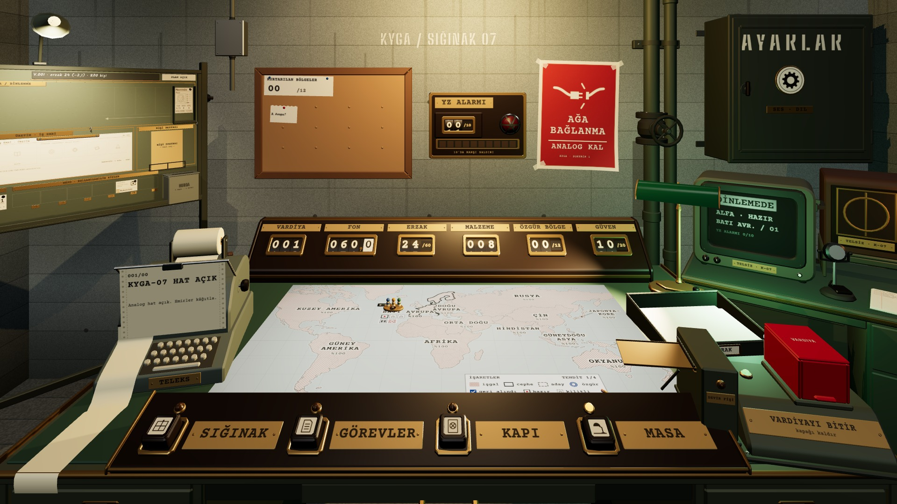
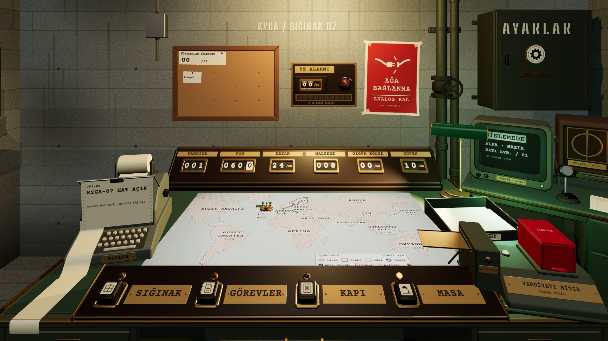
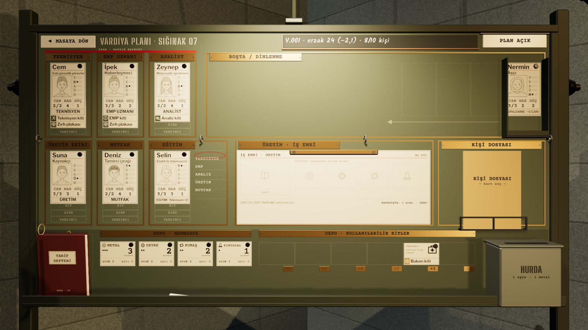
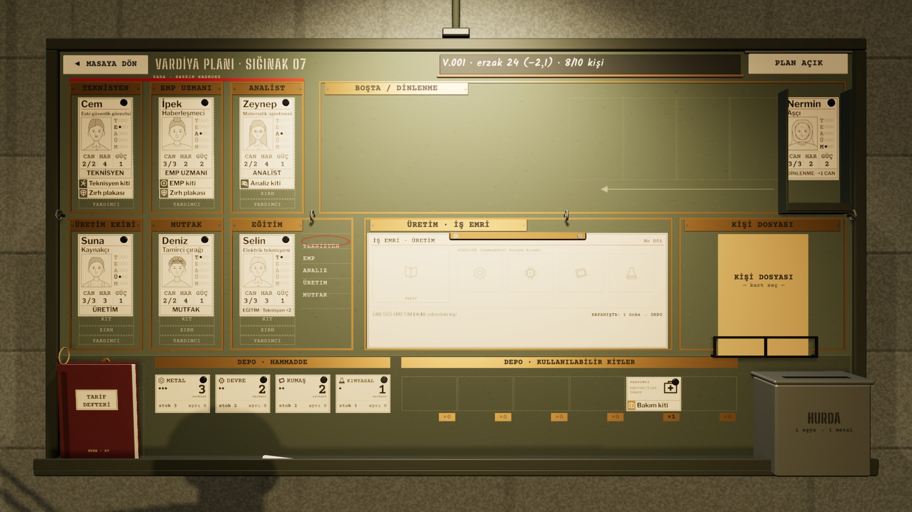

# Karşılaştırma 4 · Pano ayaklı mı, duvarda mı
*Pano: `Karsilastirma-2.dc.html` · görüntü: `../panolar/Karsilastirma-2.jpg`*

KARŞILAŞTIRMA 4 · PANO AYAKLI MI, DUVARDA MI? kartlar, cepler ve K4 kadrajı ikisinde de aynı
A · AYAKLI PANO · ESKİ RAFIN KÖŞESİ ÖNERİLEN

K1’de görünen yarı: Boşta, dosya, hurda
PLAN · K1 GÖRÜŞ ALANI
*Şema etiketleri:* K1 · K4 · A · masa
Ekin istediği “daha küçük, ayaklı pano”: (−1,62 · 0 · 1,70), yaw −48°. K1’de sol kenarda yarısı görünür, SIĞINAK tuşu K4’e getirir.
KAZANDIRIR
- **+** — Öğretici yok: K1’de Boşta destesi, kişi dosyası, hurda kutusu ve pano lambası “burada bir plan var” der.

- **+** — Masaya 48° dönük: SIĞINAK tuşuyla K4’e geçişte kamera kısa yoldan döner.

- **+** — Raf ailesinden boşalan köşeyi doldurur; tekerlek ve T ayak onu taşınabilir bir eşya yapar.

BEDELİ
- **−** — Ayak, tekerlek ve topuzlar 516 üçgen (pano 3708 / 4000).

- **−** — K1’de yazılar okunmaz; okuma K4’te (iki seçenekte de).

B · DUVAR PANOSU · SOL DUVAR İKİNCİ SEÇENEK

◄ pano kadraj dışında (Boşta destesi x −34 px)
PLAN · K1 GÖRÜŞ ALANI
*Şema etiketleri:* K1 · K4 · B · masa
Aynı pano ayaksız, sol duvara asılı: (−2,17 · 0 · 1,50), yaw −90°. K4 değişmez; K1’de pano görünmez.
KAZANDIRIR
- **+** — K4 kadrajı aynı (kamera panoya bağlı); arkası sakin beton.

- **+** — Ayak yok: 516 üçgen ve zeminde 0,4 m derinlik kazanılır.

BEDELİ
- **−** — K1’de görünmez: ilk vardiyada panonun varlığını yalnız SIĞINAK tuşu söyler.

- **−** — Arka duvara asılırsa görünür, ama sol üstü kaplayan büyük düz levhaya döner (bugünkü 01_masa_K1); mantar pano ve afişle çakışır.

- **−** — Köşe boş kalır.

K4 · A

K4 · B
KARAR: A · AYAKLI K4 iki seçenekte aynı kadraj; farkı K1 yaratıyor. Ek “pano eski rafın yerinde durur” diyor ve öğretici yok: K1’de görünen kenar, ipucunun kendisi. Duvar panosu ancak K1 kadrajı sola genişlerse (ya da pano arka duvara geçerse) aynı işi görür; ikisi de masanın okunurluğundan yer.
