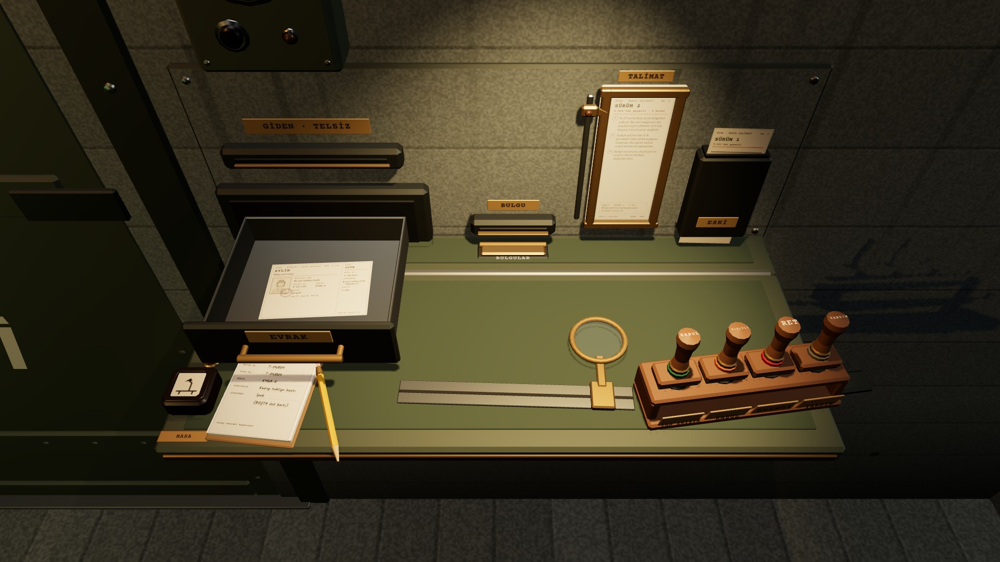

# Karşılaştırma 5 · Kabul kapıda mı, masada mı
*Pano: `Karsilastirma-kapi.dc.html` · görüntü: `../panolar/Karsilastirma-kapi.jpg`*

KARŞILAŞTIRMA · KAPI KABULÜ NEREDE? ikisi de fiziksel; kurallar, kâğıtlar ve dört karar aynı
A · KAPININ YANINDA TEZGÂH ÖNERİLEN

Kapının sağında katlanır tezgâh ve panel (R17). K8’de görünür, K8A’da çalışılır, kâğıt okumak için öne gelir.
KAZANDIRIR
- **+** — Belge, araç ve kapı aynı yerde: evrak gözü, interkom, buğu camı gerçekten kapıda.

- **+** — Kapı pozu anlam kazanır: risk kapıda tartılır.

- **+** — Masa harita, fiş ve devir fişine kalır.

- **+** — Katlı tezgâh “başvuru yok”u sessizce söyler.

BEDELİ
- **−** — Bir poz daha (K8A) ve okuma pozu.

- **−** — Tezgâh yalnız başvuruda kullanılır.

- **−** — Menüde evrak gözünün dış kapağı eklenir (R1).

B · MASADA İKİNCİ SEÇENEK

*[görüntü: K1 masası: harita, sayaç rafı, anahtar rayı, sağda EVRAK tepsisi]*

başvuru dosyası buraya
Belge evrak gözünden bir boruyla masaya gelir; incelemeler masadan (interkom ahizesi, buğu raporu kâğıtla).
KAZANDIRIR
- **+** — Tek poz: oyuncu masadan kalkmaz.

- **+** — Kâğıtlar harita pozunda zaten okunur boyutta.

- **+** — Yeni duvar donanımı gerekmez.

BEDELİ
- **−** — Harita, görev fişi, devir fişi ve teleksle aynı yüzey: kalabalık.

- **−** — Buğu camı ve kapı uzakta: SOĞUK GÖZLEM ve GÖRÜŞME soyutlaşır.

- **−** — Kapının tehdidi masaya taşınır; K8 boş kalır.

KARAR · A Kabul kapının işi; araçlar ancak kapıda fiziksel kalır. B’nin tek avantajı (poz sayısı) K8A’nın 0,45 s dönüşüyle ve kâğıdın öne gelmesiyle kapanır.
