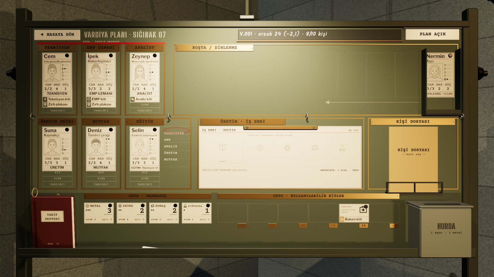

# Son Şalter · Revizyon 3 · içindekiler
*Pano: `Main.dc.html` · görüntü: `../panolar/Main.jpg`*

KYGA · TASARIM DOSYASI · R3 + EK 2026-11-03 · EK 2026-11-05

### SON ŞALTER REVİZYON 3 · MODELLER
Bütün 3B nesneler gerçek ölçekte, pahlı, malzemesi ayrılmış, hareketli parçaları pivotlu modeller oldu. Ek 11-05 ile oda yükseltmeleri ve maket kalktı: yerinde sekiz isimli kişinin kartlarını taşıyan ayaklı pano duruyor. Kapıda kabul belgelerle ve gerçek araçlarla yapılıyor; vardiya, şalterden çıkan devir fişiyle kapanıyor. Öğretici yok: her adımı nesnenin kendisi gösteriyor.
- **A** — Menü ve dolap · R1 sahanlık (6 durum) · R2 saat ve kart · R3 ayarlar dolabı · R4 içeri girme anı
- **B** — Komuta odası · R5 K1 (pano solda, fiş bekliyor) · R6 harita ve kâğıtlar · R8 CRT ve dalış · R9 kapı · R10 kâğıtlar ailesi · R7 maket kaldırıldı
- **EK** — Pano, kabul, devir · R15 kartlı pano K4 (+EN) · R16 kart ailesi ve portreler · R17 kapıda kabul K8 (+EN) · R18 tarif defteri ve üretim · R19 vardiya kapanışı K6
- **C** — Baskın · R11 üç kit, üç isimli kişi · R12 12 kit + varsayılan, renkli ve gri
- **D** — Kütüphane ve stil · R13 model sayfaları (pano, kart, kabul, fiş ağzı eklendi; raf ve ziyaretçiler çıktı) · R14 malzeme, yıpranma, ışık · 5 karşılaştırma · öncelik · sorunlar · tokenlar

Her ekranın yanında uygulama notu: eski → yeni, nesneler (ad, ölçü, malzeme), etkileşim ve durumlar, hareket ve ses. Paket: 198 model (OBJ + MTL + manifest + sayfa), three.js sahnesi, token 1.3.
1920 × 1080 · TR (EN: R3, R6, R11, R15, R17) · URP LIT · ÖZEL SHADER YOK · BLOOM YOK · POZ BAŞINA ≤ 4 GÖLGELİ IŞIK
