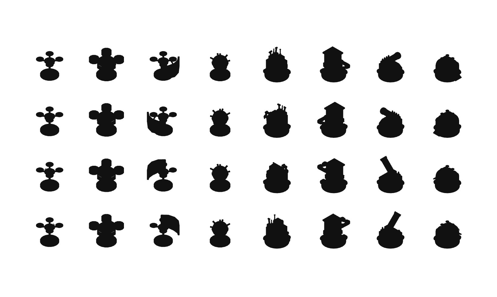

# R11c · Çin kiti · olay nesneleri
*Pano: `R11c.dc.html` · görüntü: `../panolar/R11c.jpg`*

![Planlama evresi, Çin kiti (montaj fabrikası): duvarlar açık istif parça kasaları, köprüler kablo zinciri, ayrık bloklar kasa kulesi; siviller kalite kontrol panolu krem kutular; batı kenarında seksiyonel fabrika kapısı; olay nesneleri: F2'de turuncu omuz bantlı basınçlı tüp, B4'te turuncu burunlu kaidesi üstünde iki mafsallı kaynak kolu, E5'te tavan enkazı; makineler: F7'de dron, G5'te havan robotu, G3'te kalkan dronu, H2'de çoğaltıcı; Deniz B5'te, Cem B6'da, Zeynep A4'te; B5, F3, E2, G2 ve F1 kırmızı taralı](../../ekranlar/R01-R14/R11c_cn_olay_ekip.jpg)

DENİZ
CEM
ZEYNEP
DRON · F7 ince ayak, açık dört rotor
HAVAN ROBOTU · G5 basık gövde, 45° kalın namlu
KALKAN DRONU · G3 önde 105° faset çelik kalkan
ÇOĞALTICI · H2 kemerli hangar, üstte mini dron
BASINÇLI TÜP · F2 turuncu omuz bandı, fan yok
KAYNAK KOLU · B4 turuncu burun: kolun yönü
TAVAN ENKAZI · E5 oluklu sac, kiriş, beton
TUR 4/8
SON 2 TUR
1 2 3 4 5 6 7 8
SIRA SENDE
KAYNAK HATTI · İKMAL
ZIRHLI DOLAP
İkmal kasası · F4 Amaç: kasadan ikmal al
CAN
KASADA
metal
devre
kumaş
kimyasal
erzak
GÜVEN 11
SİVİL SUNUCU
TELSİZ
L
KURALLAR
?
GERİ ÇEKİL
OZALİT KOPYA · PAFTA 2/3
MONTAJ FABRİKASI 02 Kaynak hattı Çin Ölçek 1:50 · V.045
*Şema etiketleri:* 01 · 02 · 03
ASLI GİBİDİR
SİLUET SINAMASI · 8 MAKİNE tahtadaki yön · tek renk

Dron

Zırhlı dron

Kalkan dronu

Patlayan robot

Bakım robotu

Kilitleyici

Havan robotu

Çoğaltıcı
ÇIKIŞ ONAYI · KAÇIŞ, SON TUR bu tahtada değil
KAÇIŞ · SON TUR · ZEYNEP ÇIKIŞA 2 KARE UZAKTA
Zeynep geride kalırsa kalıcı olarak ölür.
Analiz kiti ve Bakım kiti kaybolur · Analiz ustalığı silinir.
Geri dön
EMRİ YİNE DE İLET · tekrar bas

### T
DENİZ · T
HAR 4 · GÜÇ 1
Teknisyen kiti · Zırh plakası
PLAKA KIRILACAK

### E
CEM · E
HAR 4 · GÜÇ 1
EMP kiti · Zırh plakası · EMP hücresi
HAREKET + YETENEK

### A
ZEYNEP · A
HAR 4 · GÜÇ 1
Analiz kiti · Bakım kiti
HAREKET + YETENEK
Geri al
Z

### Enter EMRİ İLET
