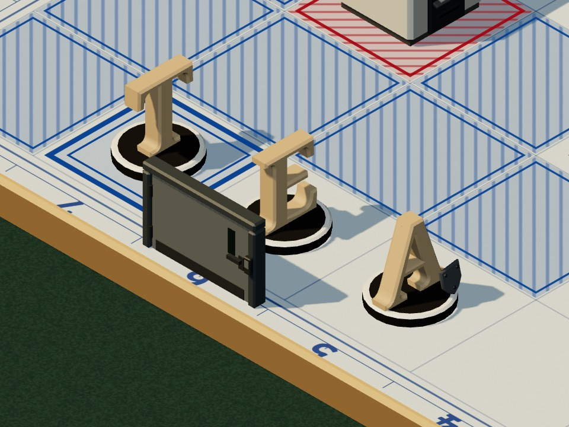
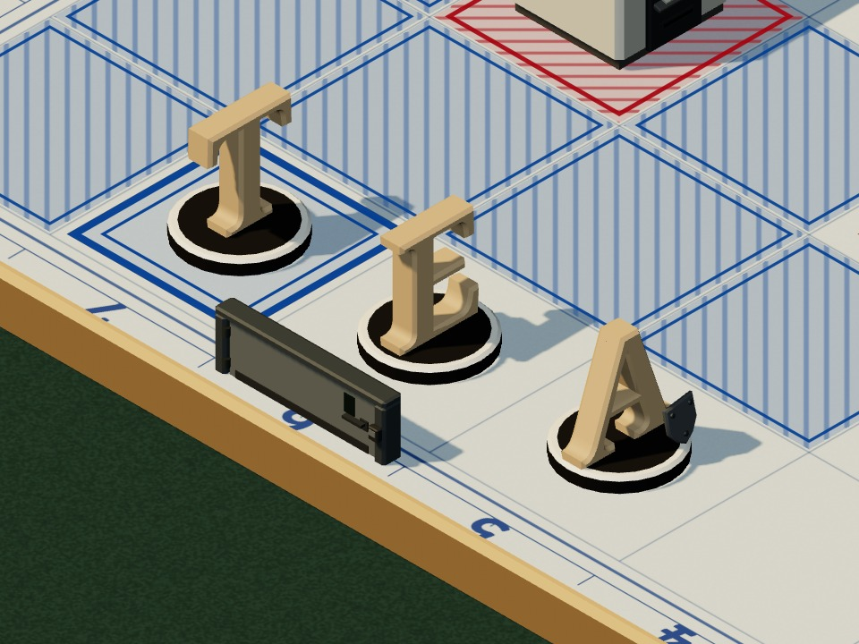

# R12 · Uygulama notu
*Pano: `R12-not.dc.html` · görüntü: `../panolar/R12-not.jpg`*

### R12 · 12 KİT + VARSAYILAN
KİT TABLOSU · KABUL KAPISI · AÇIK KARARLAR
KİT TABLOSU sayı = üçgen; her parça ≤ 400
- KİT | DUVAR KABARTMASI | KÖPRÜ | AYRIK KOLON | GEDİK MOLOZU | GİRİŞ KAPISI | SİVİL CİHAZI
- weu | rack, kablo tavası · 321 | kablo tavası · 42 | tek uzun rack · 183 | rack kapağı · 218 | çelik güvenlik kapısı · 314 | ATM · 320
- eeu | açık raf, kutular · 379 | raf tahtası · 76 | raf ucu, etiketli · 214 | dosyalar · 164 | vasistaslı ahşap çift kapı · 368 | mikrofilm okuyucu · 386
- me | boru demeti, flanş · 361 | flanşlı boru · 124 | dik boru istifi · 365 | kesik boru · 160 | mandallı patlama kapısı · 380 | gaz analiz dolabı · 364
- af | oluklu bunker, cevher · 323 | çelik I kiriş · 62 | oluklu bunker · 295 | cevher, sac · 224 | sarmal kepenk · 272 | sevk telsizi · 322
- na | palet, streç film · 210 | palet kirişi · 32 | uzun sarılı istif · 265 | koliler · 184 | tamponlu rampa kapısı · 326 | depo kiosku · 212
- ru | sandviç panel, kırağı · 259 | yuvarlak kanal · 140 | panel kabin · 252 | panel, köpük · 184 | kollu soğuk oda kapısı · 348 | operatör konsolu · 266
- in | bölme + dosya dolabı · 328 | alçak bölme · 32 | uzun dosya dolabı · 199 | kâğıtlar · 170 | itme barlı cam kapı · 230 | çağrı merkezi masası · 362
- cn | parça kasası, tutamak · 261 | kablo zinciri · 90 | kasa kulesi · 209 | parçalar · 229 | seksiyonel fabrika kapısı · 350 | kalite kontrol panosu · 338
- jk | şalt gövdesi, panjur · 328 | bara kanalı · 34 | tek panjurlu pano · 157 | pano kapağı · 181 | yuvarlak camlı hava kilidi · 290 | temiz oda terminali · 280
- sea | kum torbası sıraları · 308 | üstte tahta · 16 | torba sütunu · 120 | patlak torba · 169 | mandallı oval su kapısı · 226 | test tezgâhı · 376
- sa | kalıp ızgarası, takoz · 359 | çelik U kiriş · 36 | kalıp çifti · 228 | eğri levha · 160 | ağır cıvatalı kapak kasası · 314 | röle panosu · 390
- oc | sandık, V destek · 244 | baklava sac · 42 | uzun sandık · 238 | sac, cıvata · 184 | tel örgülü liman kapısı · 328 | vinç kumanda kioskı · 376
- vars. | iki katlı blok · 38 | yok (sahibin kararı) | aynı blok | eski dolap enkazı | sade kasa · 166 | bugünkü sunucu · 162

KABUL KAPISI
- **üst · yan** — Üst L* 58–74, yanlar L* ≥ 40, doygunluk C* ≤ 22.
- **ahşap · ayrılmış** — Piyon ahşabı #C9A77A ve kontrplağa ΔE ≥ 15; kırmızı, mavi, yeşil, turuncu, sarıya ΔE ≥ 20 (CIE76).
- **desen** — ΔL* ≤ 15 (P5–P95, baker 14'e sıkıştırır); yan yüz birimlerin arkasında gürültü yapmaz.
- **kanal · kuyu** — L* ≤ 30, mavi yok; mat, metalsiz, ışımasız.
- **parça** — İnce parça ≥ 0,025 birim, kare başına ≤ 3 renderer; yalnız üst, batı, güney yüz, gölge iki yüzlü.
- **yakın çiftler** — me–sea ΔE ≈ 3,9; in–sa, cn–sa ≈ 5,2: yalnız biçim ayırır, R12b'de ayrılıyor.
- **denetim** — RaidKitGate: kapıdan geçmeyen kit kütüphaneye bağlanmaz.

AYRILMIŞ İŞARETLER KORUNDU
- **kırmızı** — Yalnız YZ: göz, taban halkası, düğüm simgesi, kopya dolabı; kitlerde yok.
- **halka + çarpı** — 12 sivil cihazında üstte Ø 0,32 halka ve çarpı, mavi bant; cihaz bandın altında.
- **soğutma** — Dik silindir + fan + sarı üçgen yalnız soğutma ünitesinde.
- **turuncu** — Omuz bandı yalnız tüpte; kitlerde turuncu yok, kanal kenarı ve kaynak kaidesi bugünkü işaret.
- **çark · harf** — Çark yalnız kayar rafta (teker yok); harfli ahşap ekip, kâğıtta harf kare adı; kitlerde yazı yok.

AÇIK KARARLAR
Giriş kapısı yüksekliği. Batı kenarındaki kapı (≤ 0,60) A sütununu örtüyor: tam boyda A6–A7 altlıkları ve “6” kare adı kapanıyor. Öneri: ≤ 0,30 ya da açık kasa (söve + üst kiriş, kanat yok).

TAM 0,58 · örtüyor

ALÇAK 0,29 · açık
Kamera ölçeği. Oyun kamerası 88 px/kare (raid_tokens camera), çekimler 132,6 px/birim. 88'de 3 px kuralı ince parçayı ≥ 0,035 birim ister; bugün 0,025 olan kanal rayı, anten ve iğne o ölçekte 2,2 px kalır. Ya kamera 132,6'da kilitlenir ve token düzelir, ya bu parçalar 0,035'e kalınlaşır ya da dokuya iner.
Soğutma ve sandık rengi. Kapıda değil: eeu üstü soğutma ünitesine ΔE ≈ 10, ru ≈ 6; bugün şekil ayırıyor. Ayrılmış listeye eklemek sahibin kararı.
Ek 11-05 kitleri değiştirmez. R12 çekimlerinde zırh plakası eski örnek ekipteki gibi A piyonunda; isimli ekipte Deniz (T) ve Cem (E) taşır, R11 bu yüzden yeniden çekildi.
