# R12a · 12 kit + varsayılan · renkli
*Pano: `R12a.dc.html` · görüntü: `../panolar/R12a.jpg`*

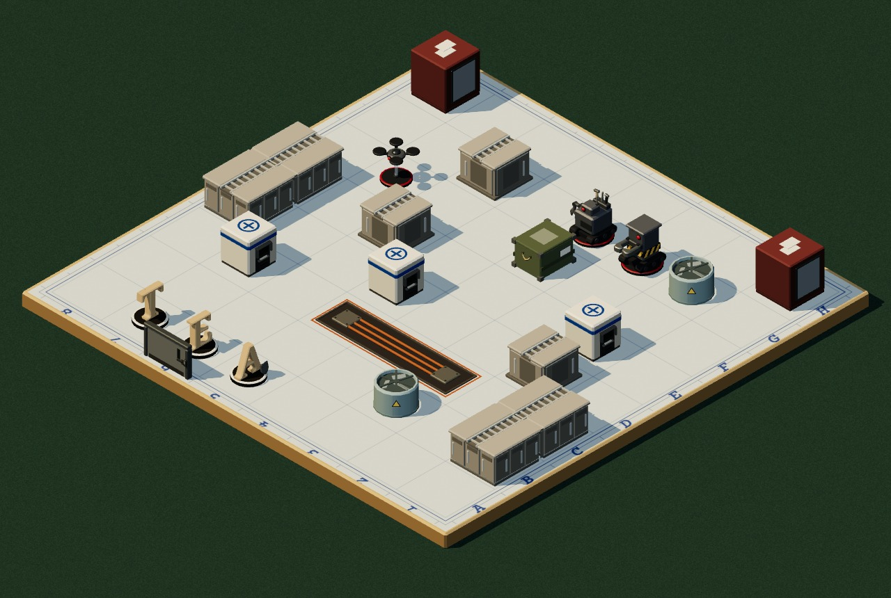

weu Batı Avrupa · Banka veri merkezi
uzun dikey paneller · üstte merdiven kablo tavası, kollu uzun rack kapıları
Kapı: çelik güvenlik kapısı, kart okuyucu · Sivil: ATM

eeu Doğu Avrupa · Devlet arşivi
yatay raflar · açık çelik raf, kutu ızgarası
Kapı: vasistaslı ahşap çift kapı · Sivil: mikrofilm okuyucu

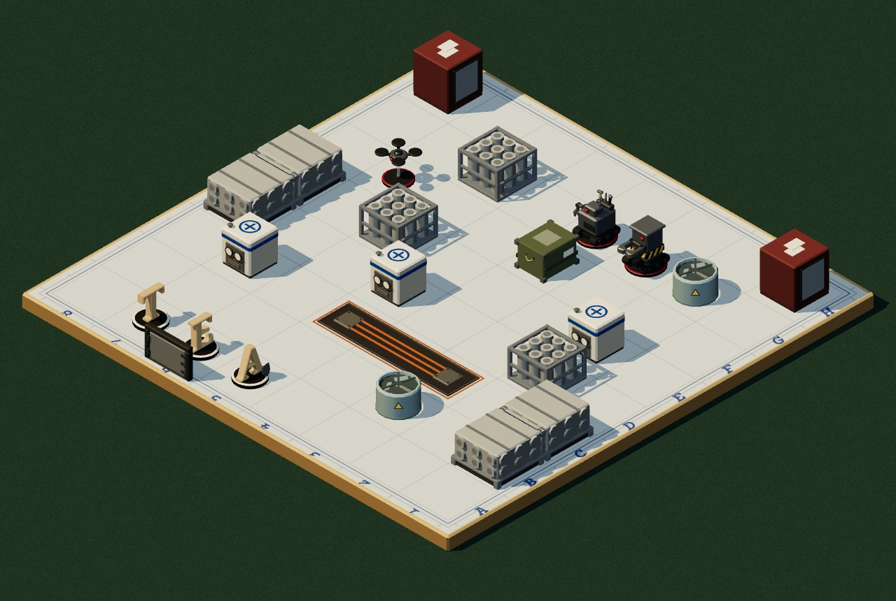

me Orta Doğu · Körfez rafinerisi
yuvarlak, iri · yatay boru demeti, boru ağzı daireleri ve flanşlar
Kapı: kollu mandallı patlama kapısı · Sivil: gaz analiz dolabı

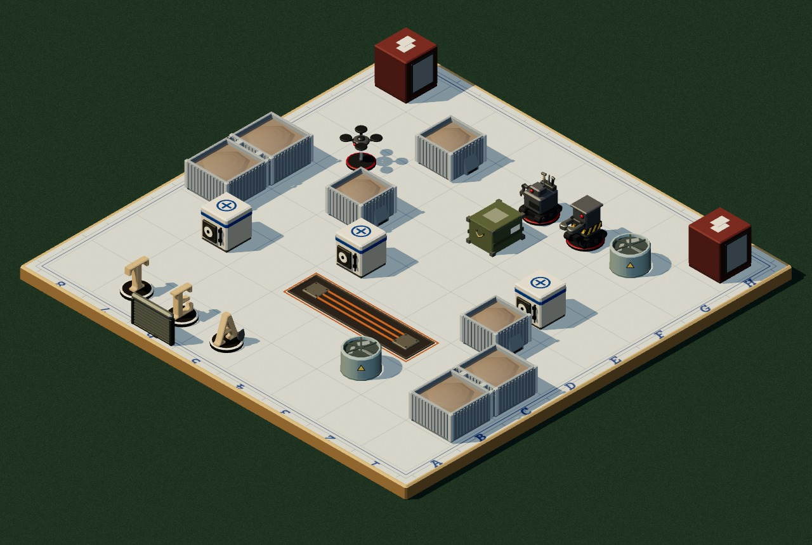

af Afrika · Cevher hangarı
ince dikey nervür · oluklu galvaniz bunker, içinde cevher yığını
Kapı: sarmal kepenk · Sivil: sevk telsizi konsolu

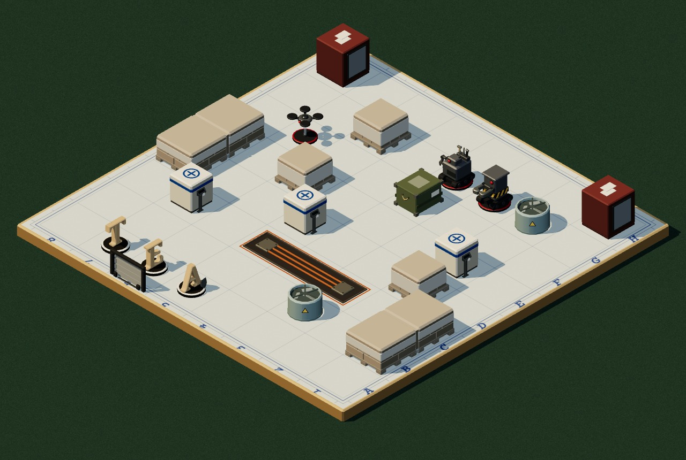

na Kuzey Amerika · Dağıtım merkezi
katmanlı + çıtalı · palet çıtaları, kolilerde açık streç film bandı
Kapı: tamponlu rampa kapısı · Sivil: depo kiosku

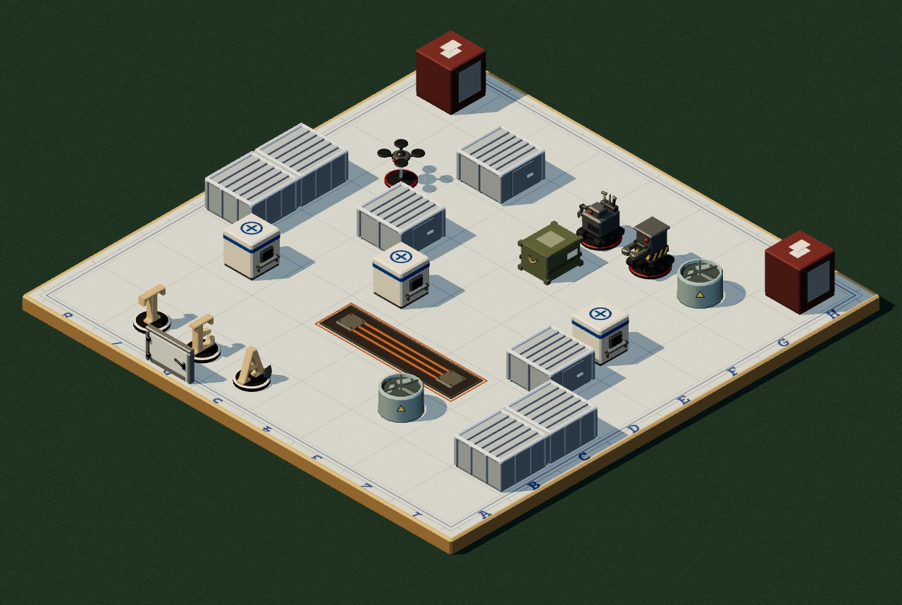

ru Rusya · Sibirya veri merkezi
geniş dikey derzler · sandviç panel, kırağı kenarı, nervürlü çatı
Kapı: büyük kollu soğuk oda kapısı · Sivil: operatör konsolu

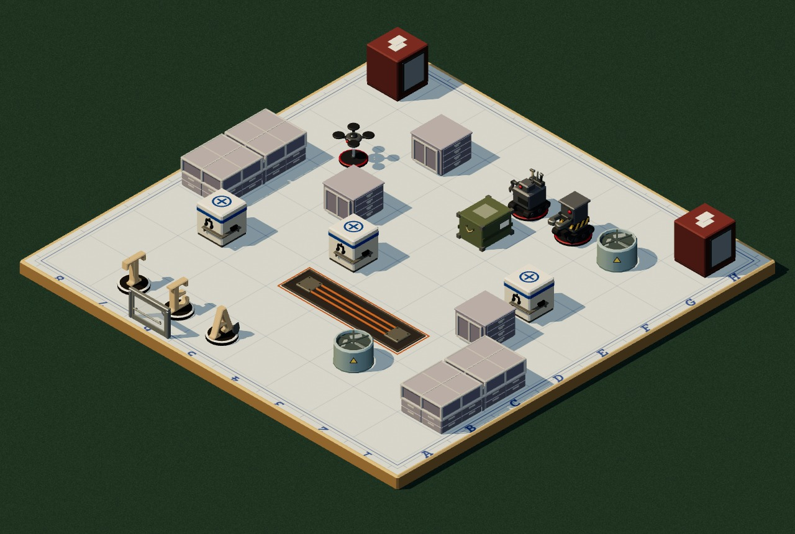

in Hindistan · Çağrı merkezi
çerçeve ızgarası · açık alüminyum bölme çerçeveleri, dosya dolabı
Kapı: itme barlı cam kapı · Sivil: çağrı merkezi masası

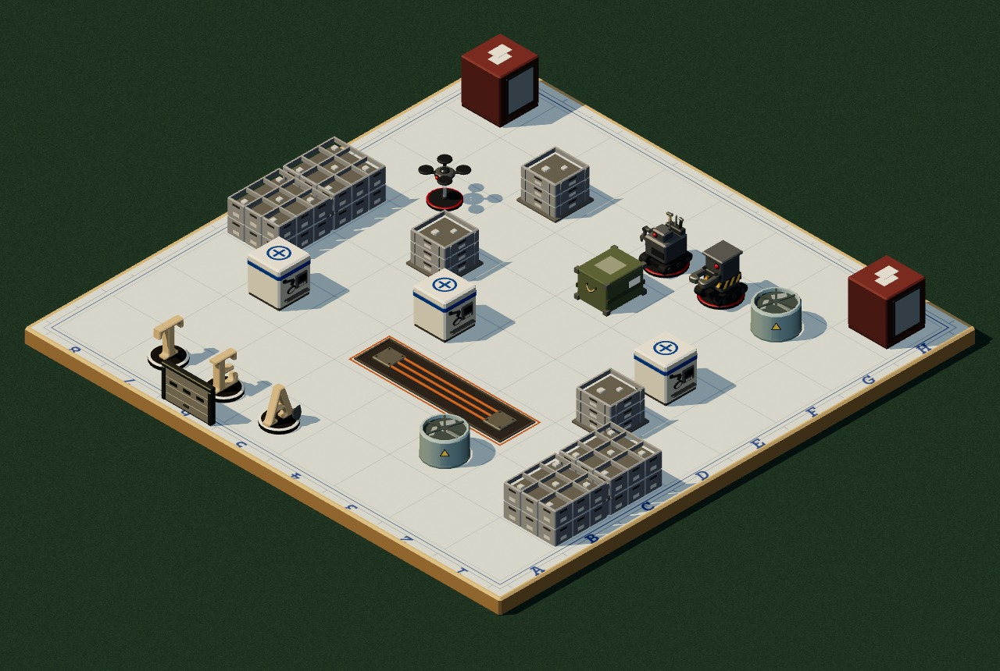

cn Çin · Montaj fabrikası
sık küçük kutular · açık istif parça kasaları, koyu tutamak yuvaları
Kapı: seksiyonel fabrika kapısı · Sivil: kalite kontrol panosu

jk Japonya-Kore · Çip fabrikası
yatay panjurlar · şalt panjurları, üstte rakor plakaları
Kapı: yuvarlak pencereli hava kilidi · Sivil: temiz oda terminali

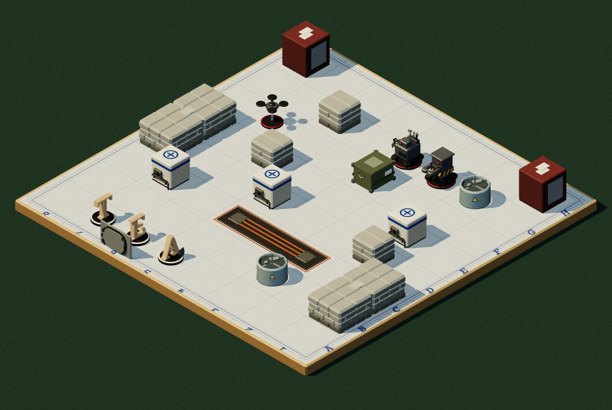

sea Güneydoğu Asya · Elektronik fabrikası
yuvarlak yatay sıralar · kum torbası yastıkları, koyu ıslak alt sıra
Kapı: mandallı oval su geçirmez kapı · Sivil: test tezgâhı

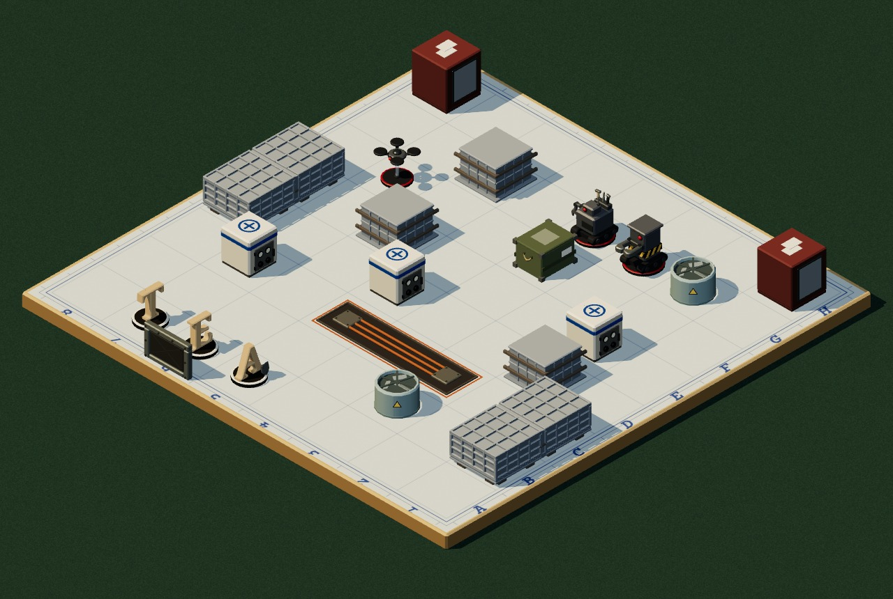

sa Güney Amerika · Hidroelektrik santrali
kare ızgara · kalıp panosu (waffle) ızgarası, takozlu levha
Kapı: ağır cıvatalı kapak kasası · Sivil: röle panosu

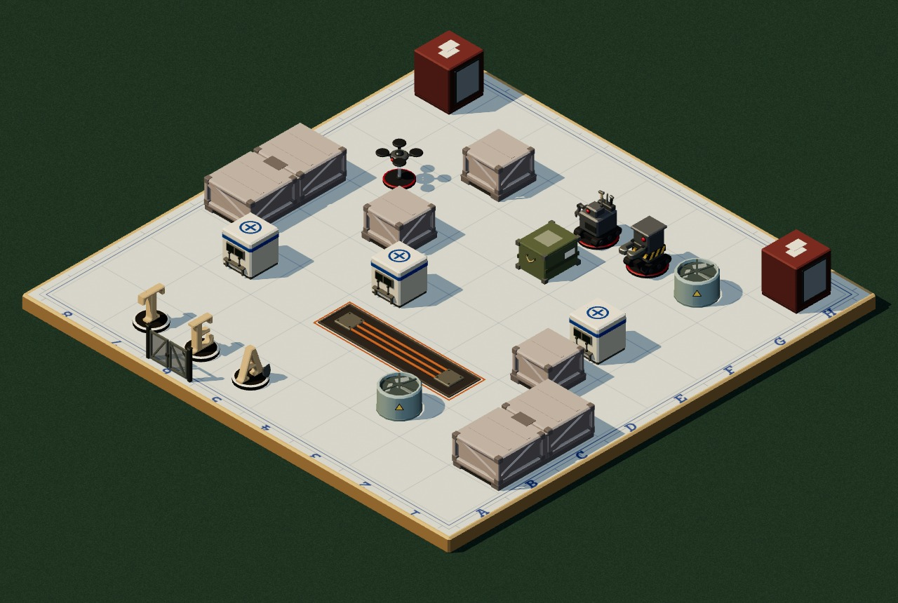

oc Okyanusya · Maden limanı
çıtalar + kızaklar · derin sandık, V destek, koyu köşe çeliği, baklava sac kızak
Kapı: tel örgülü liman kapısı · Sivil: vinç kumanda kioskı

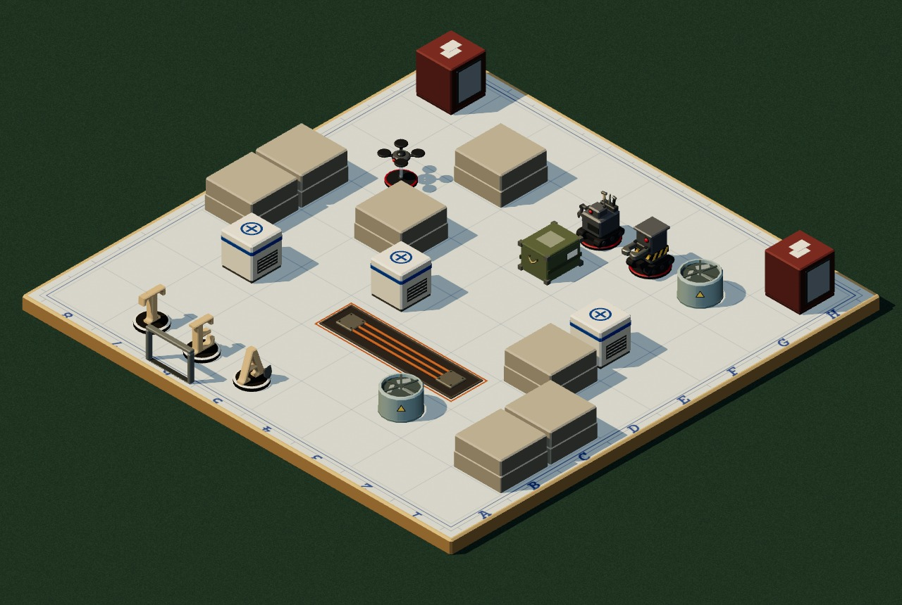

varsayılan eğitim ve örnek baskın
düz iki katlı blok · bugünkü mukavva blok, köprüsüz (MapSeed 0)
Kapı: sade kasa · Sivil: bugünkü sunucu, pahlı
OZALİT KOPYA · R12a · PAFTA 1/2

### BİNA KİTLERİ · RENKLİ
12 kit + varsayılan · aynı harita ve kamera (ortografik 35°/45°, 100 px/birim); kenar boşluğu kırpıldı.
duvar barikatı · köprülü dizi: D8–E8, B1–C1
ayrık blok · kitin dik istifi: E6, G6, D2
sivil sunucu + bölge cihazı: C7, D5, E2
giriş kapısı · kontrplak payı, A6'nın batısı
kanal C3–C5 · yalnız oluk içi kitten
Değişmeyen: pafta, kontrplak, makineler, piyonlar, dolaplar, soğutma ünitesi, ikmal sandığı, kanal kenarı.
Okuma: gövde ritmi → kapı → sivil cihazı; renk ikinci (R12b).
*Şema etiketleri:* A · B · C · D · E · F · G · H · 8 · 7 · 6 · 5 · 4 · 3 · 2 · 1
HARİTA ANAHTARI
