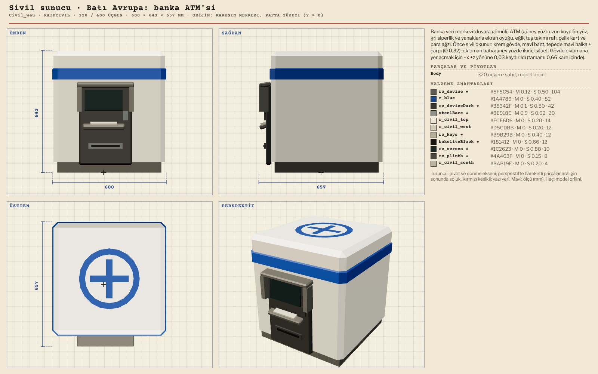
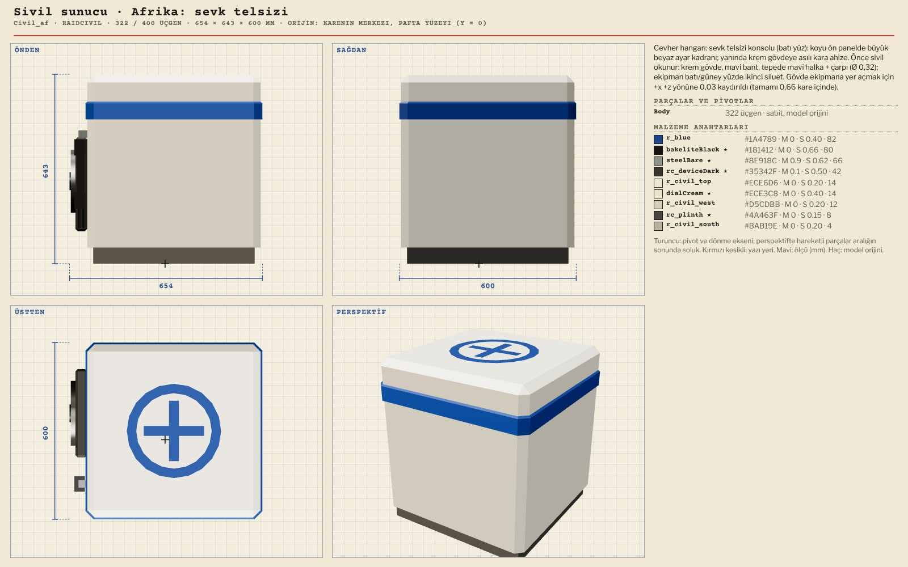
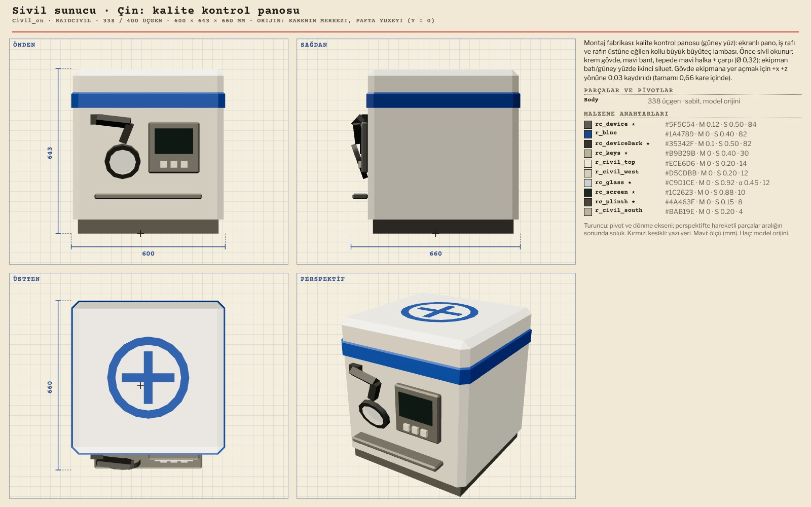
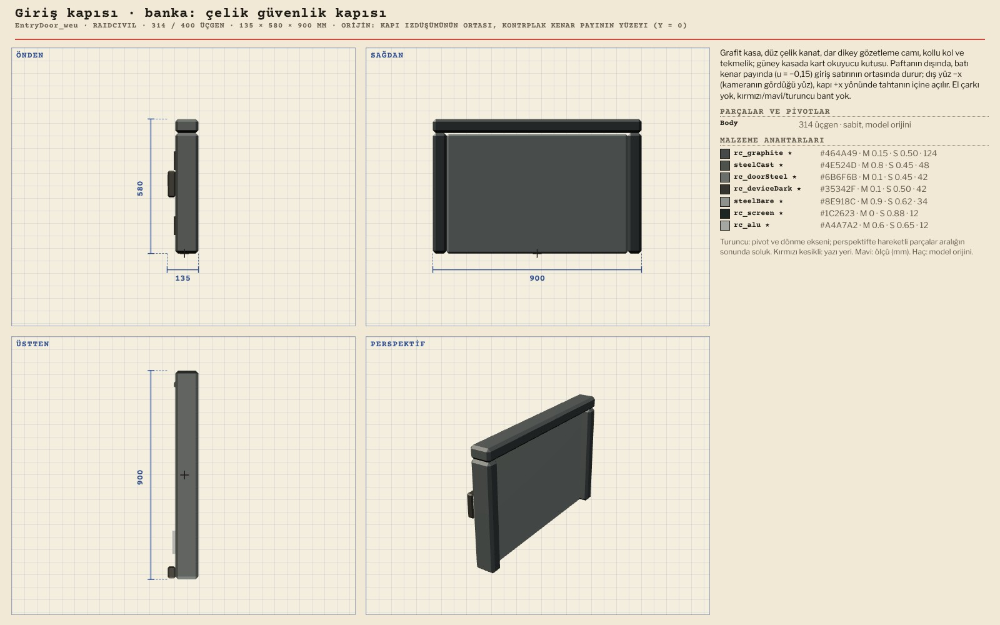
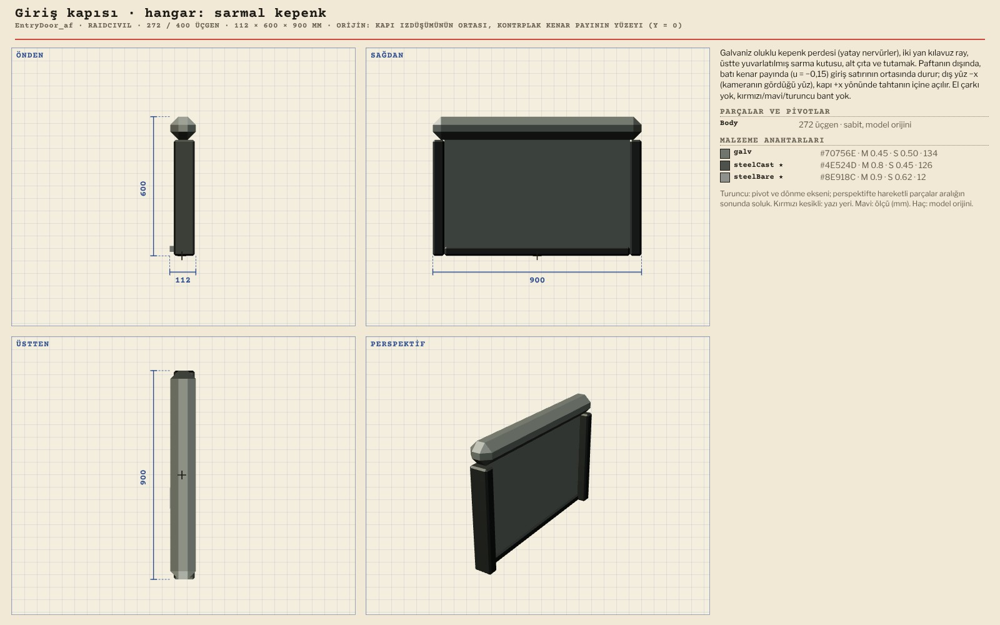
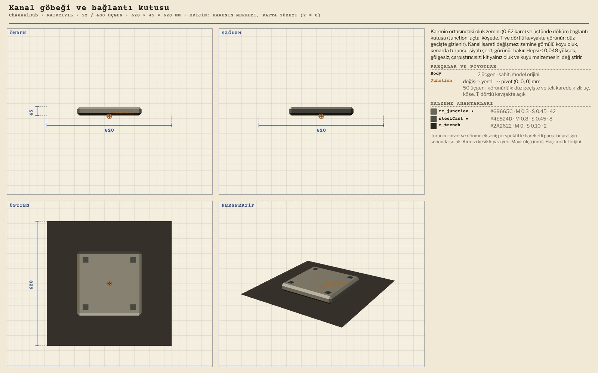

# R13 · Baskın kitleri, siviller, kapılar, kanal
*Pano: `R13-baskin-kit.dc.html` · görüntü: `../panolar/R13-baskin-kit.jpg`*

R13 · BASKIN KİTLERİ VE SİVİL DONANIM · 82 MODEL KARE 1 M · DUVAR GÖVDESİ 0,555 M · KİT BAŞINA 4 PARÇA + SİVİL SUNUCU + GİRİŞ KAPISI · BÜTÇE 400

*[görüntü: Model sayfası: duvar bloğu]*

WallBlock Duvar bloğu (varsayılan kit) 38 / 400 · 940 × 555 × 940
İki katlı gövde · 12 kit bunun yerine Relief / ReliefIso / Bridge / Rubble kullanır

*[görüntü: Model sayfası: Batı Avrupa duvar barikatı]*

Relief_weu Batı Avrupa · banka veri merkezi 321 / 400 · 940 × 555 × 940
Duvar barikatı: sökülmüş rack kabinleri

*[görüntü: Model sayfası: Afrika duvar barikatı]*

Relief_af Afrika · cevher hangarı 323 / 400 · 940 × 555 × 940
Duvar barikatı: oluklu galvaniz sac bunker

*[görüntü: Model sayfası: Çin duvar barikatı]*

Relief_cn Çin · montaj fabrikası 261 / 400 · 935 × 555 × 935
Duvar barikatı: istiflenmiş parça kasaları

*[görüntü: Model sayfası: Orta Doğu ayrık blok]*

ReliefIso_me Orta Doğu · körfez rafinerisi 365 / 400 · 800 × 555 × 800
Ayrık blok: çerçevede dik boru istifi

*[görüntü: Model sayfası: Doğu Avrupa köprüsü]*

Bridge_eeu Doğu Avrupa · devlet arşivi 76 / 400 · 120 × 555 × 924
Köprü: iki blok arasına yatırılmış raf tahtası

*[görüntü: Model sayfası: Güneydoğu Asya gedik molozu]*

Rubble_sea Güneydoğu Asya · elektronik fabrikası 169 / 400 · 920 × 110 × 920
Gedik molozu: patlamış torbalar

*[görüntü: Model sayfası: kayar arşiv rafı]*

SlidingShelf Kayar arşiv rafı (el çarkı, iki teker) 399 / 400 · 972 × 556 × 940
Wheel (el çarkı) · kayar duvar hücresi

Civil_weu Sivil sunucu · banka ATM’si 320 / 400 · 600 × 643 × 657
Batı Avrupa

Civil_af Sivil sunucu · sevk telsizi 322 / 400 · 654 × 643 × 600
Afrika

Civil_cn Sivil sunucu · kalite kontrol panosu 338 / 400 · 600 × 643 × 660
Çin

EntryDoor_weu Giriş kapısı · çelik güvenlik kapısı 314 / 400 · 135 × 580 × 900
Batı Avrupa (banka) · tahtanın batı kenarı, u −0,65 · v 2

EntryDoor_af Giriş kapısı · sarmal kepenk 272 / 400 · 113 × 600 × 900
Afrika (hangar)

ChannelHub Kanal göbeği ve bağlantı kutusu 52 / 400 · 620 × 45 × 620
Junction (düz geçişte gizli) · ChannelArm, ChannelEdge, ChannelSingle ile birleşir
AİLENİN DİĞERLERİ Kit kodları weu, eeu, me, af, na, ru, in, cn, jk, sea, sa, oc. Her kitte Relief, ReliefIso, Bridge, Rubble (48 model); ayrıca BoardBase (21), Tile (2). 12 Civil + Civil_default (162), 12 EntryDoor + EntryDoor_default (166), ChannelArm (74), ChannelEdge (12), ChannelSingle (350).
