# R13 · Baskın makineleri, piyonlar, parçalar
*Pano: `R13-baskin-parca.dc.html` · görüntü: `../panolar/R13-baskin-parca.jpg`*

R13 · BASKIN PARÇALARI · 26 MODEL BİRİM ≤ 0,78 M (BİR KARE) · BİRİM BÜTÇESİ 1500, DONANIM 400 · ORİJİN KARE ORTASI

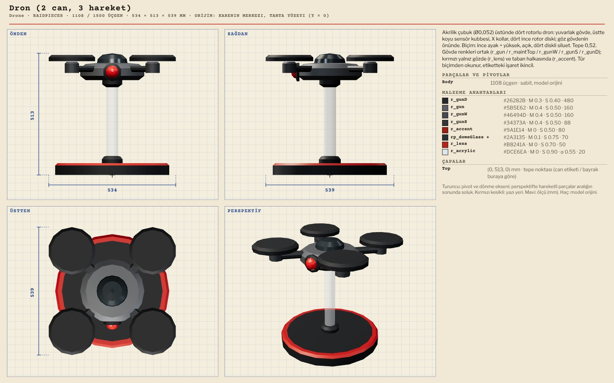

Drone Dron (2 can, 3 hareket) 1108 / 1500 · 534 × 513 × 539
Tek parça; hareket konumla

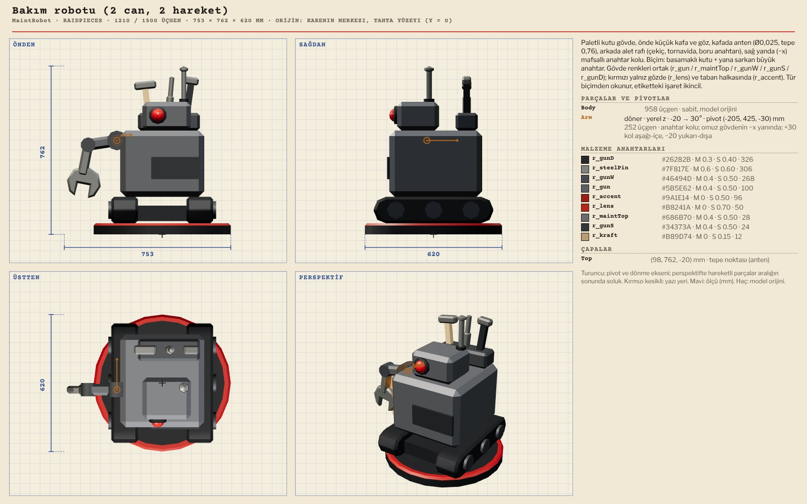

MaintRobot Bakım robotu (2 can, 2 hareket) 1210 / 1500 · 753 × 762 × 620
Arm (z −20…+30°, anahtar kolu)

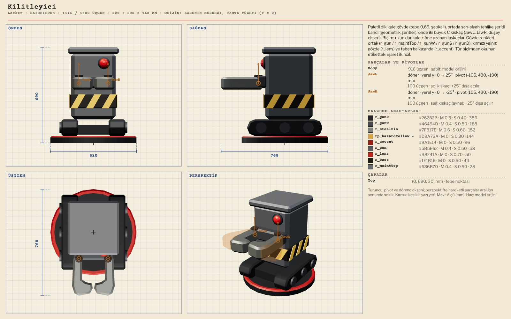

Locker Kilitleyici 1116 / 1500 · 620 × 690 × 768
JawL (y 0…25°), JawR (y 0…−25°) · kıskaçlar dışa açılır

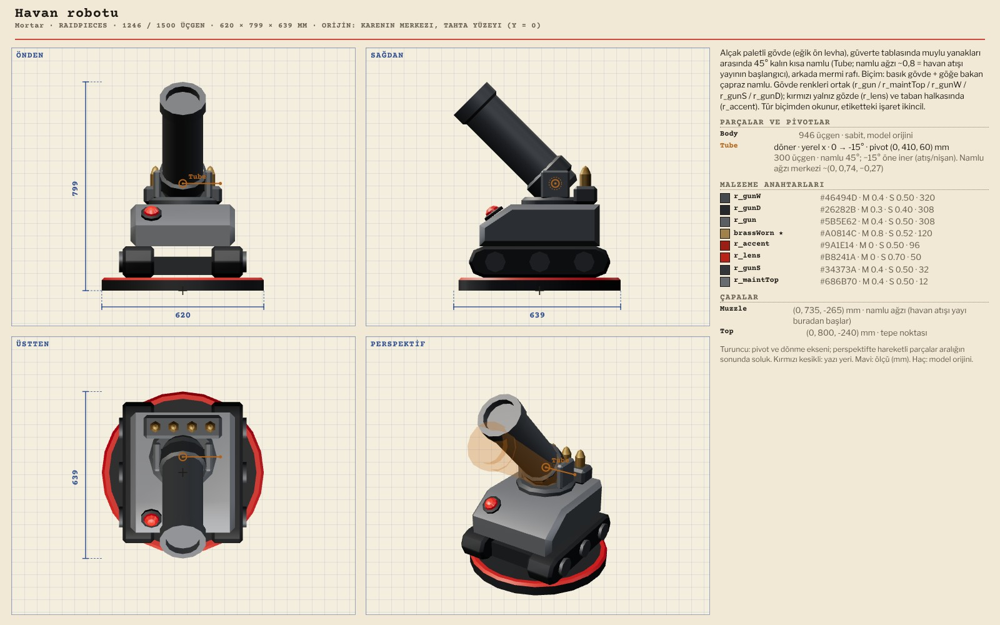

Mortar Havan robotu 1246 / 1500 · 620 × 799 × 639
Tube (x 0…−15°; namlu 45°, atışta öne iner)

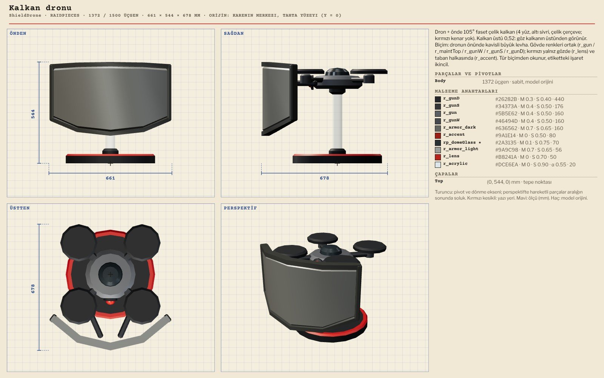

ShieldDrone Kalkan dronu 1372 / 1500 · 662 × 544 × 678
Tek parça

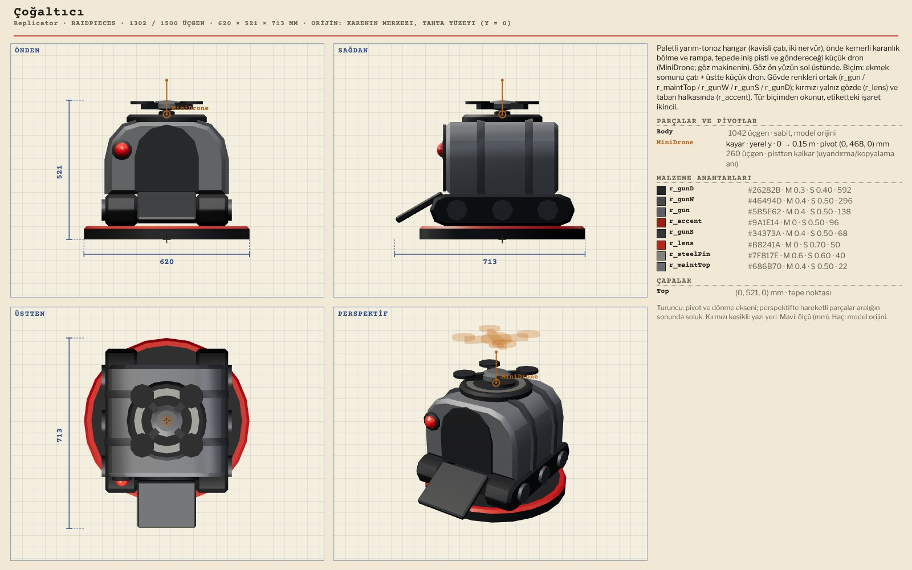

Replicator Çoğaltıcı 1302 / 1500 · 620 × 521 × 713
MiniDrone (y kayma 0…150 mm; pistten kalkar)

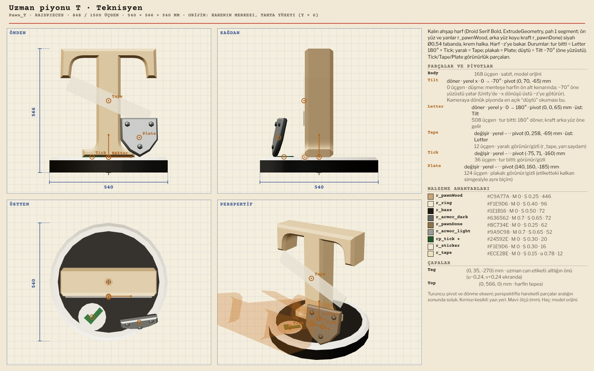

Pawn_T Uzman piyonu T · Teknisyen 848 / 1500 · 540 × 566 × 540
Tilt (x 0…−70°) · Letter (y 0…180°) · Tape, Tick, Plate (swap: zırh plakası) · EK: T, E, A = baskın ekibinin üç kişisi

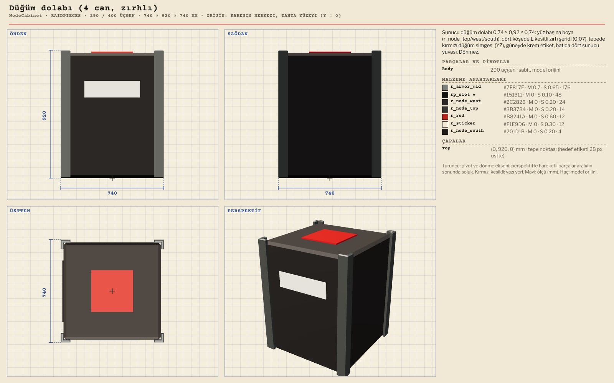

NodeCabinet Düğüm dolabı (4 can, zırhlı) 290 / 400 · 740 × 920 × 740
Tek parça · CoreCabinet (354), BackupCore (186), CopyCabinet (166) aynı dilde

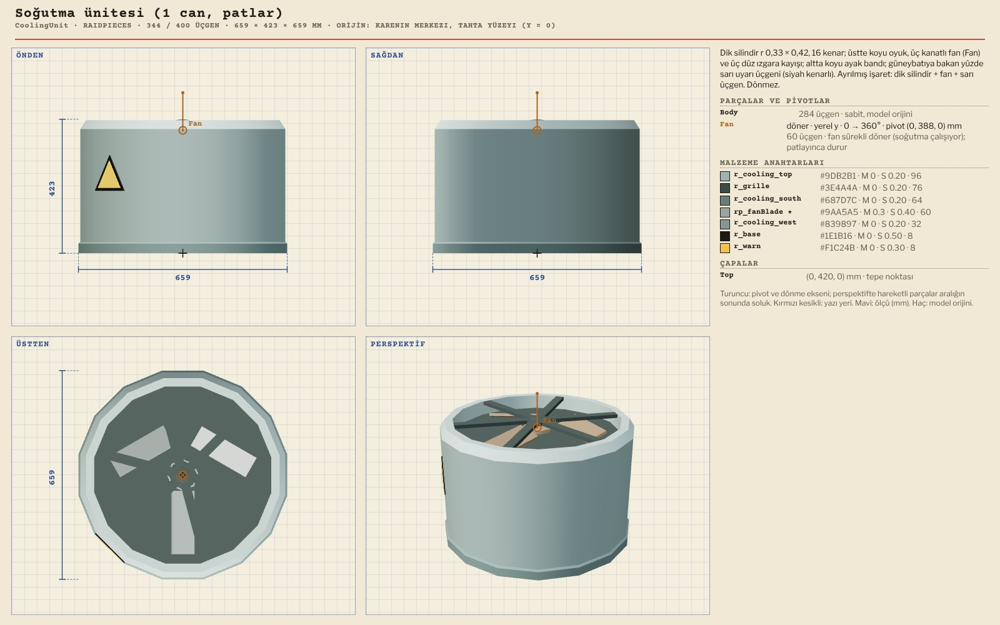

CoolingUnit Soğutma ünitesi (1 can, patlar) 344 / 400 · 659 × 423 × 659
Fan (y 0…360°, sürekli; patlayınca durur)

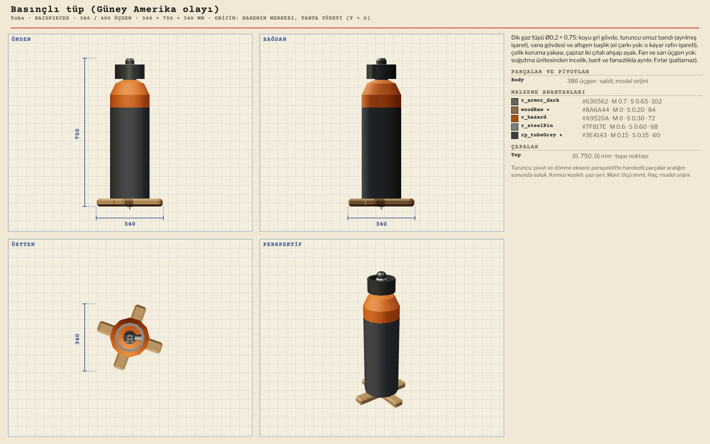

Tube Basınçlı tüp (Güney Amerika olayı) 386 / 400 · 340 × 750 × 340
Tek parça

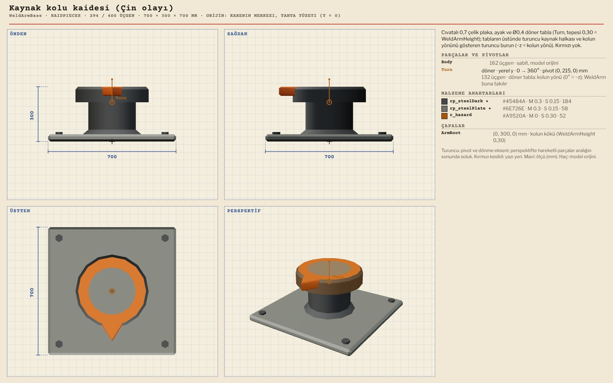

WeldArmBase Kaynak kolu kaidesi (Çin olayı) 294 / 400 · 700 × 300 × 700
Turn (y 0…360°; 0° = −z) · WeldArm (348) buna takılır

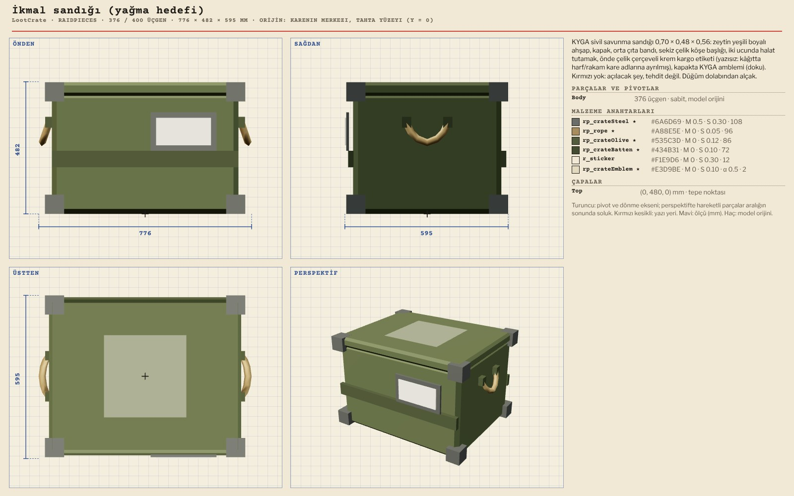

LootCrate İkmal sandığı (yağma hedefi) 376 / 400 · 776 × 482 × 595
LootCrateOpen (356) açık hali, swap
Ailenin diğerleri (pakette): ArmorDrone (1162), Bomber (1100), Pawn_E (832), Pawn_A (1164), CoreCabinet (354), BackupCore (186), CopyCabinet (166), LootCrateOpen (356), WeldArm (348), CeilingDebris (320), WakePin (300), GhostRing (124), HitQuad ve MoveQuad (2’şer). Piyonun “tur bitti” yüzü koyu kraft (r_pawnDone; Karşılaştırma 3). EK 11-05: Pawn_M (madenci) ve Pawn_S (sis uzmanı) kaldırıldı; piyon harfi görev yerini, kişinin adı R11 kartını gösterir.
