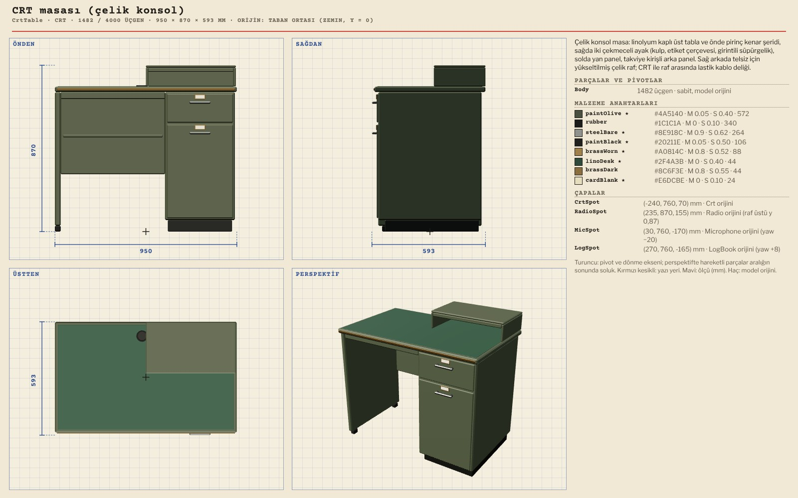
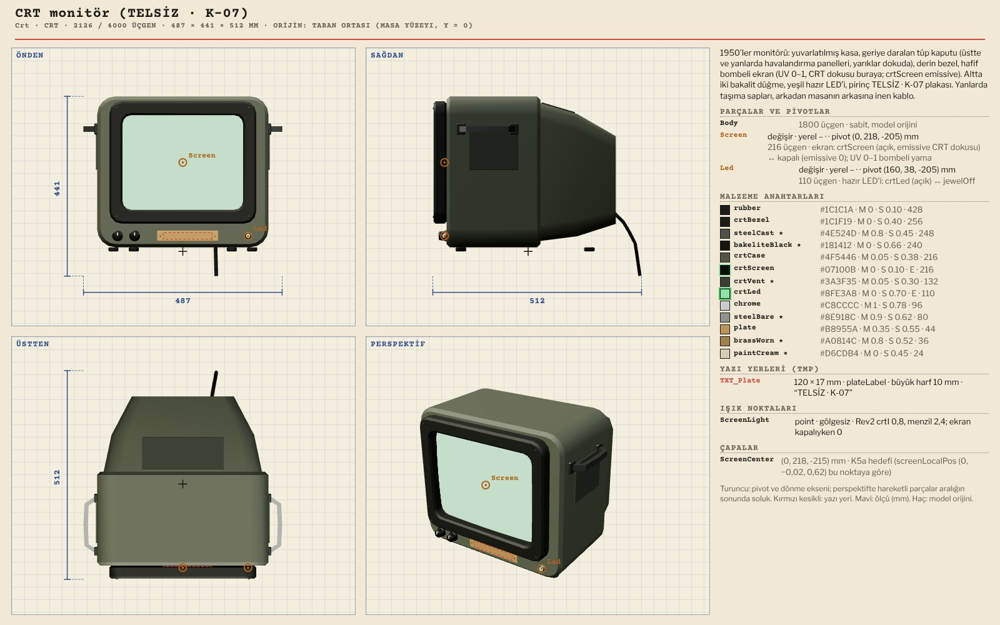
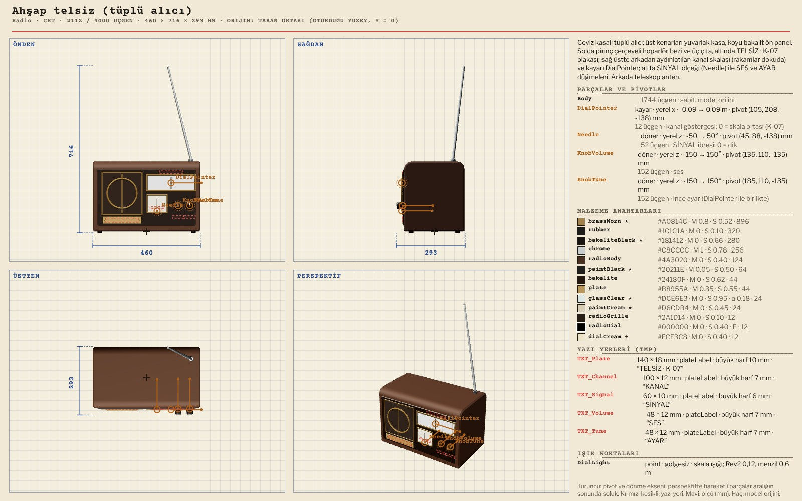
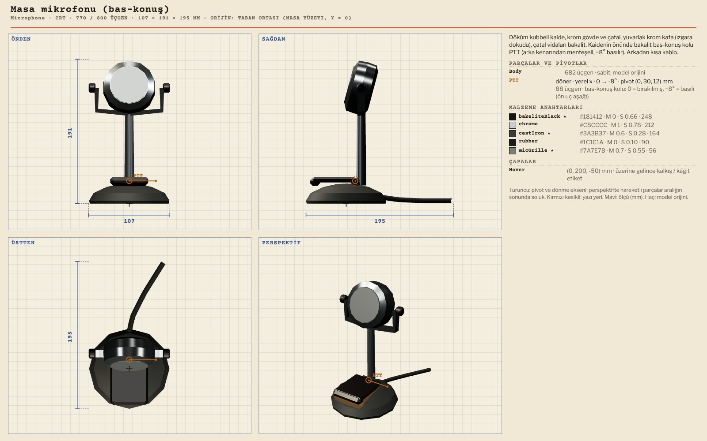
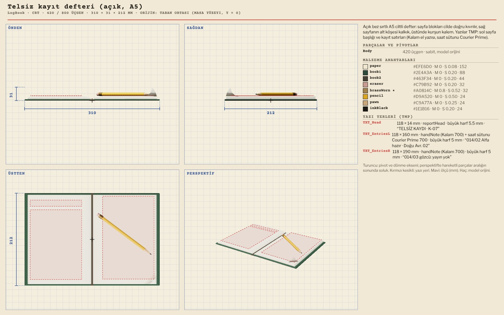

# R13 · CRT masası modelleri
*Pano: `R13-crt.dc.html` · görüntü: `../panolar/R13-crt.jpg`*

R13 · CRT KÖŞESİ · 5 MODEL MASA ORİJİNİ (1,50 · 0 · 1,72), YAW 35° · EKRAN VE SKALA IŞIKLARI GÖLGESİZ NOKTA

CrtTable CRT masası (çelik konsol) 1482 / 4000 · 950 × 870 × 593
Yükseltilmiş telsiz rafı (RadioSpot çapası) · dünya AABB x 0,94–2,06, z 1,21–2,23

Crt CRT monitör (TELSİZ · K-07) 2126 / 4000 · 487 × 441 × 512
Screen (swap: crtScreen emissive ↔ kapalı) · Led (swap) · TXT_Plate · ScreenLight

Radio Ahşap telsiz (tüplü alıcı) 2112 / 4000 · 460 × 716 × 293
DialPointer (x ±90 mm) · Needle (z ±50°) · KnobVolume, KnobTune (z ±150°) · 5 TMP

Microphone Masa mikrofonu (bas-konuş) 770 / 800 · 107 × 191 × 195
PTT (x 0…−8°, basılı = ön uç aşağı) · CRT ile telsiz arasında, yaw −20°

LogBook Telsiz kayıt defteri (açık, A5) 420 / 800 · 310 × 31 × 212
TXT_Head (Courier Prime) · TXT_EntriesL/R (Kalam 700, saat sütunu Courier) · yaw +8°
IŞIK VE YAZI ScreenLight #7FD9A0, 0,8, menzil 2,4 m; ekran kapalıyken 0. DialLight #FFA850, 0,12, menzil 0,6 m. İkisi de gölgesiz; köşenin gölgesini tavan spotu verir. Plaka yazıları (TELSİZ · K-07, KANAL, SİNYAL, SES, AYAR) TMP; EN karşılıkları sampleEn alanında. K5a’da büyük harf ≥ 14 px.
