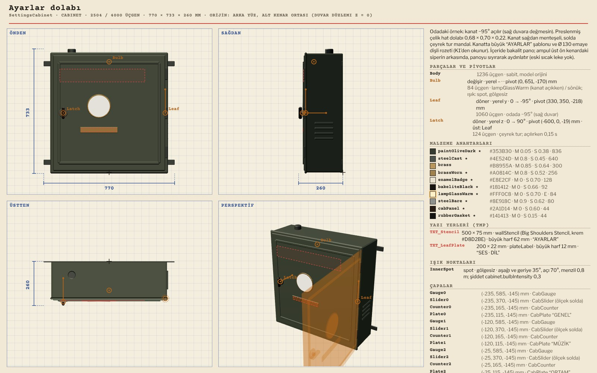
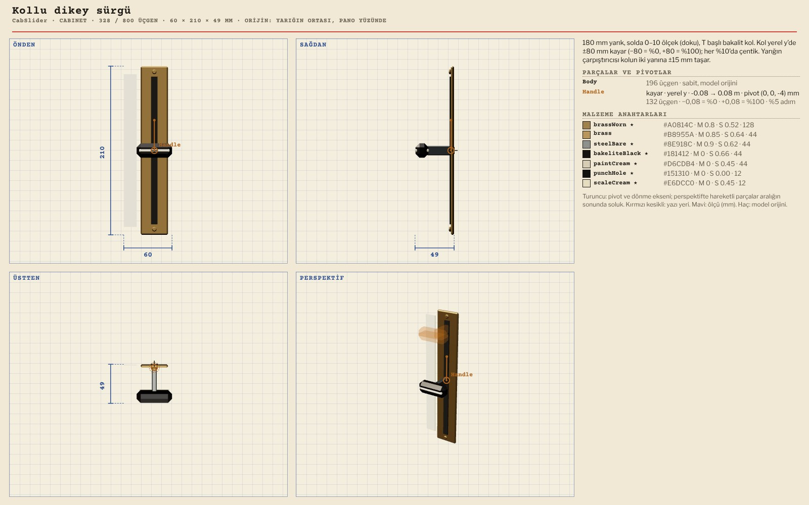
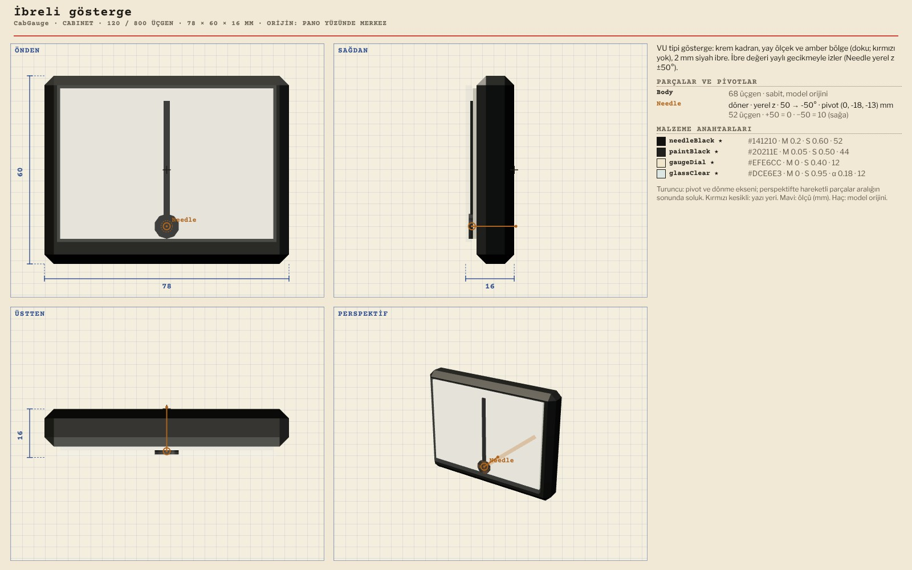
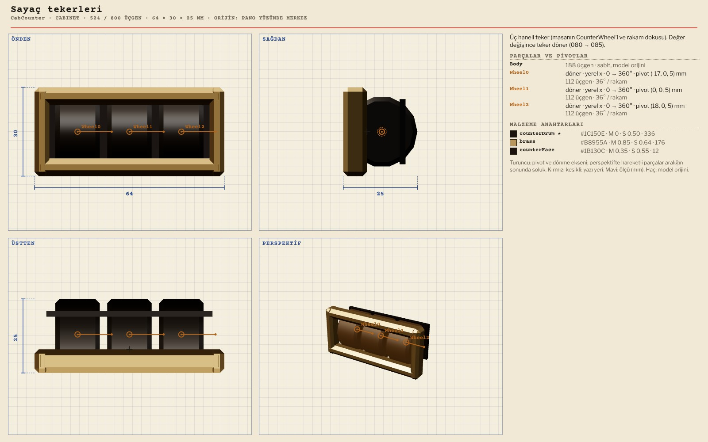
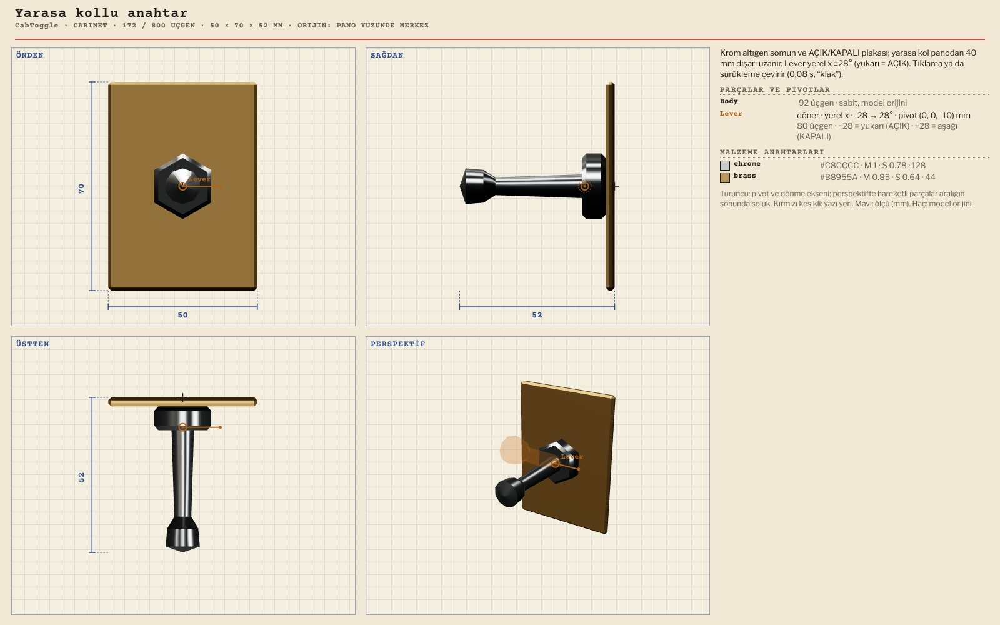
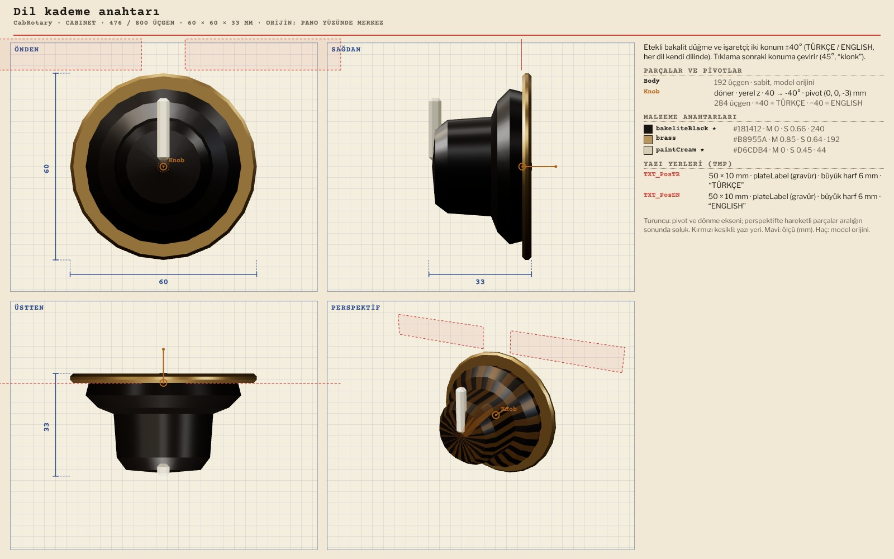
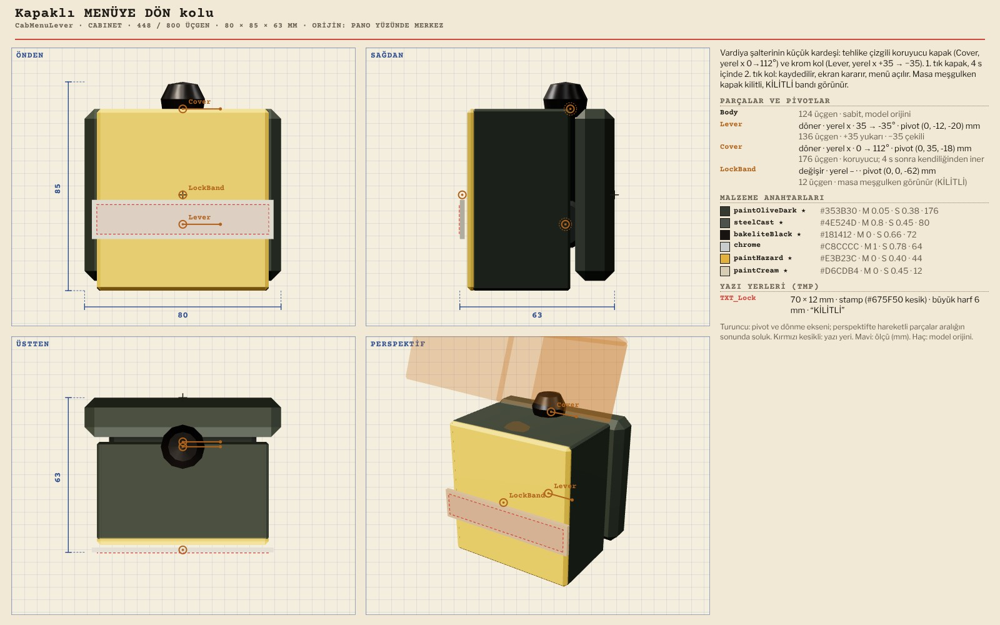
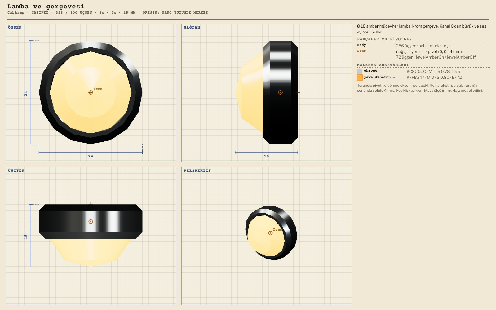

# R13 · Ayarlar dolabı modelleri
*Pano: `R13-dolap.dc.html` · görüntü: `../panolar/R13-dolap.jpg`*

R13 · AYARLAR DOLABI · 12 MODEL KONTROLLER PANEL ÇAPALARINA OTURUR (Gauge0–3, Slider0–3, Counter0–3, Plate0–3, ToggleSES, RotaryDIL, MenuLever)

SettingsCabinet Ayarlar dolabı 2504 / 4000 · 680 × 700 × 220
Leaf (y 0…−95°; menü −120°) · Latch ← Leaf (z 90°) · Bulb (swap) · InnerSpot · K9 çapası

CabSlider Kollu dikey sürgü 328 / 800 · 60 × 210 × 49
Handle (y kayma ±80 mm) · CabSliderMaster pirinç başlı · ölçek dokuda

CabGauge İbreli gösterge 120 / 800 · 78 × 60 × 16
Needle (z +50…−50°) · ibre 2 mm (K9'da ≥ 3 px)

CabCounter Sayaç tekerleri 524 / 800 · 64 × 30 × 27
Wheel0–2 (x, 36°/rakam) · pirinç çerçeve, 54 × 18 mm pencere

CabToggle Yarasa kollu anahtar 172 / 800 · 50 × 70 × 52
Lever (x ±28°, −28 yukarı = AÇIK) · panelden 40 mm taşar

CabRotary Dil kademe anahtarı 476 / 800 · 60 × 60 × 33
Knob (z +40 TÜRKÇE / −40 ENGLISH) · TXT_PosTR, TXT_PosEN

CabMenuLever Kapaklı MENÜYE DÖN kolu 448 / 800 · 80 × 85 × 63
Cover (x 0…112°) · Lever (x 35…−35°) · LockBand (swap, KİLİTLİ)

CabLamp Lamba ve çerçevesi 328 / 800 · 24 × 24 × 14
Lens (swap: jewelAmberOn / Off) · krom çerçeve
AİLENİN DİĞERLERİ SettingsCabinetMenu (menü örneği, kanat −120°), CabSliderMaster (328), CabPlate (172, TMP yuvası TXT), CabBlank (300, menüde MENÜYE DÖN yerine). İç parçalar gölge almaz ve vermez; iç ampul spot 70°, gölgesiz, şiddet cabinet.bulbIntensity 0,3.
