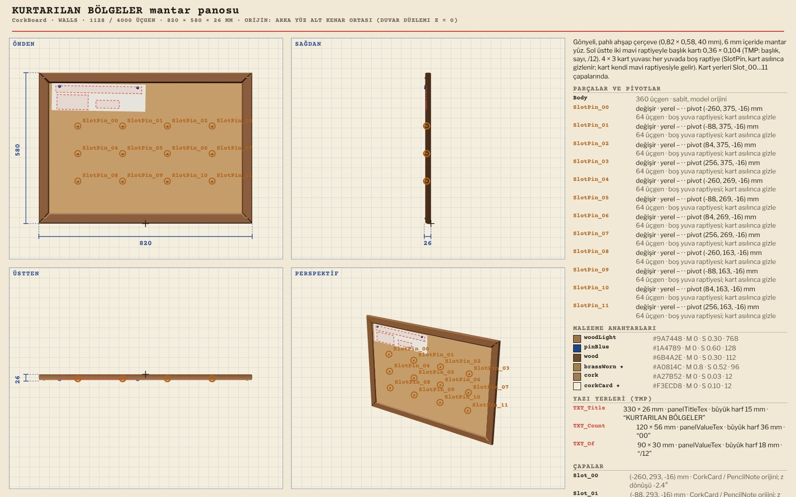
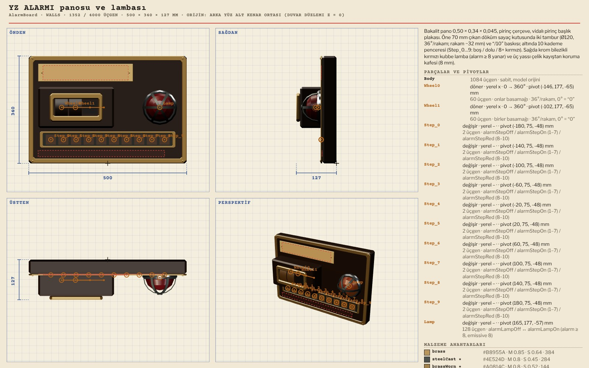
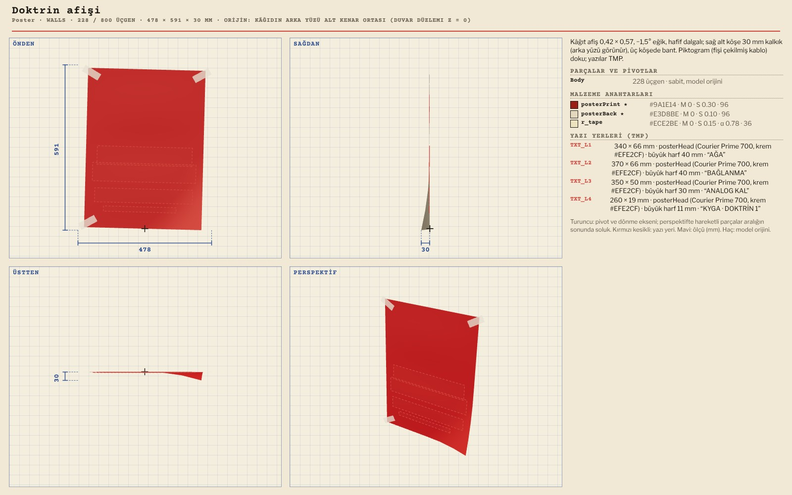
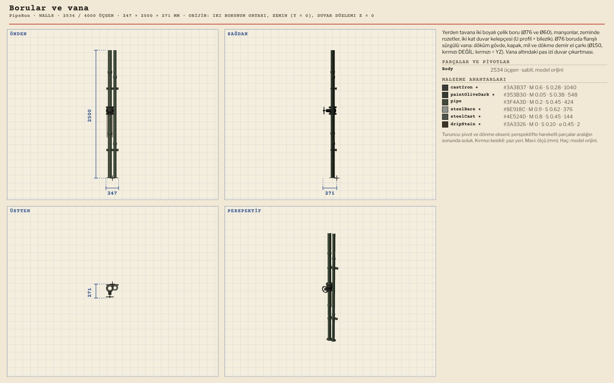
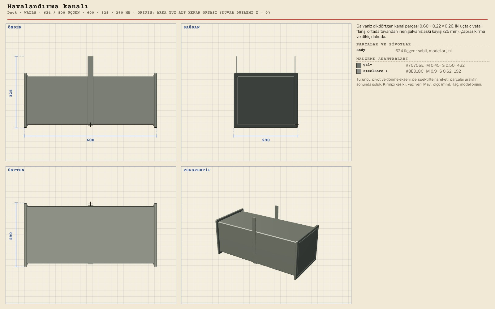
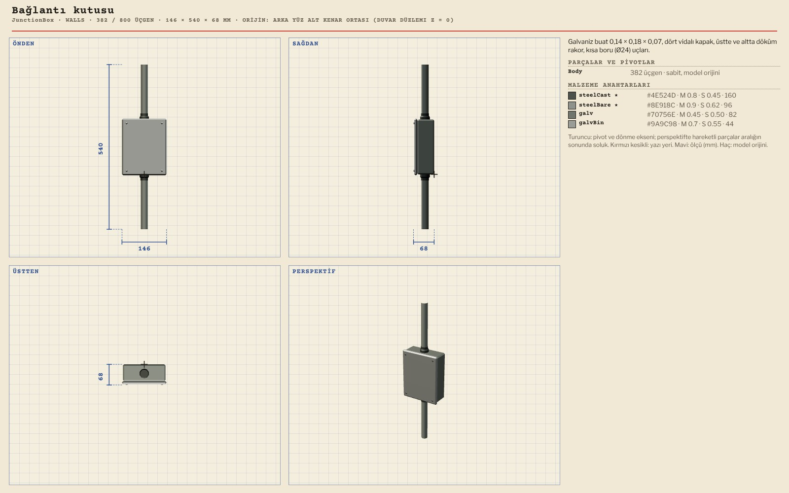
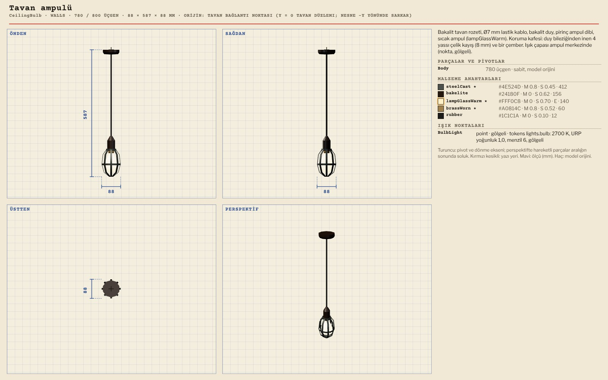
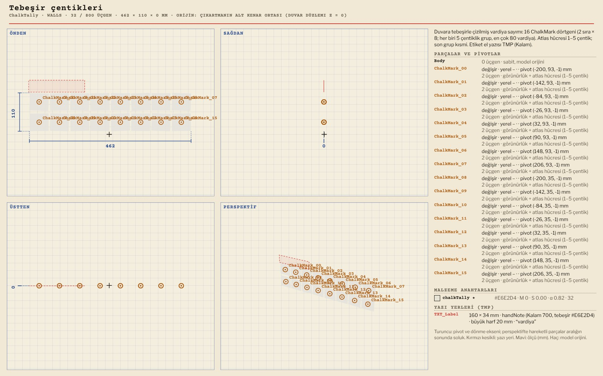

# R13 · Duvar modelleri
*Pano: `R13-duvar.dc.html` · görüntü: `../panolar/R13-duvar.jpg`*

R13 · DUVARLAR · 12 MODEL ARKA DUVAR z 2,30 · ORİJİN ARKA YÜZÜN ALT KENAR ORTASI · VANA ÇARKI DÖKME DEMİR (KIRMIZI YZ'NİN)

CorkBoard KURTARILAN BÖLGELER panosu 1128 / 4000 · 820 × 580 × 26
SlotPin_00–11 (boş yuva iğneleri) · başlık kartı TMP · CorkCard ×12, PencilNote

AlarmBoard YZ ALARMI panosu ve lambası 1352 / 4000 · 500 × 340 × 127
Wheel0–1 (x) · Step_0–9 (swap, tek tek) · Lamp (swap, kırmızı kubbe = YZ) · sayaç kutusu 70 mm çıkıntı

Poster Doktrin afişi 228 / 800 · 478 × 591 × 30
Hafif bükük kâğıt, kalkık köşe, 3 bant · AĞA / BAĞLANMA / ANALOG KAL (TMP)

PipeRun Borular ve vana 2534 / 4000 · 247 × 2500 × 271
Ø 76 / 60 mm, kelepçe, rakor, sürgülü vana; damla izi doku

Duct Havalandırma kanalı 624 / 800 · 600 × 325 × 290
Galvaniz, flanşlı ek, askı · 7 yerleşim + DuctEnd (panjurlu)

JunctionBox Bağlantı kutusu 382 / 800 · 146 × 540 × 68
Vidalı kapak, iki rakor, boru uçları

CeilingBulb Tavan ampulü 780 / 800 · 88 × 587 × 88
Kauçuk kordon, bakalit duy, 4 yassı kafes şeridi (≥ 8 mm) · ışık: aşağı 120° spot önerilir

ChalkTally Tebeşir çentikleri 32 / 800 · 462 × 110 × 0
ChalkMark_00–15 (beşli gruplar, swap) · Kalam etiket “vardiya”
AİLENİN DİĞERLERİ CorkCard (78), PencilNote (128, Kalam), DuctEnd (662), StencilSign (2, TMP stencil). Mantar panonun ÖZGÜR/FREE damgası bir TMP yuvası + kelimesiz halka sprite'ı. K1'de 14 px altında kalan ikincil yazılar (alarm alt yazısı, kart adları) üzerine gelince etikette okunur.
