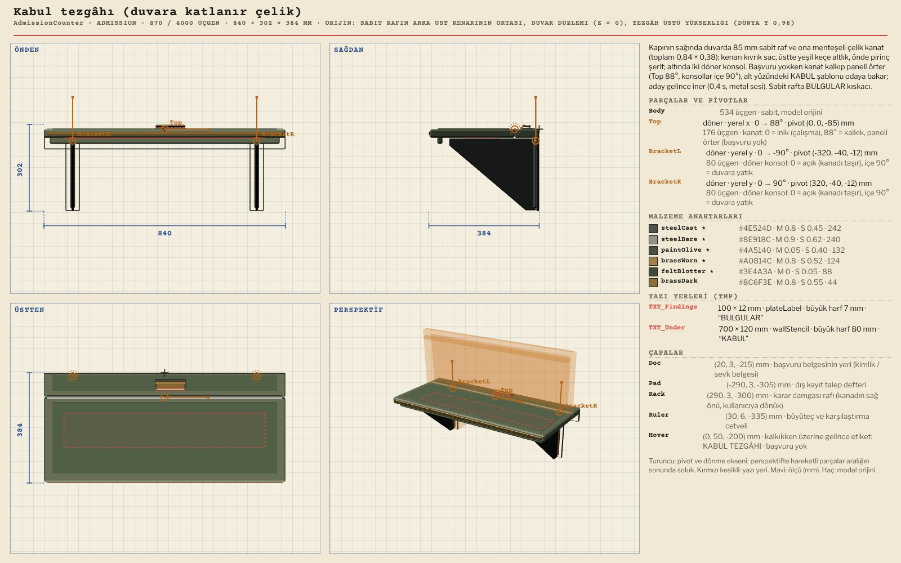
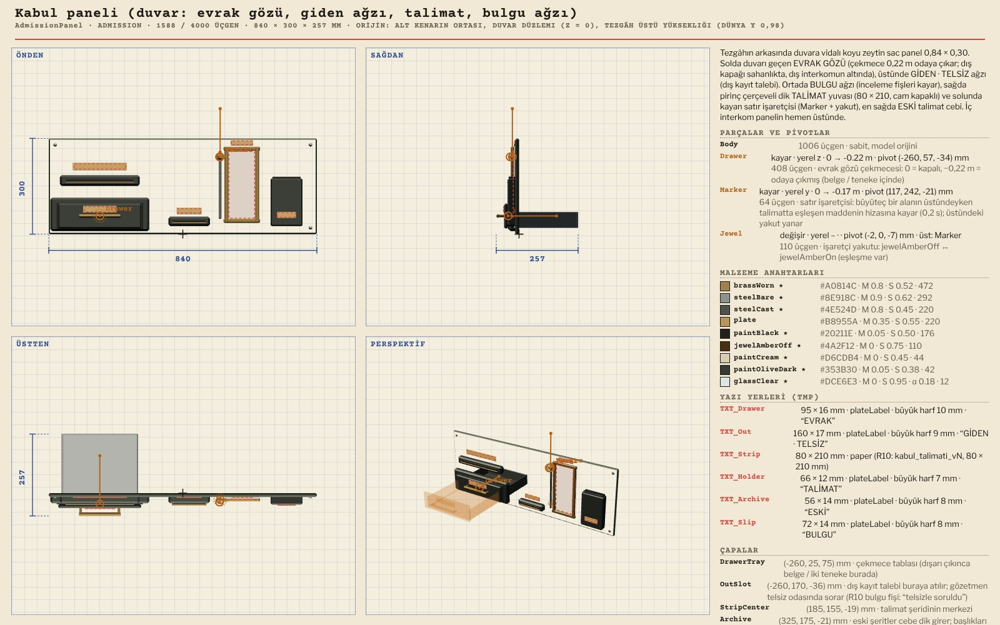
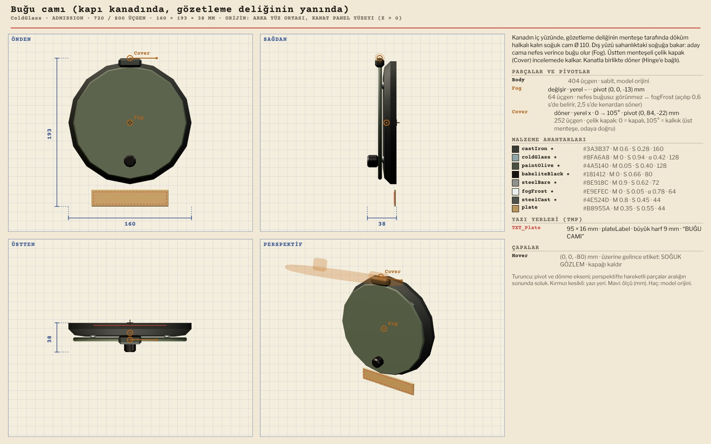
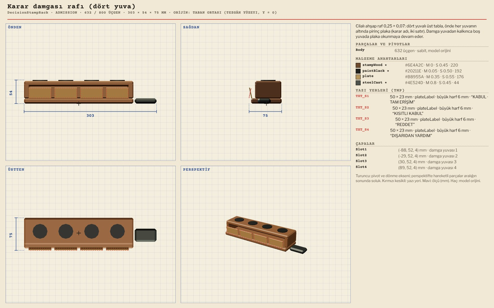
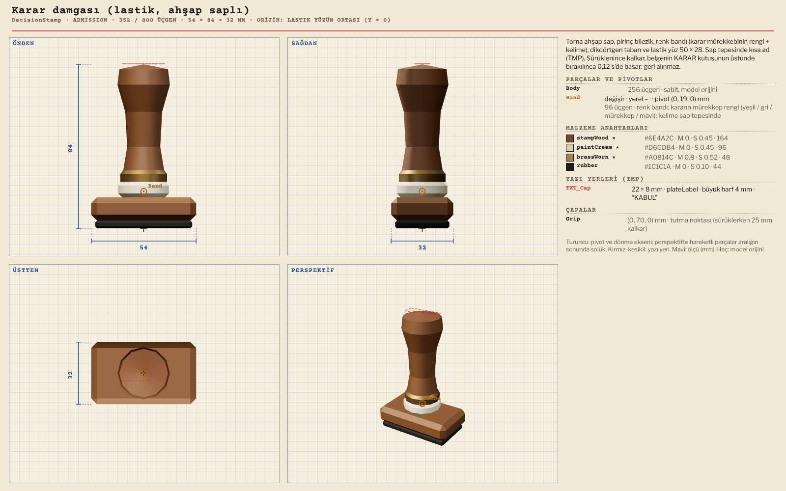
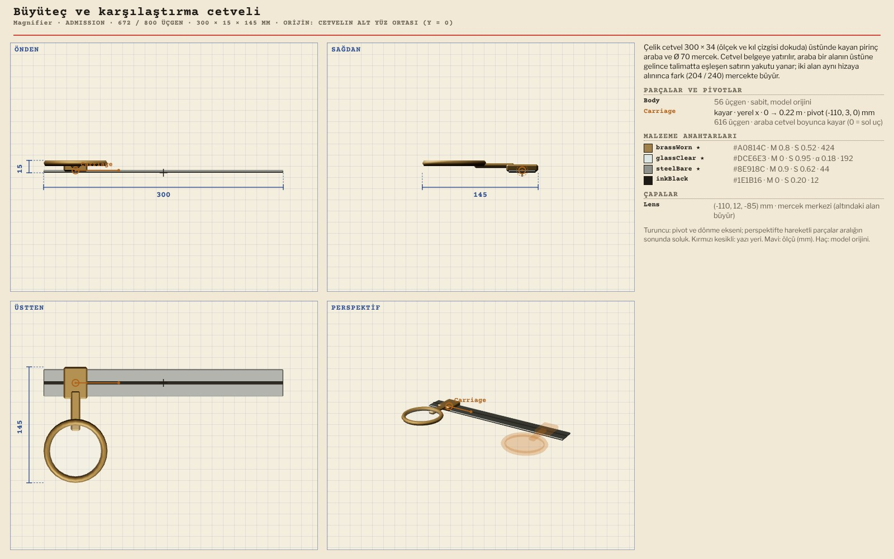
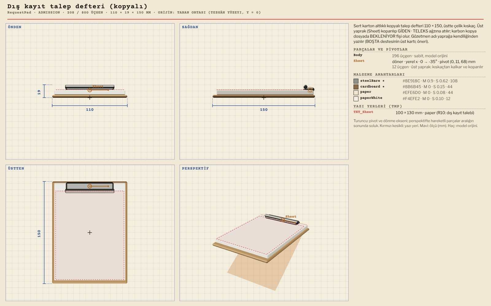
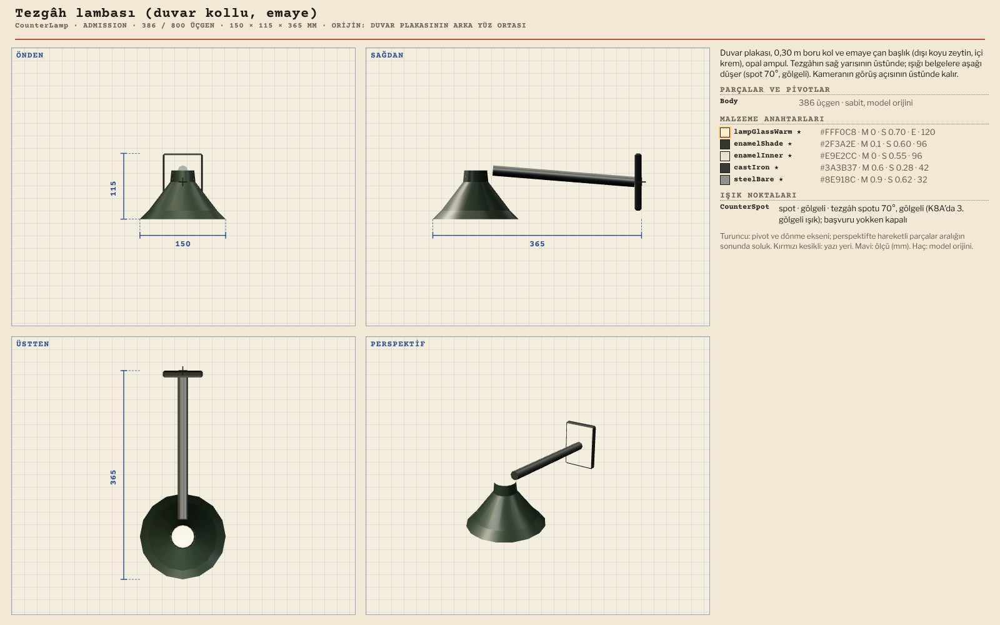

# R13 · Kapı kabul tezgâhı modelleri
*Pano: `R13-kabul.dc.html` · görüntü: `../panolar/R13-kabul.jpg`*

R13 · KABUL İSTASYONU · 10 MODEL KAPI DUVARI x 2,20 · z −0,69…0,15 · TEZGÂH ÜSTÜ y 0,98 · YAW 90 (MODEL +x = DÜNYA −z) · BUĞU CAMI KANATTA

AdmissionCounter Kabul tezgâhı (duvara katlanır çelik) 870 / 4000 · 840 × 302 × 384
Top (x 0…88°, kalkınca paneli örter) · BracketL / BracketR (y ∓90°, içe yatar) · TXT_Under KABUL şablonu · çapalar Doc, Pad, Rack, Ruler

AdmissionPanel Kabul paneli (evrak gözü, giden ağzı, talimat, bulgu ağzı) 1588 / 4000 · 840 × 300 × 257
Drawer (z kayma 0…−0,22 m) · Marker (y kayma 0…−0,17 m) + Jewel (swap) · TMP: EVRAK, GİDEN · TELSİZ, TALİMAT, ESKİ, BULGU · TXT_Strip 80 × 210

ColdGlass Buğu camı (kanatta, gözetleme deliğinin yanında) 720 / 800 · 160 × 193 × 38
Cover (x 0…105°, üst menteşe) · Fog (swap, tx_fog) · kanadın Hinge grubuna bağlı · TXT_Plate BUĞU CAMI

DecisionStampRack Karar damgası rafı (dört yuva) 632 / 800 · 303 × 54 × 75
Slot1–4 çapaları · TXT_S1–S4 iki satır plaka (KABUL · TAM ERİŞİM, KISITLI KABUL, REDDET, DIŞARIDAN YARDIM), −12°

DecisionStamp Karar damgası (lastik, ahşap saplı) 352 / 800 · 54 × 85 × 32
Band (swap: kararın mürekkep rengi) · TXT_Cap kısa ad · Grip çapası (sürüklerken 25 mm kalkar, basış 0,12 s)

Magnifier Büyüteç ve karşılaştırma cetveli 672 / 800 · 300 × 16 × 145
Carriage (x kayma 0…0,22 m) · Lens çapası (altındaki alan büyür) · ölçek ve kıl çizgisi dokuda

RequestPad Dış kayıt talep defteri (kopyalı) 208 / 800 · 110 × 19 × 150
Sheet (x 0…−35°, koparılır, GİDEN ağzına) · TXT_Sheet (R10 talep) · karbon kopya defterde kalır

CounterLamp Tezgâh lambası (duvar kollu, emaye) 386 / 800 · 150 × 115 × 365
CounterSpot (spot 70°, gölgeli, #FFD9A0) · başvuru yokken kapalı · dünya y 1,78, kameranın üstünde
AİLENİN DİĞERLERİ VE YERLEŞİM RationTin (448): Ø 75 × 110, tinOlive + tinRim, ERZAK şablonu; DIŞARIDAN YARDIM’da çekmeceyle ikişer çıkar. FileTag (56): İNCELE / KISITLI sekmesi ve kıskacı. Yeniden kullanılanlar: IntercomBox (GÖRÜŞME), KeyKey (tezgâhtaki MASA tuşu), Pencil. Kâğıtlar R10 PNG: talimat 80 × 210, belge 148 × 105, fiş 90 × 60, saydam damga izleri. Dress modülü: dress_room_admission.js (&adm=idle|present|inspect|pending|stamped|aid|v3|trace|cold, &cand, &admLang); pozlar K8A, K8G, K8R.
Hepsi bütçe içinde (büyük ≤ 4000, küçük ≤ 800). Hareketli parçalar aralığın sıfırında, pivot ekseninde; kabulün hareketli parçaları: karar damgası, büyüteç arabası, interkom düğmesi, buğu camı kapağı, evrak gözü, tezgâh kanadı.
