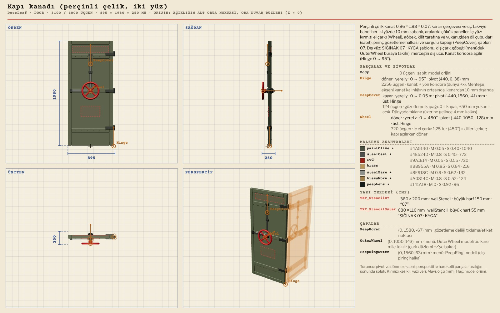
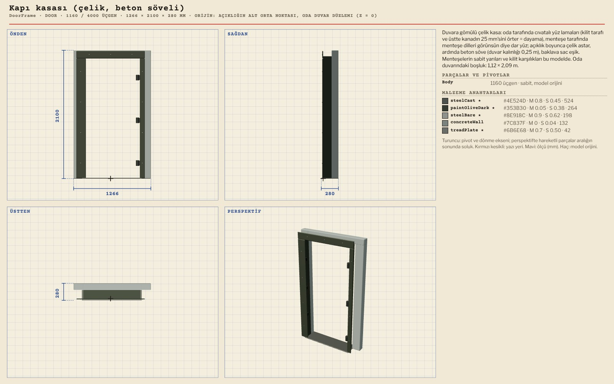
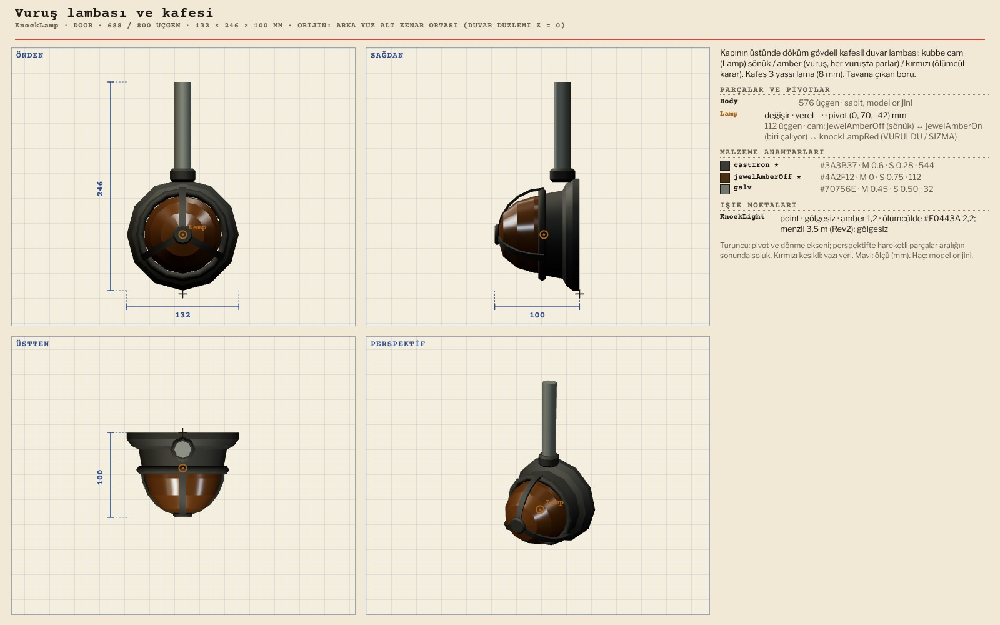
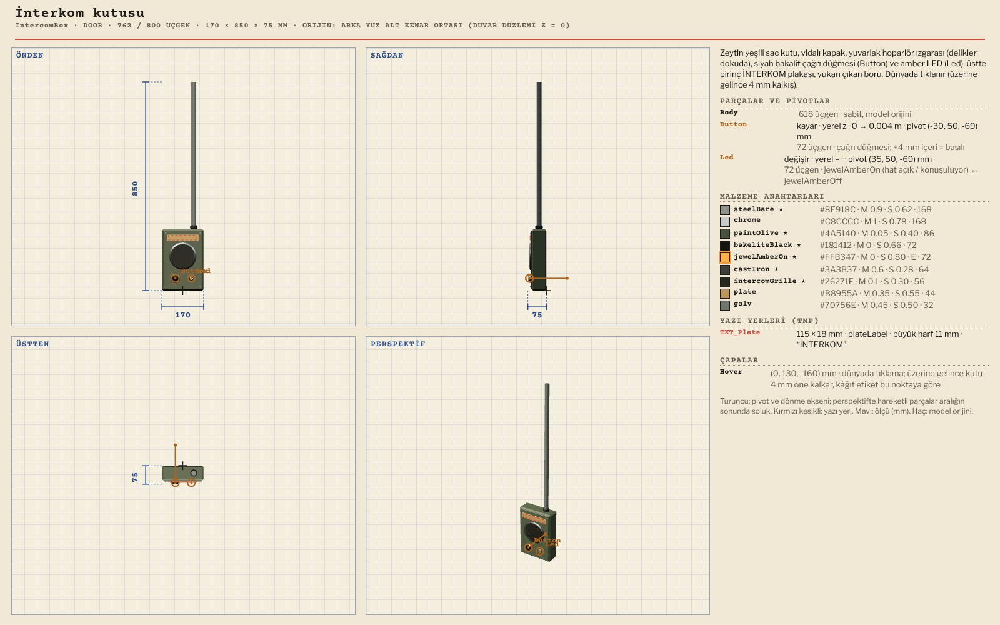
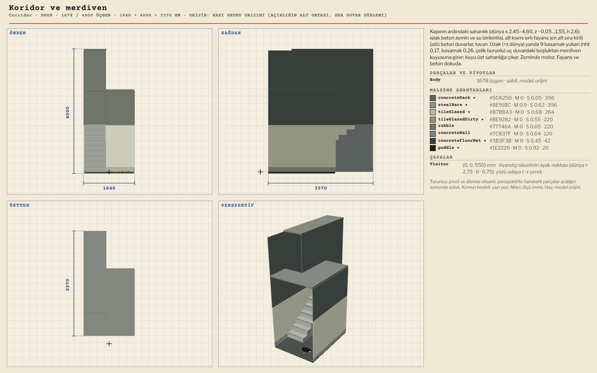

# R13 · Kapı ve koridor modelleri (ziyaretçisiz)
*Pano: `R13-kapi.dc.html` · görüntü: `../panolar/R13-kapi.jpg`*

R13 · KAPI VE KORİDOR · 8 MODEL KAPI GRUBU ORİJİNİ: AÇIKLIĞIN ALT ORTASI, DUVAR DÜZLEMİ x 2,20 · KANAT + YÖNDE KORİDORA AÇILIR

DoorLeaf Kapı kanadı (perçinli çelik, iki yüz) 3100 / 4000 · 895 × 1980 × 250
Hinge (y 0…95°) · PeepCover (y kayma 0…50 mm) · Wheel (z 0…450°, 1,25 tur) · buğu camı bu kanada takılır (R13-kabul)

DoorFrame Kapı kasası (çelik, beton söveli) 1160 / 4000 · 1266 × 2100 × 280
Söve iç yüzü koyu beton (portal) · DoorLeaf ile aynı orijin

KnockLamp Vuruş lambası ve kafesi 688 / 800 · 132 × 246 × 100
Lamp (swap: sönük ↔ amber, aday var) · KnockLight amber 1,2, gölgesiz · y 2,31 · kırmızı durum kalktı

IntercomBox İnterkom kutusu 762 / 800 · 170 × 850 × 76
Button (z kayma 0…4 mm) · Led (swap: hat açık) · merkez y 1,42, kapının sağı · GÖRÜŞME aracı (R17)

Corridor Koridor ve merdiven 1678 / 4000 · 1640 × 4000 × 3370
Sahanlık + 9 basamak, kuyu ~x 5,8 · yalnız kanat açıkken görünür, ışık CorridorLamp · Visitor çapası kullanılmıyor
AİLENİN DİĞERLERİ HazardHeader (114), Handrail (472), CorridorLamp (592, iki yerleşim). Kaldırılanlar (ek, 2026-11-05): dokuz ziyaretçi silueti (Visitor_anne … _genel3) ve vuruş lambasının kırmızı durumu; koridor hep boş. Koridor ile menü sahanlığı farklı ölçüde: tek “Sahanlık” prefab’ı önerisi R9 notunda.
