# R13 · Masa modelleri (fiş ağzı, devir fişi dahil)
*Pano: `R13-masa.dc.html` · görüntü: `../panolar/R13-masa.jpg`*

R13 · MASA · 20 MODEL K1'DE 1 PX ≈ 2 MM · PAH 6 MM (BÜYÜK) / 3–4 MM (KÜÇÜK) · İNCE PARÇA ≥ 6 MM

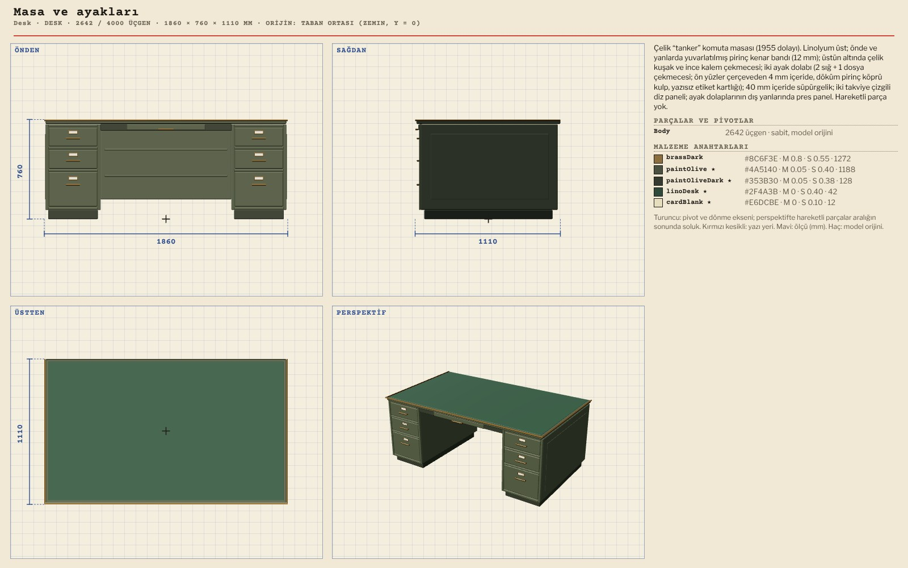

Desk Masa ve ayakları 2642 / 4000 · 1860 × 760 × 1110
Linolyum üst, pirinç ön şerit, iki çekmeceli ayak, gömme süpürgelik

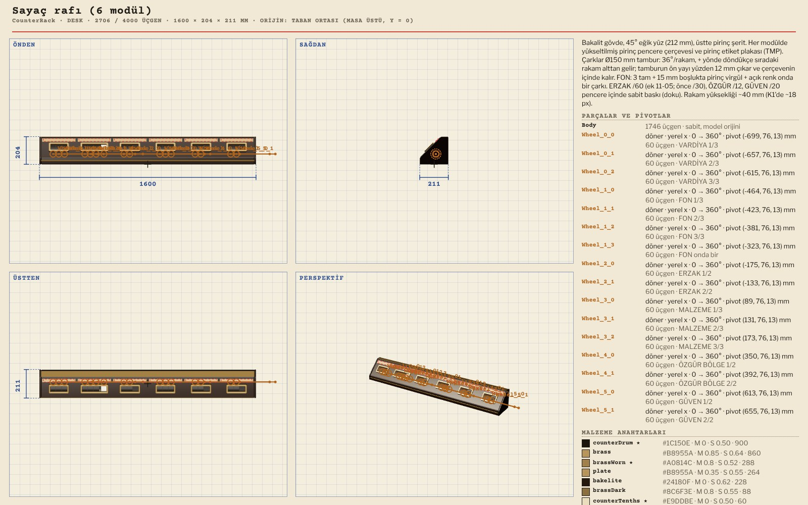

CounterRack Sayaç rafı (6 modül) 2706 / 4000 · 1600 × 204 × 211
Wheel_m_i ×16 (x, 36°/rakam; 11 hücreli şerit) · FON onda biri açık teker + pirinç virgül · EK: ERZAK /60, MALZEME = dört hammaddenin toplamı

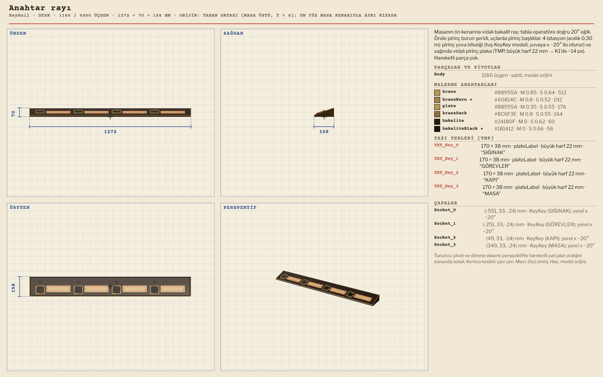

KeyRail Anahtar rayı 1160 / 4000 · 1272 × 70 × 158
4 yuva, 0,30 m aralık, tabla 20° · pirinç plakalar (TMP)

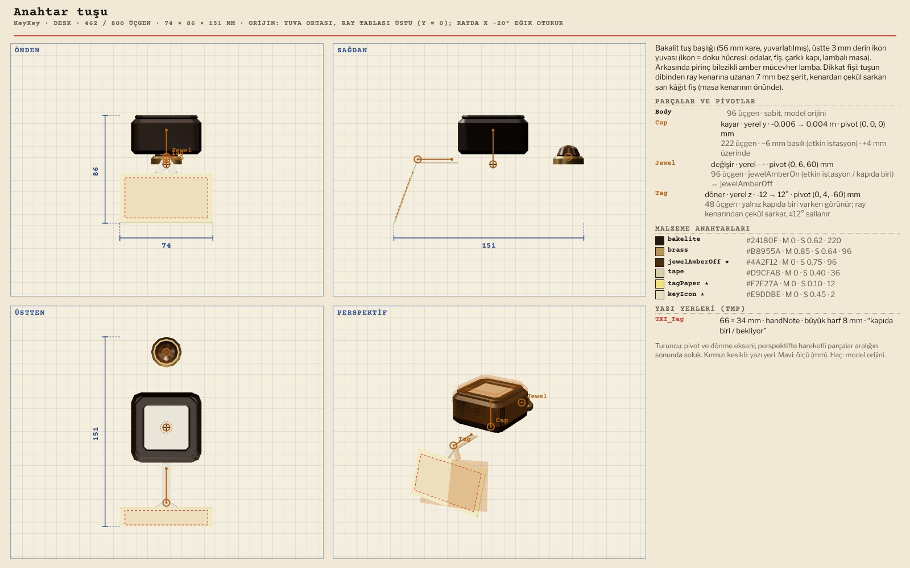

KeyKey Anahtar tuşu 462 / 800 · 74 × 86 × 151
Cap (y −6/+4 mm) · Jewel (swap) · Tag (z ±12°, 6 mm bant) · yerleşim euler (−20, 0, 0)

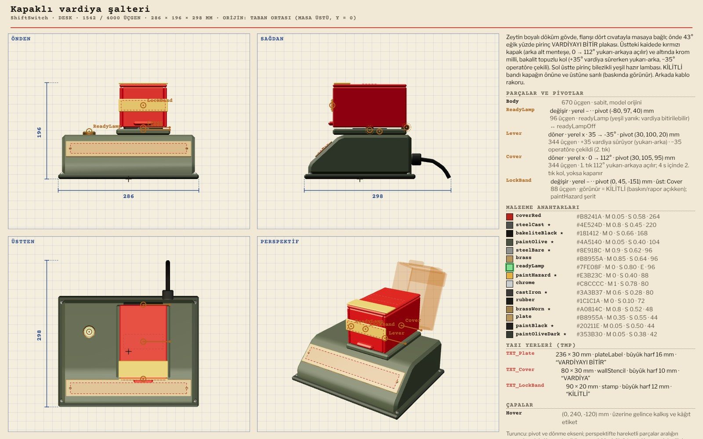

ShiftSwitch Kapaklı vardiya şalteri 1542 / 4000 · 286 × 196 × 298
Cover (x 0…112°) · Lever (x +35…−35°) · ReadyLamp, LockBand (swap) · kırmızı kapak korunur · EK: plaka 2. satır durum yazısı (TMP), bekleme hâli kırmızı

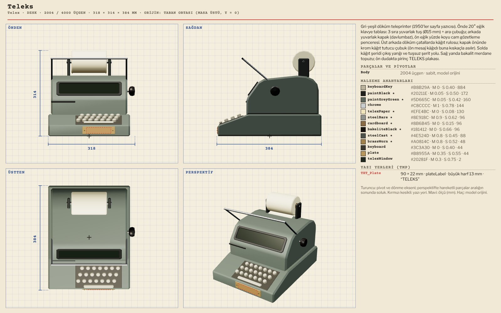

Telex Teleks 2004 / 4000 · 318 × 314 × 384
0,30 m genişlik (haritayı örtmez) · klavye sağda, kâğıt şeridi solda · TelexPaper ayrı

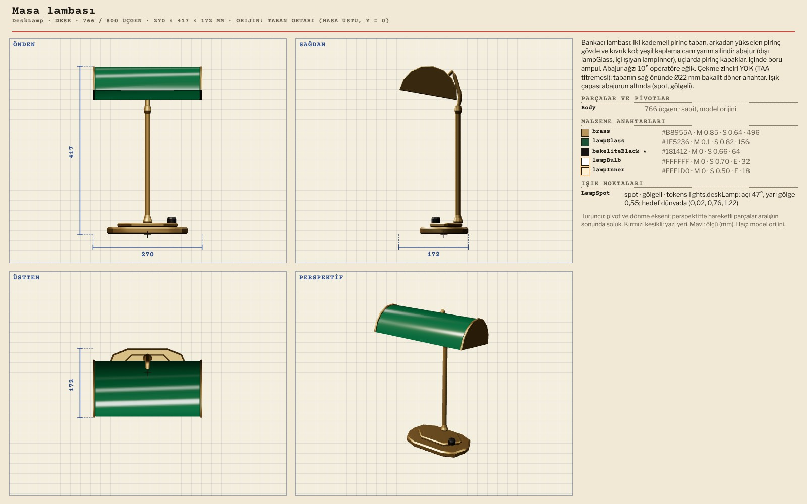

DeskLamp Masa lambası 766 / 800 · 270 × 417 × 172
Zincir yok (TAA) · döner anahtar Ø 22 · spot ışık noktası (gölgeli)

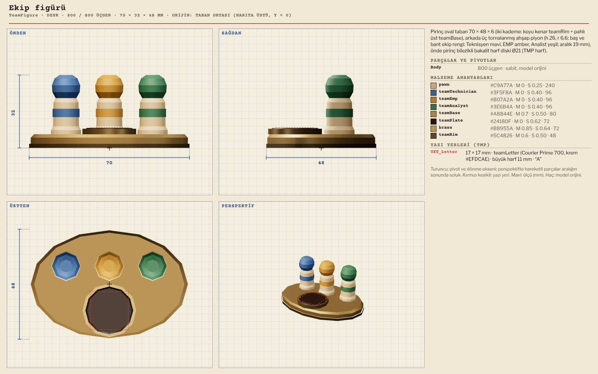

TeamFigure Ekip figürü 800 / 800 · 70 × 32 × 48
Pirinç oval taban, üç ahşap piyon (renk bantları), harf diski TMP “A”

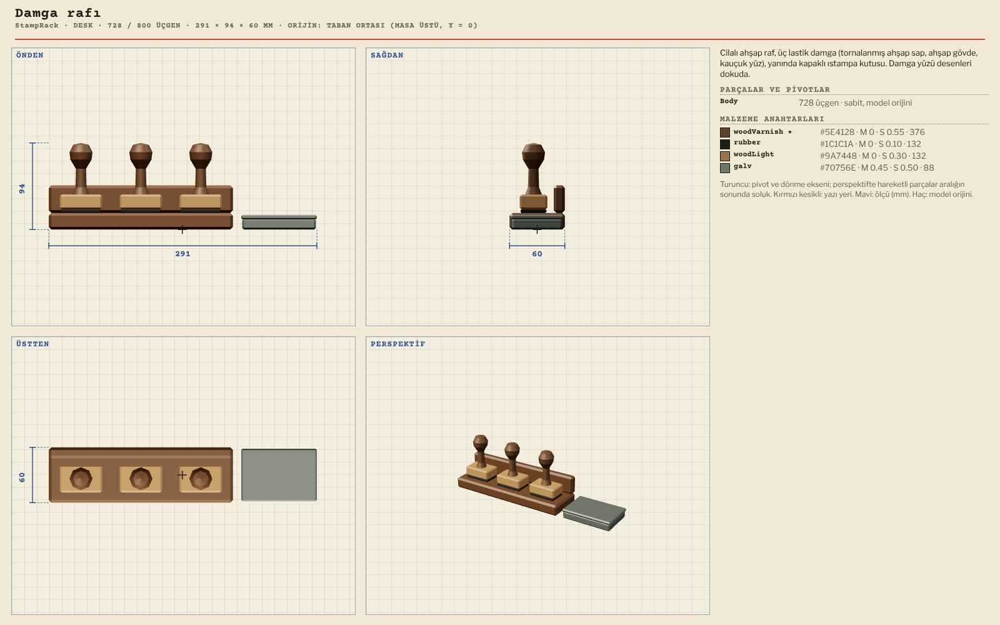

StampRack Damga rafı 728 / 800 · 291 × 94 × 60
Üç damga + ıstampa · sol arka köşeye taşındı

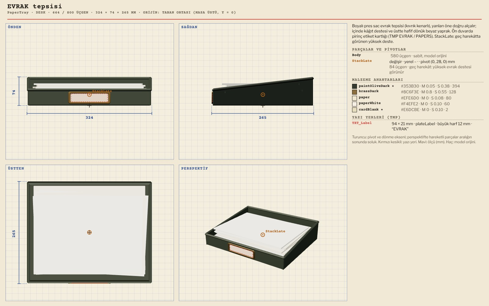

PaperTray EVRAK tepsisi 664 / 800 · 324 × 74 × 265
StackLate (swap: geç harekâtta yüksek yığın) · TMP EVRAK / PAPERS

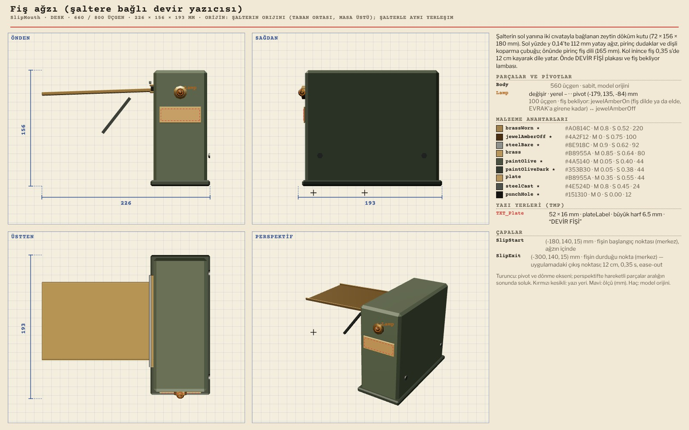

SlipMouth Fiş ağzı (devir yazıcısı) 660 / 800 · 226 × 156 × 193
EK · şalterin sol yanında · Lamp (swap, amber = fiş bekliyor) · SlipStart → SlipExit: şalter yerelinde x −0,18 → −0,30 (y 0,14, z 0,015), 0,35 s

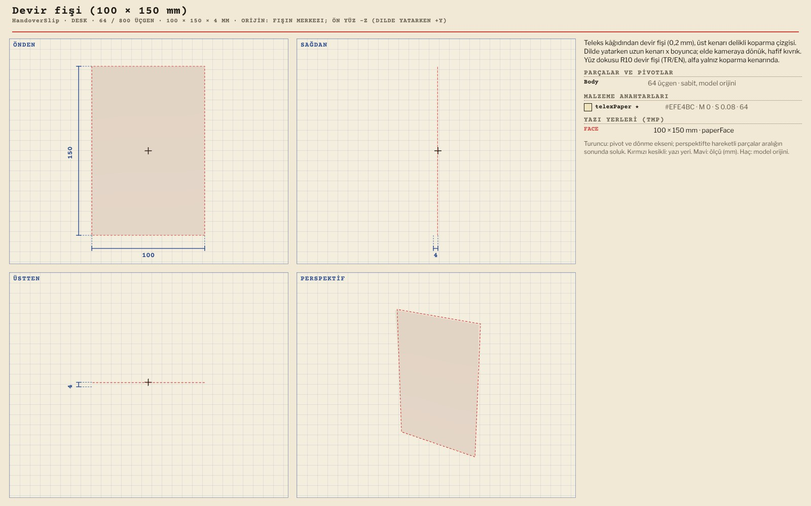

HandoverSlip Devir fişi (100 × 150) 64 / 800 · 100 × 150 × 4
EK · kıvrık düzlem, doku R10 devir_fisi_v001 / v031 (TR, EN) · dilden EVRAK tepsisine sürüklenir
Ailenin diğerleri (pakette): TelexPaper (124), Mug (440), Pencil (196), Eraser (132), Shavings (400), CoffeeRing (2, decal), TelexRoll (228), PaperPile (100). Geç harekât katmanı yalnız nesne ekler; dokular değişmez.
