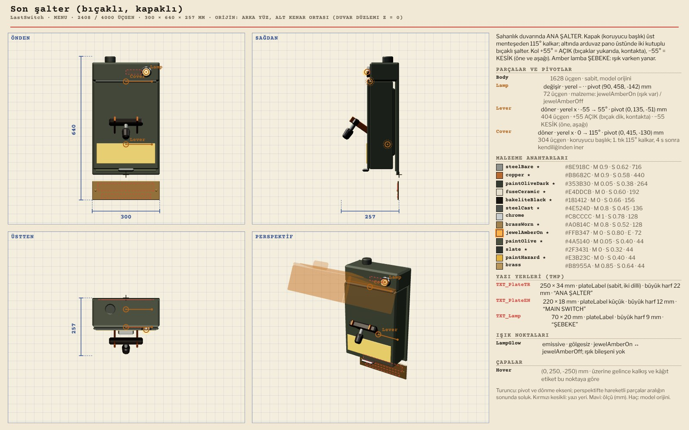
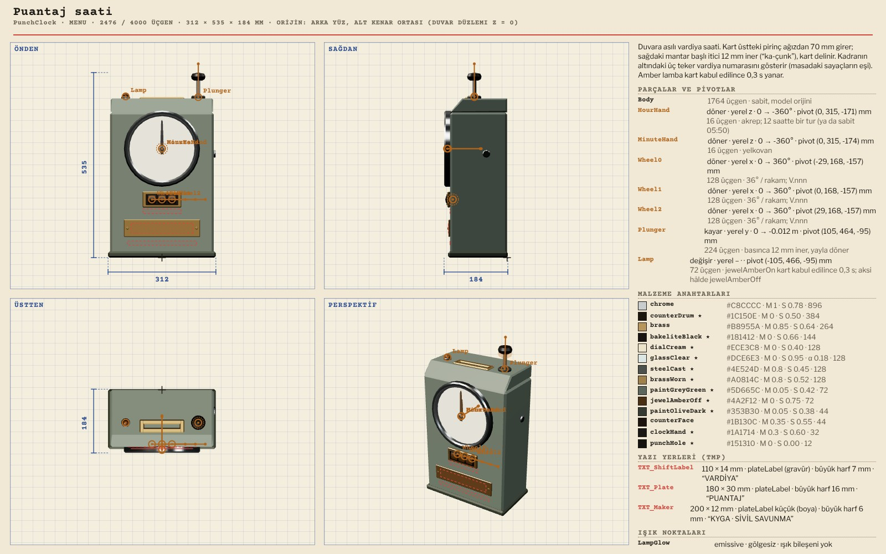
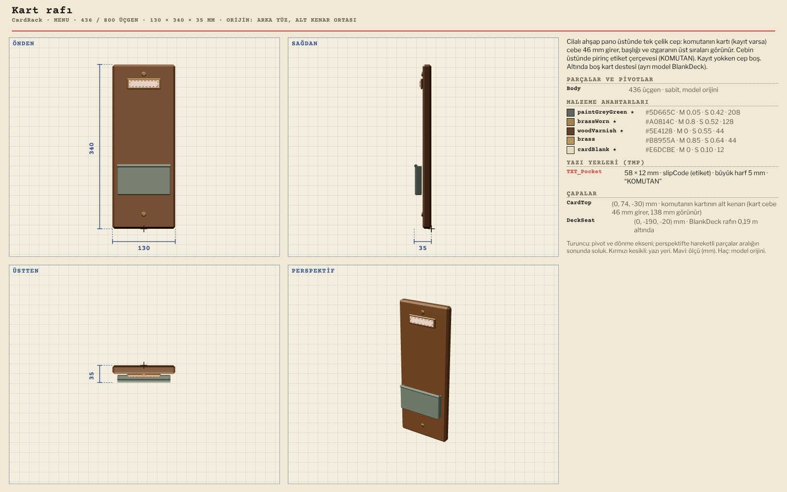
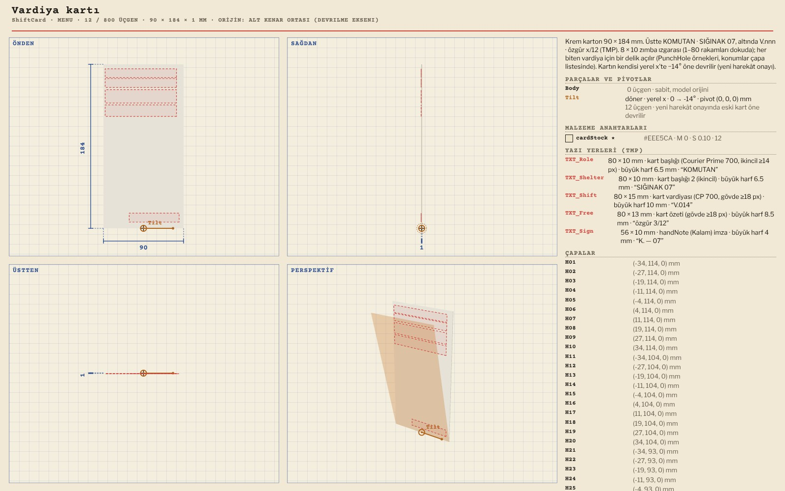
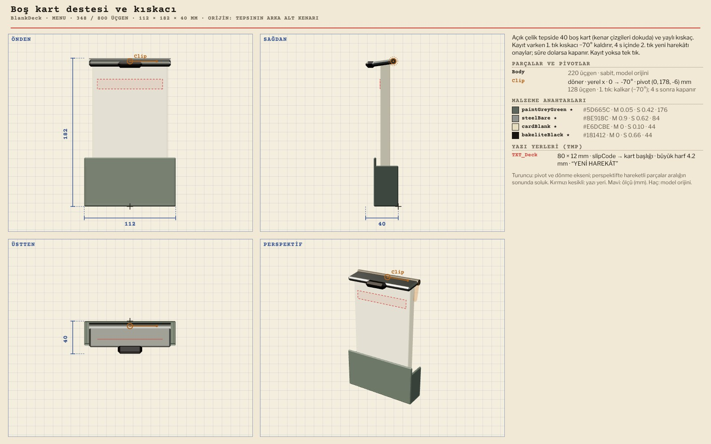
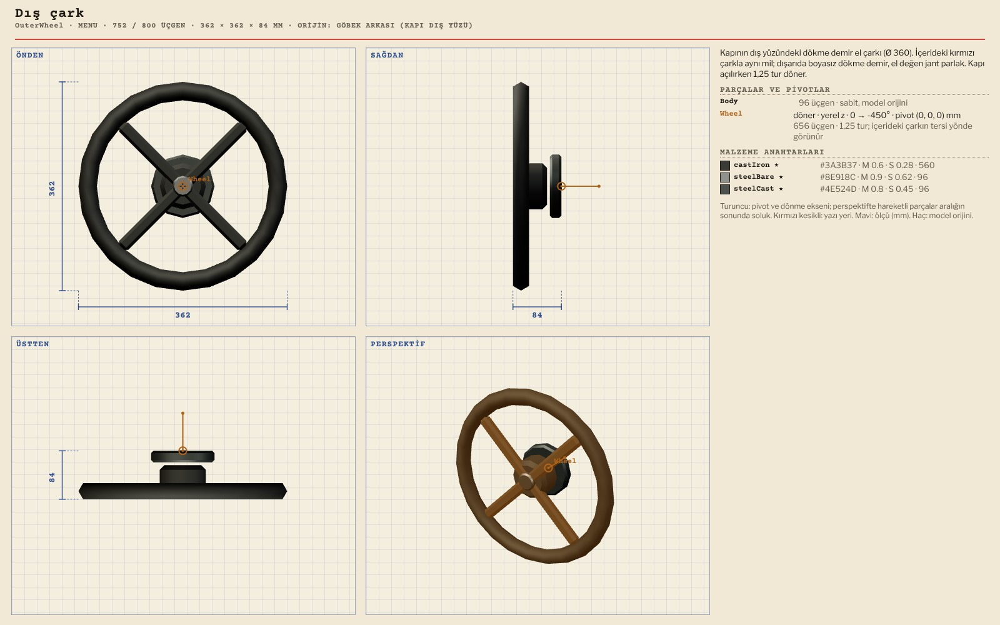
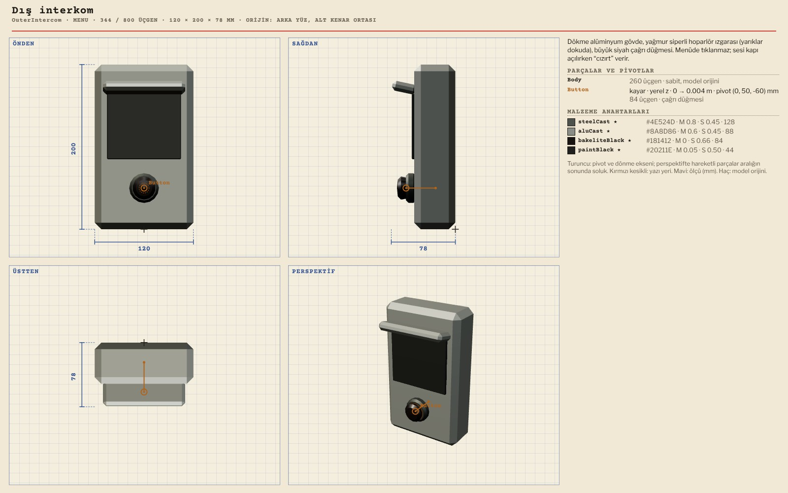
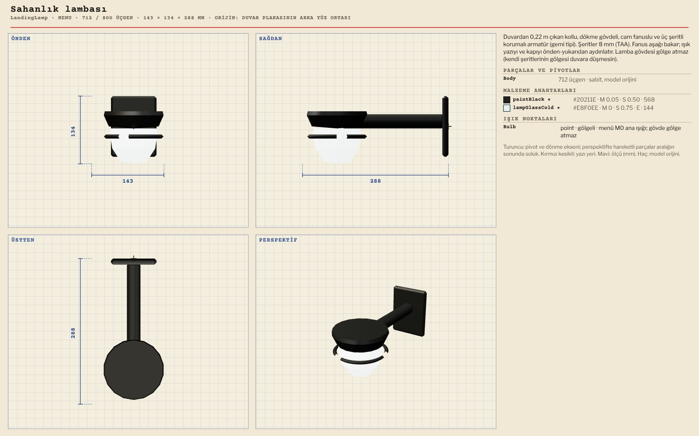
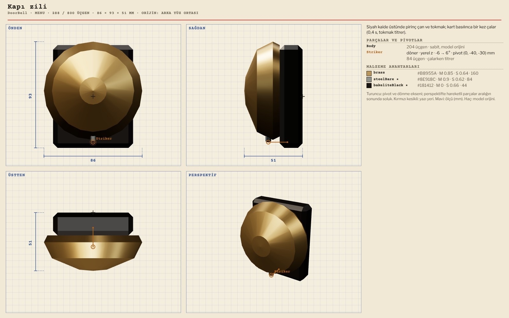
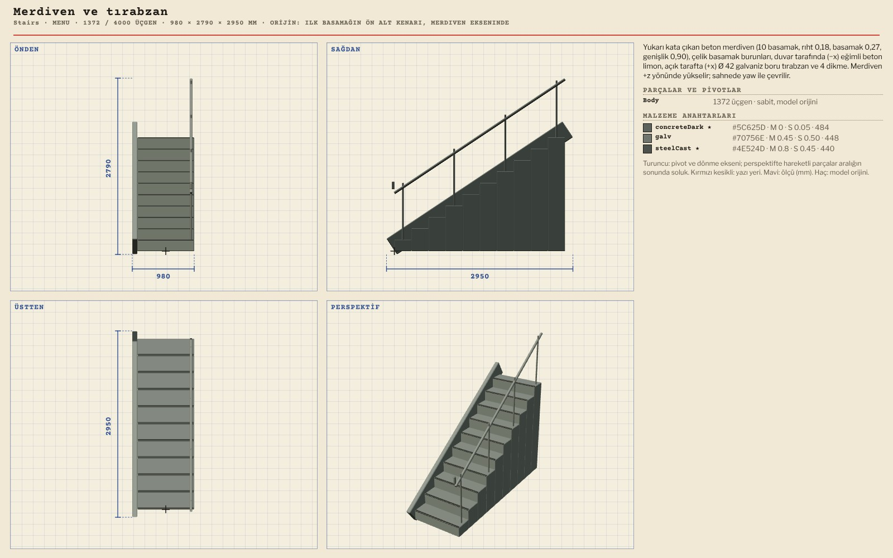

# R13 · Menü modelleri
*Pano: `R13-menu.dc.html` · görüntü: `../panolar/R13-menu.jpg`*

R13 · MENÜ (SAHANLIK) · 14 MODEL ÖNDEN · SAĞDAN · ÜSTTEN · PERSPEKTİF · ÖLÇÜ MM (MAVİ) · PİVOT (AMBER) · TMP YUVASI (KIRMIZI KESİKLİ) · HAREKETLİ PARÇA HAYALET

LastSwitch Son şalter (bıçaklı, kapaklı) 2408 / 4000 · 300 × 640 × 257
Cover (x 0…115°) · Lever (x ±55°) · Lamp (swap)

PunchClock Puantaj saati 2476 / 4000 · 312 × 535 × 184
HourHand, MinuteHand (z) · Wheel0–2 (x, 36°/rakam) · Plunger (y −12 mm) · Lamp

CardRack Kart rafı 436 / 800 · 130 × 340 × 36
Çapalar CardTop, DeckSeat · TXT_Pocket (KOMUTAN)

ShiftCard Vardiya kartı 12 / 800 · 90 × 184 × 1
Tilt (x 0…−14°) · TXT_Role, Shelter, Shift, Free, Sign · H01–H80

BlankDeck Boş kart destesi ve kıskacı 348 / 800 · 112 × 182 × 40
Clip (x 0…−70°) · TXT_Deck (YENİ HAREKÂT)

OuterWheel Dış çark 752 / 800 · 362 × 362 × 84
Wheel (z, 1,25 tur) · kanadın OuterWheel çapasına

OuterIntercom Dış interkom 344 / 800 · 120 × 200 × 78
Button (z kayma 4 mm) · dökme alüminyum, siperlik

LandingLamp Sahanlık lambası 712 / 800 · 143 × 134 × 288
Işık noktası (spot 110° önerilir) · 3 yassı kafes şeridi, gölge vermez

DoorBell Kapı zili 288 / 800 · 86 × 93 × 51
Striker (z ±6°) · pirinç çan

Stairs Merdiven ve tırabzan 1372 / 4000 · 980 × 2790 × 2950
10 basamak 0,18 / 0,27 · koridorun merdiveniyle hizalanmalı (Sorun 2)
Ailenin diğerleri (paketteki sayfalarda): PeepRing (352), TitleStencil (24, TMP 1,16 × 0,20), PunchHole (32), CancelSlip (120). Bütün yazılar TMP yuvası; dokuda kelime yok. Orijin: duvar nesnelerinde arka yüzün alt kenar ortası.
