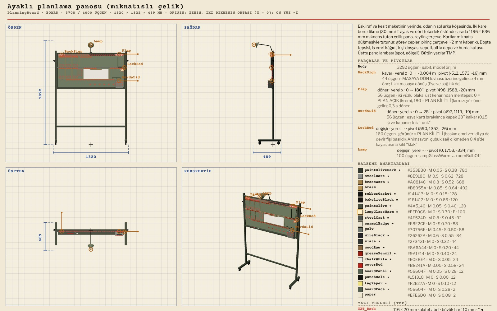
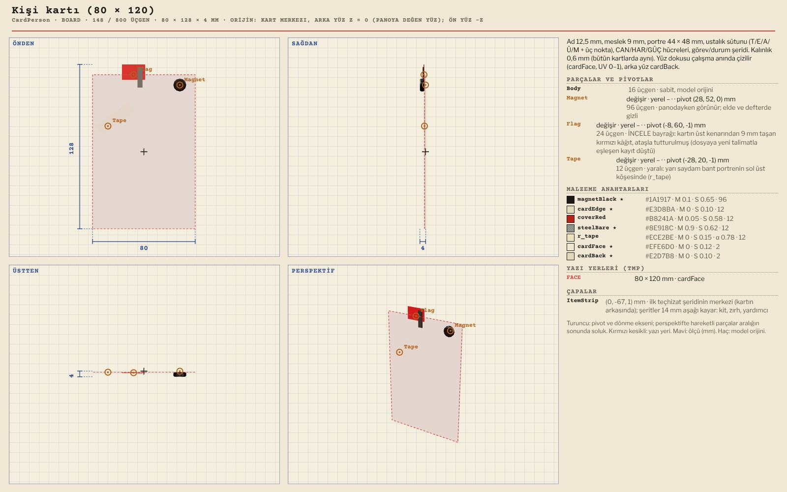
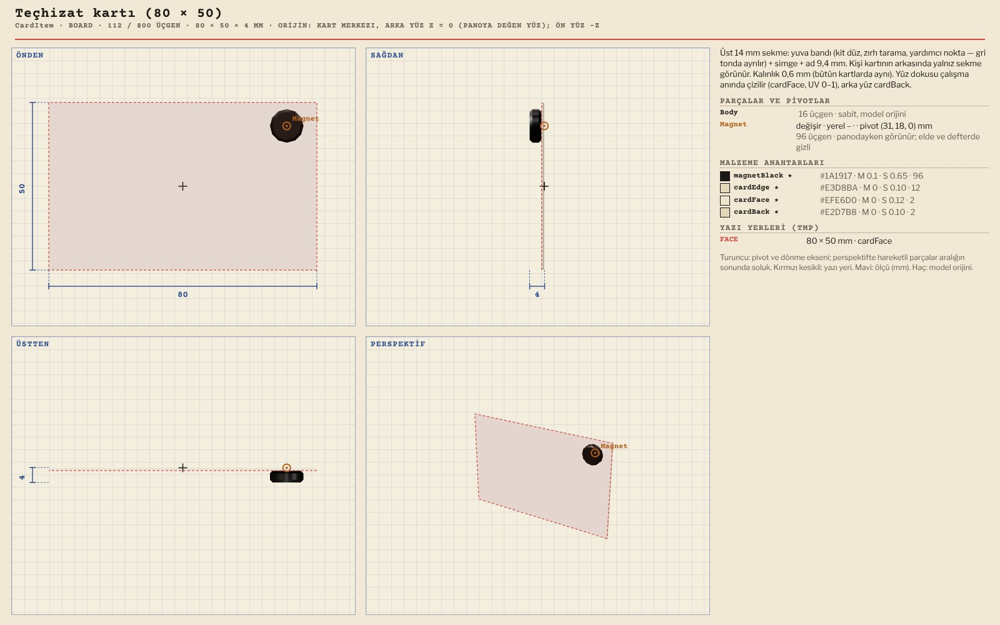
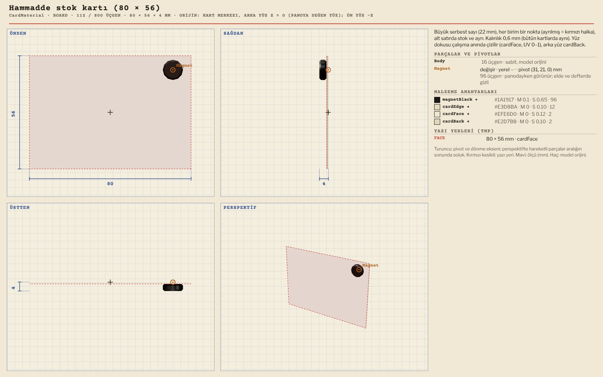
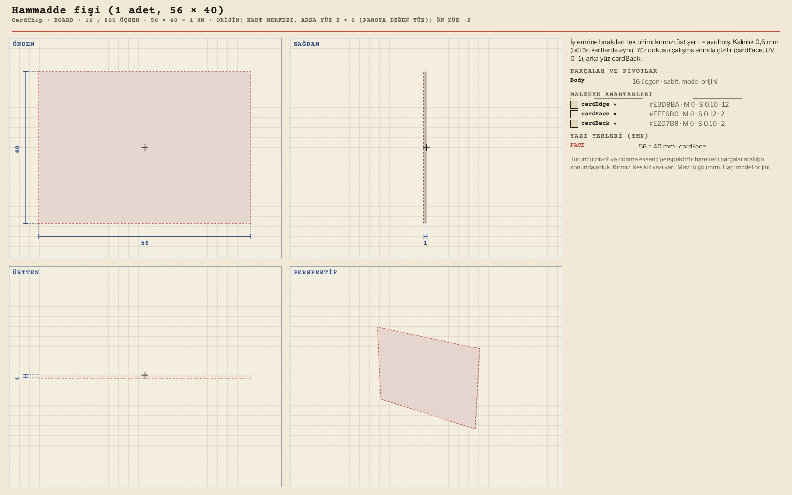
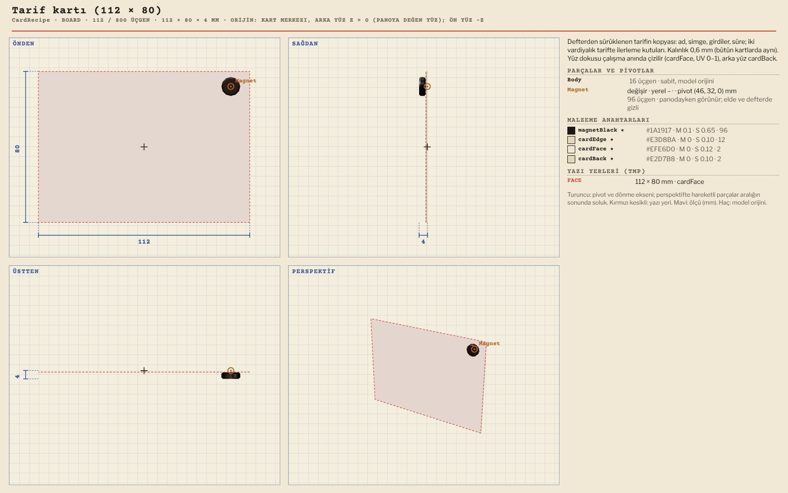
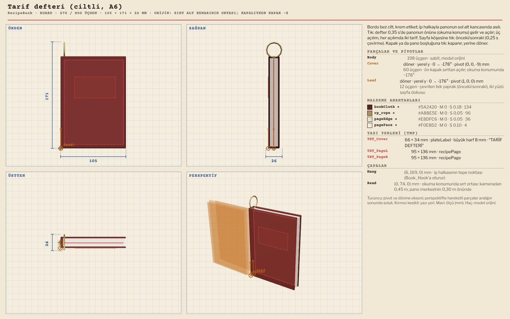
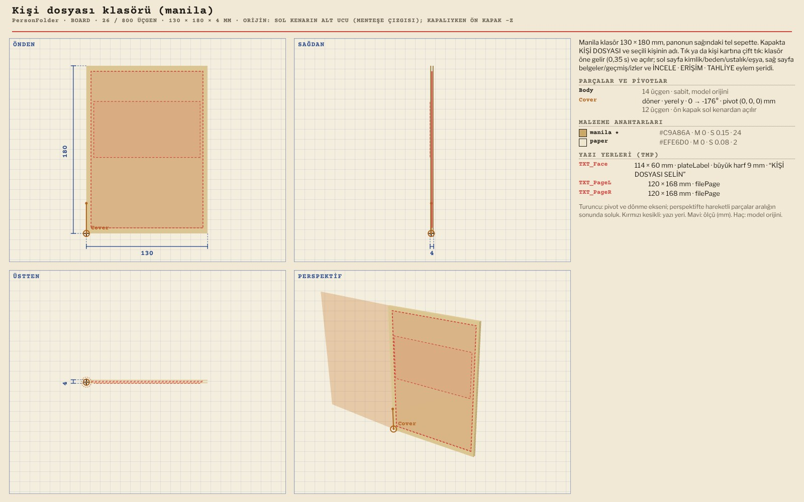

# R13 · Planlama panosu ve kartlar
*Pano: `R13-pano.dc.html` · görüntü: `../panolar/R13-pano.jpg`*

R13 · PLANLAMA PANOSU VE KARTLAR · 8 MODEL ESKİ RAFIN YERİ (−1,62 · 0 · 1,70), YAW −48° · K4’TE 1,52 PX/MM · KART 0,6 MM + Ø 10 MM MIKNATIS

PlanningBoard Ayaklı planlama panosu (mıknatıslı çelik) 3708 / 4000 · 1320 × 1822 × 489
BackSign (kayma: MASAYA DÖN levhası) · Flap (x 0…180°, üst menteşe) · HurdaLid (x 0…28°) · LockRod, Lamp (swap) · BoardLamp spot, gölgeli · 32 TMP yuvası, 26 çapa

CardPerson Kişi kartı (80 × 120) 148 / 800 · 80 × 128 × 4
Magnet · Flag (swap: İNCELEME bayrağı) · Tape (swap: yaralı bandı) · FACE dokusu: ad 14 mm, değerler ≥ 9,5 mm · ItemStrip çapası

CardItem Teçhizat kartı (80 × 50) 112 / 800 · 80 × 50 × 4
Kimlik bandı altta (14 mm), kişi kartının altında görünür · yuva deseni: kit düz, zırh taralı, yardım noktalı

CardMaterial Hammadde stok kartı (80 × 56) 112 / 800 · 80 × 56 × 4
Büyük serbest sayı + pip sırası · ayrılan adet kırmızı halka · STOK / BOŞ / AYRI dokuda

CardChip Hammadde fişi (1 adet) 16 / 800 · 56 × 40 × 1
Mıknatıssız, hafif eğik · iş emrine sürüklenir, iptalde depoya döner

CardRecipe Tarif kartı (112 × 80) 112 / 800 · 112 × 80 × 4
Girdi ikonları + vardiya sayısı · çok vardiyalıda ilerleme kutuları · defterden iş emrine

RecipeBook Tarif defteri (ciltli, A6) 270 / 800 · 105 × 171 × 26
Cover (y 0…−178°) · Leaf (sayfa) · 3 yayım × 2 tarif (TXT_PageL/R) · Hang, Read çapaları · kordon

PersonFolder Kişi dosyası klasörü (manila) 26 / 800 · 130 × 180 × 4
Cover (y 0…−176°) · TXT_Face (ad, çevrilmez) · İNCELE / ERİŞİM / TAHLİYE sayfaları · tel sepette
AİLENİN DİĞERLERİ Kart arkası (4 boy), cep baskıları ve alan plakaları dokuda: yüz kelimesiz, başlıklar TMP (TR/EN). Kartların hepsi aynı ince kalınlık. Kaldırıldı (EK): raf, sandıklar, bidon, umut bitkisi, kesit maketi, oda kartları, özet panosu, BOŞTA tepsisi ve askıları, ziyaretçi silüetleri. Okunurluk K4’te: kart adı 21 px, değerler 14–17 px (1920 × 1080).
