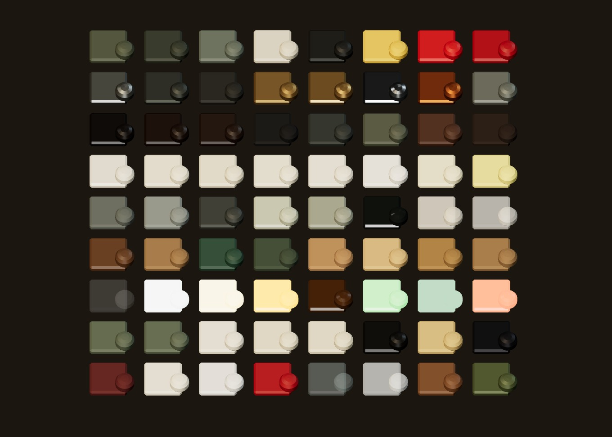

# R14a · Malzemeler
*Pano: `R14a.dc.html` · görüntü: `../panolar/R14a.jpg`*

R14a · MALZEMELER · 72 ANAHTARIN ÖRNEĞİ URP LIT · METRİK UV · ÖZEL SHADER YOK · KIRMIZI = EK 11-05

paintOlive
paintOliveDark
paintGreyGreen
paintCream
paintBlack
paintHazard
coverRed
red
steelBare
steelCast
castIron
brassWorn
brass
chrome
copper
galv
bakeliteBlack
bakelite
cabPanel
rubberGasket
slate
crtCase
radioBody
radioGrille
enamelBadge
dialCream
scaleCream
cardStock
paper
paperWhite
telexPaper
tagPaper
concreteDark
concreteWall
concreteFloorWet
tileGlazed
tileGlazedDirty
puddle
stencilPaint
chalkDecal
woodVarnish
woodRaw
linoDesk
feltBlotter
cork
r_plyTop
r_plyEdge
cardboard
glassClear
lampGlassCold
lampGlassWarm
jewelAmberOn
jewelAmberOff
readyLamp
crtScreen
knockLampRed
boardPanel
boardFace
cardFace
cardEdge
cardBack
magnetBlack
manila
wireBlack
bookCloth
pageFace
chalkWhite
greasePencil
coldGlass
fogFrost
stampWood
tinOlive
BOYA
METAL
BAKALİT · KAUÇUK
KÂĞIT · EMAYE
BETON · FAYANS
AHŞAP · KARTON
CAM · IŞIK
EK · PANO, KART
EK · DEFTER, KABUL
KURALLAR
- **1** — Boya dielektrik (metal ≤ 0,1), pürüzlülük 0,55–0,8. El değen metal ayrı malzeme: brassWorn, steelBare (metal 0,8–0,9).

- **2** — Kâğıt ve kart yüzleri emisyonsuz, albedo ≤ 0,8: pano ve tezgâh lambası altında beyaz patlamaz.

- **3** — Cam ve buğu Transparent; yanan lambalar emission (readyLamp, jewelAmberOn). Bloom yok, her şey kapalı post-processing’de de okunur.

- **4** — Bir anahtar = bir URP Lit malzemesi; aynı değerliler Unity’de birleşir (~45 oda malzemesi, Sorunlar 5).

EK 11-05 · YENİ ANAHTARLAR (20)
boardPanel · mıknatıs tutan çelik pano yüzü, mat zeytin-gri (kartlardan iki ton koyu)
boardFace · tx_board_face 4096 × 2048: kelimesiz baskı, cep sınırları, Boşta yelpaze izi
cardFace · cardBack · cardEdge · kart yüzü çalışma anında 8 px/mm; arka KYGA · 07 şablonu; 0,6 mm karton
magnetBlack · kart mıknatısı Ø 10 × 3,5 mm (panoda görünür, elde gizli)
manila · wireBlack · kişi dosyası klasörü; tel sepet ve kanca
bookCloth · pageFace · pageEdge · tarif defteri: bordo bez cilt, iki tarifli açılım dokusu
chalkWhite · greasePencil · tebeşir başlık; eğitim konusundaki kırmızı yağlı kalem halkası
coldGlass · fogFrost · buğu camı (α 0,42) ve nefes katmanı (α 0,78, yumuşak kenar)
stampWood · tinOlive · tinRim · enamelShade · enamelInner · kabul tezgâhı: damga sapı, erzak tenekesi, tezgâh lambası
KALDIRILDI (_was_1_3)
shelfPost, rope, roomCard, selYellow, moltenGlow, firstAidSign, scrapMetal (raf ve maket) · visitor, visitorCopy (ziyaretçi silüetleri)
