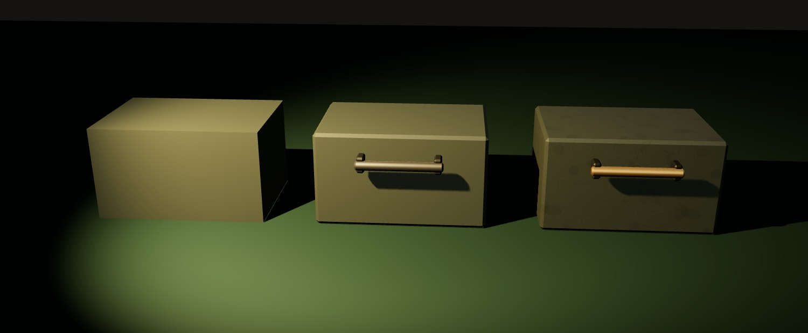

# R14b · Yıpranma
*Pano: `R14b.dc.html` · görüntü: `../panolar/R14b.jpg`*

R14b · YIPRANMA · IŞIĞI TUTAN KENAR, PAYLAŞILAN DETAY, EL DEĞEN METAL ÖZEL SHADER YOK · DETAIL MAP · METRİK UV

a · pahsız: oyuncak gibi
b · 6 mm pah: kenarda ışık çizgisi
c · pah + paylaşılan detay + aşınmış pirinç tutamak
MALZEME AİLESİ boya (zeytin, koyu zeytin, gri-yeşil, krem emaye, siyah, tehlike sarısı) · metal (çıplak çelik, döküm, dökme demir, aşınmış pirinç, bakır, galvaniz) · bakalit · cam (berrak, lamba camları emission) · kâğıt ve kart (krem kart, teleks kâğıdı, manila, defter bezi) · beton ve fayans · ahşap (cilalı, ham, kontrplak, mantar, karton) EK 11-05 · KART VE PANO Kartlar: köşe 3 mm yuvarlatma doku alfasında; eskime dokuda (kalem izi, parmak lekesi, bant). Pano yüzü kelimesiz baskı, cep çerçevesi 3 mm pirinç (K4’te 4,6 px). KALDIRILDI Umut bitkisi (1 → 3) ve maketin pirinç şeritleri: zamanla değişen oda artık kart durumları ve masadaki nesnelerle anlatılır.
1 Pah ışığı tutar
Her silüet kenarı kendi pozunda ≥ 3 px: K1 6 mm, K4 kart ve cep 2–3 mm, K9 2 mm, M0 5–6 mm, M2 1,5–2 mm, baskın 0,02–0,03. Kenarda ince parlak çizgi “kullanılmış” okunur; pahsız kutu oyuncak gibi durur.
2 Tek paylaşılan detay haritası
UV metrik (1 UV = 1 m): bütün odada aynı ölçekte yıpranma. URP Lit Detail Inputs → Detail Albedo ×2 (tx_wear_detail 1024², 0,25 m’de bir) + Detail Normal 0,3. Malzeme başına ayrı doku yok.
3 El değen metal ayrı malzeme
Tutamak, kol başı, mandal, şalter kolu, fiş dili brassWorn / steelBare (metal 0,8–0,9, pürüzlülük 0,38–0,48); boya dielektrik kalır. Pas ve damla izi yalnız doku notu olan yerlerde (boru, beton).
4 Kir aşağıda toplanır
Duvarlarda alt 0,5 m daha koyu (tileGlazedDirty, betonda nem lekesi). Masada ve panoda kâğıt, kahve halkası, kalem talaşı, tebeşir tozu gibi nesneler kirin yerine geçer.
5 Oda zamanla değişir
V.001 → V.031: kâğıt yığını, teleks rulosu, kahve halkası, tebeşir çentikleri, mantar panoda kartlar, afişin kalkık köşesi ve ek bant; panoda kayıp kişinin yas köşesi, iş emri kâğıdında silinti izleri. Dokular değişmez; nesneler ve kart durumları birikir.
6 İnce ayrıntı dokuya
Tel, vida yarığı, ölçek çizgisi, ızgara deliği ≥ 3 px değilse dokuda (mip’li). Lamba zinciri kalktı (döner anahtar). Kartın kendisi 0,6 mm: kalınlığı yalnız kenar şeridi ve mıknatısın gölgesi gösterir.
