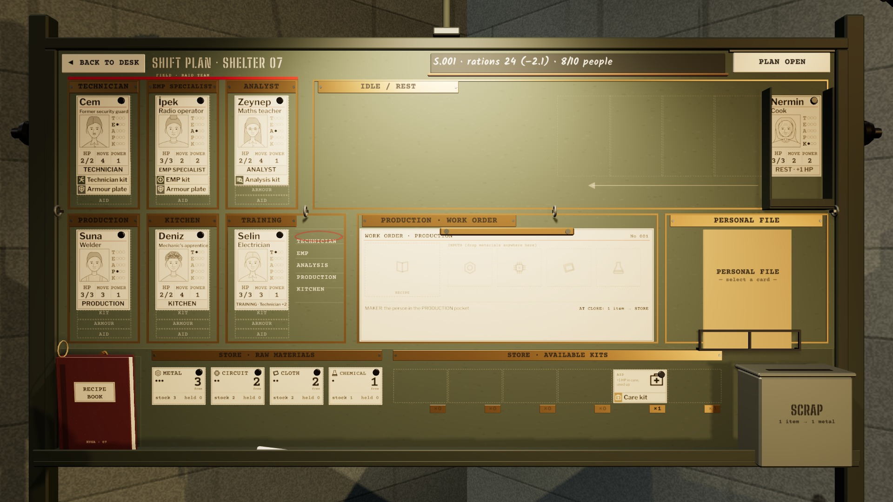

# R15 · Board K4 · EN
*Pano: `R15-EN.dc.html` · görüntü: `../panolar/R15-EN.jpg`*

R15 · EN · PLANLAMA PANOSU (K4) TR İLE AYNI DÜZEN · METİNLER TMP

EN PANODAKİ İNGİLİZCE METİNLER
Plakalar: TECHNICIAN · EMP SPECIALIST · ANALYST · PRODUCTION · KITCHEN · TRAINING · IDLE / REST · PRODUCTION · WORK ORDER · PERSONAL FILE · STORE · RAW MATERIALS · STORE · AVAILABLE KITS · SCRAP. Başlık: SHIFT PLAN · SHELTER 07; tebeşir “S.001 · rations 24 (−2.1) · 8/10 people”; PLAN OPEN / PLAN LOCKED; ◄ BACK TO DESK.
KART KART YAZILARI
HP / MOVE / POWER; ustalık harfleri T · E · A · P · K; durum şeridi DUTY yerine görev adı, REST · +1 HP, TRAINING · EMP +2, BED REST · 2 SH., RESTRICTED · 2 SH., LOST · S.024. İsimler çevrilmez (Selin, İpek, Nermin).
SIĞMA EN UZUNLUKLARI
Plakalarda en uzun EN metni “PRODUCTION · WORK ORDER” (230 mm plaka, 8,4 mm büyük harf) sığar; kartta “Mechanic’s apprentice” 9,5 mm’de %86’ya küçülür (alt sınır %74). Uzun meslekler EN tablosunda kısaltılmaz, punto küçülür.
- **Dil değişince · yalnız TMP yazıları ve kart dokuları yeniden çizilir; kart konumları, mıknatıslar ve baskı yüzü aynı kalır.** — Sayılar · EN’de ondalık nokta (−2.1), TR’de virgül (−2,1).
