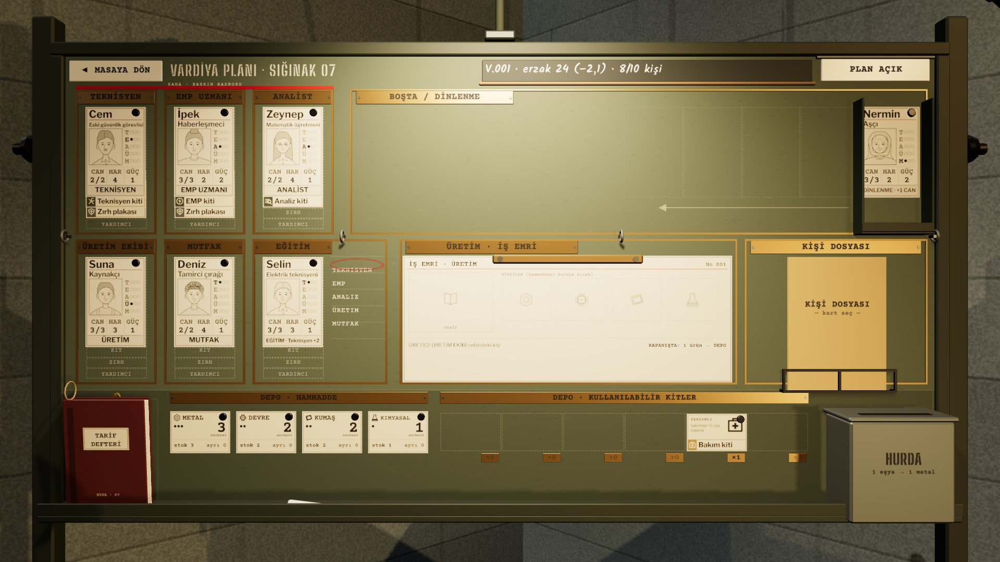

# R15a · Pano K4 · genel görünüş
*Pano: `R15a.dc.html` · görüntü: `../panolar/R15a.jpg`*

R15a · PANO (K4) · GENEL GÖRÜNÜŞ · İLK VARDİYA AYAKLI MIKNATISLI PANO · 1196 × 636 MM

- **1** — MASAYA DÖN · emaye levha; üzerine gelince 4 mm öne, tık masaya döndürür. Esc ve sağ tık aynı işi yapar.
- **2** — Başlık · tebeşirle arduvaz: vardiya, erzak ve kapanıştaki beklenen değişim, kişi sayısı. Plan değişince değişim yeniden yazılır.
- **3** — PLAN AÇIK / KİLİTLİ · üst kenarından menteşeli iki yüzlü plaka; kilitte kırmızı yüz öne döner.
- **4** — Saha cepleri · TEKNİSYEN, EMP UZMANI, ANALİST; üstte kırmızı SAHA · BASKIN KADROSU şeridi. Kit şeridi “KİT · GEREKLİ”.
- **5** — Sığınak cepleri · ÜRETİM EKİBİ, MUTFAK, EĞİTİM. Her cep tek kişi; dolu cebe bırakmak takas eder.
- **6** — Eğitim konusu · beş satır; seçili konu kırmızı yağlı kalem halkasında. Satıra tık halkayı yeniden çizer.
- **7** — BOŞTA tepsisi · deste; üst kart doğrudan sürüklenir. Tepsinin solundaki geniş alan açık elin yeri.
- **8** — ÜRETİM · İŞ EMRİ · klipsli form: TARİF kutusu ve girdi alanı; kartlar bırakıldığı yerde kalır.
- **9** — KİŞİ DOSYASI · tel sepette manila klasör; seçili kişinin adı kapakta. Tık: öne gelir ve açılır.
- **10** — Hammadde · dört stok kartı: büyük serbest sayı, her birim bir nokta, ayrılmış kırmızı halka.
- **11** — Kullanılabilir kitler · türüne göre yığın, pirinç sayı etiketi (×n); üst kart sürüklenir.
- **12** — HURDA · eşya kartı bırakılınca kapak kalkar: 1 eşya → 1 metal.
- **13** — Tarif defteri · rafta duran bordo defter; tık öne açar (R18).

- Okunurluk (K4, 1,52 px/mm) · kart adı 14 mm → 21 px; meslek 9,5 mm → 14 px; CAN/HAR/GÜÇ 11,5 mm → 17 px; teçhizat adı 9,4 mm → 14 px; plaka yazıları 8,4 mm büyük harf → 18 px. | İlk vardiyanın fiziksel ipuçları · boş cepte kesikli kart dış hattı, kişi simgesi ve üç teçhizat şeridi; saha ceplerinde kırmızı “KİT · GEREKLİ”; Boşta’nın solunda yelpaze izi; iş emrinde TARİF kutusu; hurdada “1 eşya → 1 metal”. | Ekran şeridi · K4’te üstteki sayaç şeridi ve istasyon çipleri gizlenir (0,25 s); vardiya, erzak ve kişi panonun başlığında. Dönüş: MASAYA DÖN levhası, Esc, sağ tık.
