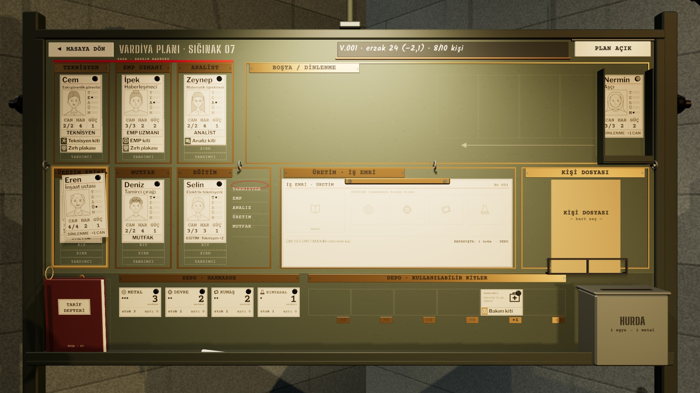
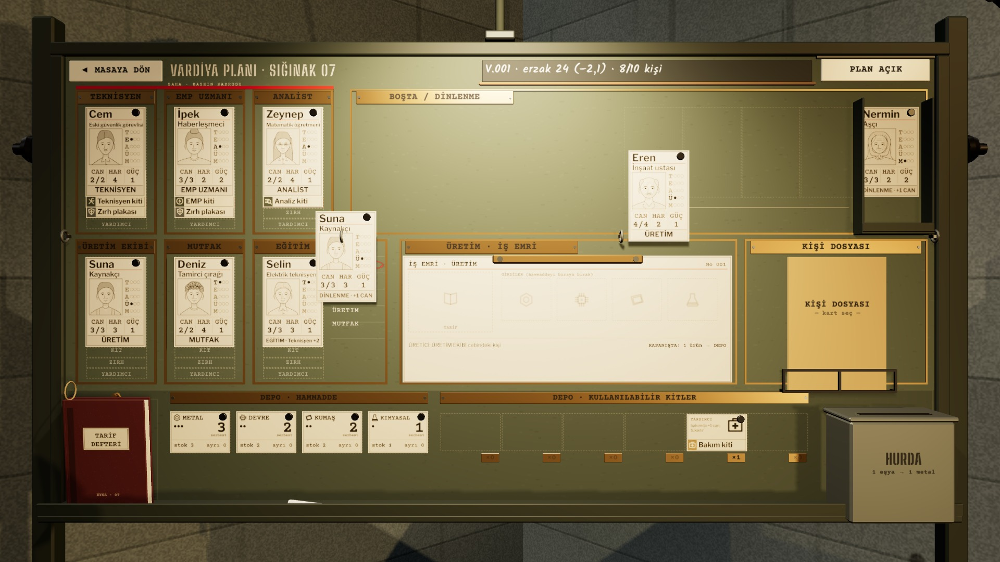
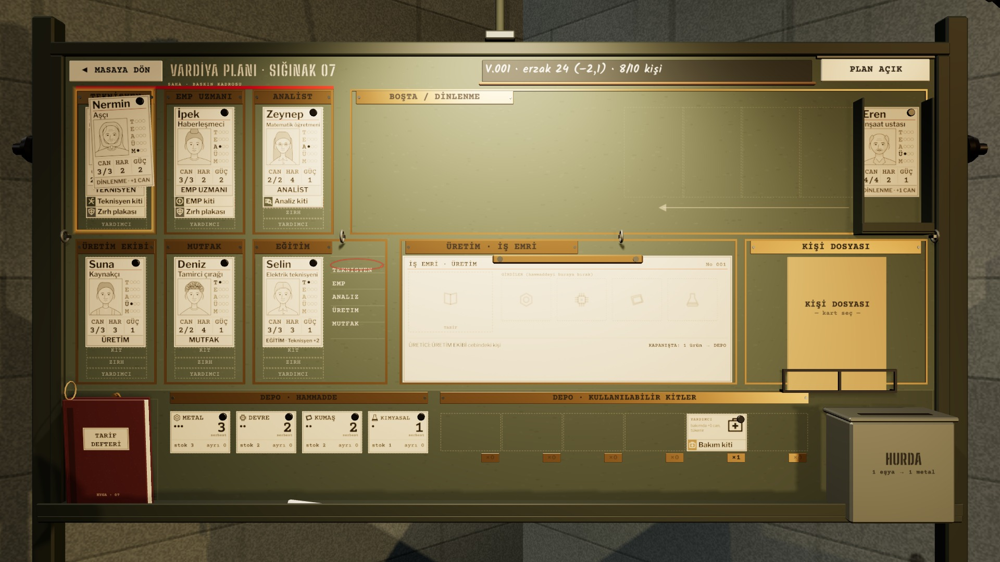

# R15b · Atama, takas, uyarı
*Pano: `R15b.dc.html` · görüntü: `../panolar/R15b.jpg`*

R15b · ATAMA: SÜRÜKLE, DOLU CEBE TAKAS, UYARI FARE SÜRÜKLE-BIRAK · KLAVYE: SEÇ + HEDEF + ENTER

ÜRETİM EKİBİ ← EREN takas: Suna → BOŞTA · kit gerekmez
1 SÜRÜKLENİYOR · DOLU CEP
Tutulan kart 10 mm kalkar, 3° döner; uygun cepler amber çerçeveyle belirir, uygun olmayanlar (yatan kişi için iş cepleri) sönük kalır. Hedefin üstünde 400 ms sonra önizleme etiketi: yeni görev, takas, kit ve kaynak.

2 TAKAS · 0,32 S
Bırakınca iki kart aynı anda yer değiştirir (0,32 s, ease-in-out); mıknatıslar oturunca iki tok “tık”. Geçersiz bırakmada kart 0,25 s’de kavisle yerine döner, görev değişmez.

TEKNİSYEN ← NERMİN takas: Cem → BOŞTA, Teknisyen kiti onunla gider · KİT YOK: baskın emri verilemez
3 GEÇERLİ AMA EKSİK · UYARI
Takas yapılır ama sonuç önceden yazılır: kişisel eşya kişide kalır, kit Cem’le Boşta’ya gider. Saha cebindeki kırmızı “KİT · GEREKLİ” şeridi açık kalır; baskın emri gerekçesi CRT ve teleksten okunur.
- Hedef · cebin bütün çerçevesi (108 × 194 mm); Boşta bölgesi 770 × 194 mm; hurda kutusunun bütün ön yüzü. | Önizleme etiketi · R3f etiket dili: krem kâğıt, sürüklerken mavi çerçeve, uyarıda amber. Ekranda düğme yok. | Ses · kalkış: kâğıt hışırtısı; oturma: mıknatıs “tık”; geri dönüş: yumuşak “tak”. | Teçhizat · teçhizat kartı kişinin üstüne bırakılır; depoya bırakılınca kişiden çıkar (R16b).
