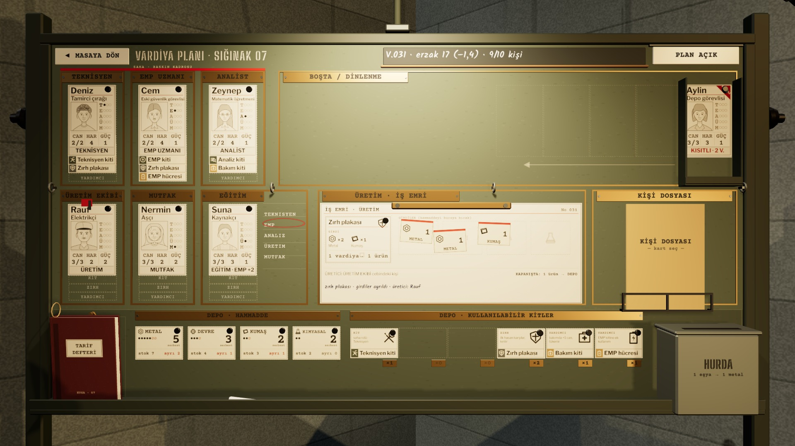
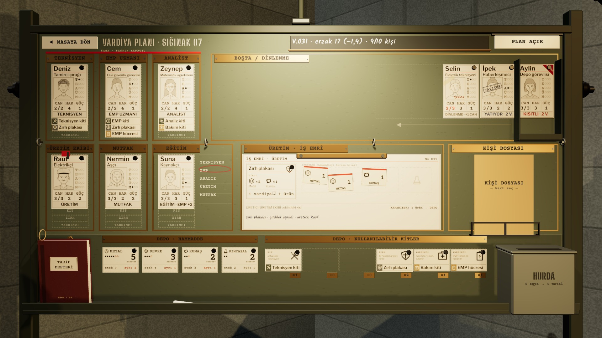
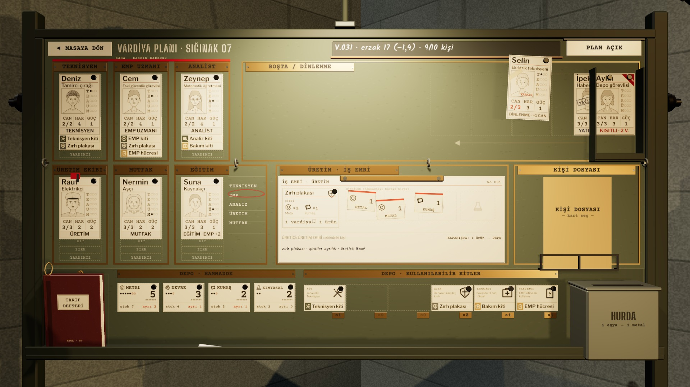

# R15c · Boşta destesi
*Pano: `R15c.dc.html` · görüntü: `../panolar/R15c.jpg`*

R15c · BOŞTA / DİNLENME DESTESİ · KAPALI, AÇIK, BİR KART ALINMIŞ GEÇ HAREKÂT ÖRNEĞİ · SELİN YARALI, İPEK YATIYOR, AYLİN KISITLI

KAPALI DESTE
Kartlar tepside 1 mm sağ-alt kaymalı yığın. Üst kart (Aylin, kısıtlı) doğrudan sürüklenir; alttakiler destede kalır. Destenin altındaki teçhizat şeritleri tepsinin dudağının üstünde görünür.

AÇIK TIK: SOLA TEK TEK
Üst karttan başlayarak her kart 320 ms’de, aralarında 70 ms ile sola açılır (hareketler üst üste biner). Adım min(82, 690/(n−1)) mm: 10 kişi de binmeden sığar. Arkada ek panel, başlık ya da Topla düğmesi yok.

ALINDI DİĞERLERİ DÖNER
Açık elden bir kişi alınınca ötekiler desteye döner (alttan başlayarak, 320 ms / 70 ms). Açık kartlara ya da boş panoya tık eli kapatır. Yarım harekette yön değişirse mevcut konumdan sürer.
- Desteye bırakma · görevden desteye bırakılan kişi eski görevine uğramadan bırakıldığı noktadan tepsiye kayar (0,32 s). | Sınır · en çok 10 kişi; tepsi kart + üç teçhizat şeridini (170 mm) taşır. | Ses · açılış: art arda yumuşak kâğıt kaymaları; toplanma: tek “şırp”.
