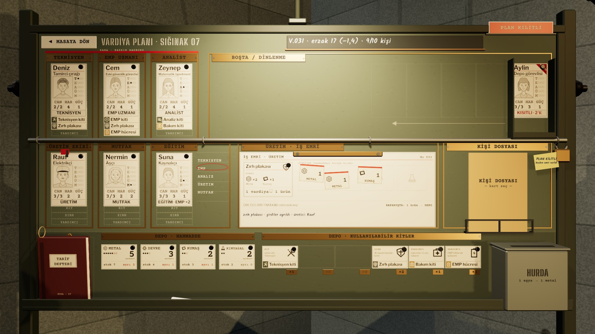
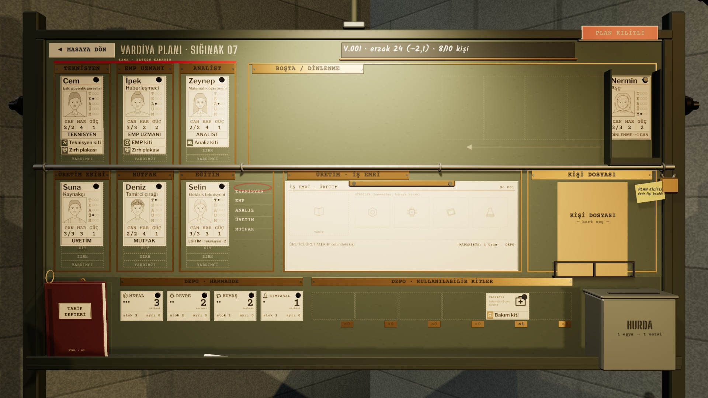

# R15d · Plan kilitli
*Pano: `R15d.dc.html` · görüntü: `../panolar/R15d.jpg`*

R15d · PLAN KİLİTLİ · BASKIN EMRİNDEN YA DA FİŞ BASILDIKTAN SONRA KİLİT ÇUBUĞU · ASMA KİLİT · PLAN PLAKASI

KİLİT BASKIN EMRİNDEN SONRA
Kilit çubuğu sağ dikmeden 0,4 s’de kayarak dört halkadan geçer, asma kilit “klak”; PLAN plakası 0,3 s’de kırmızı yüzüne döner. Kartlar üzerine gelince kalkmaz, 2 mm titrer ve tok “tok” verir.

ETİKET NEDEN YAZILI
Mavi kalemle: “PLAN KİLİTLİ · baskın emri verildi”.

FİŞ DEVİR FİŞİ BASILINCA
Aynı kilit, etiket “devir fişi basıldı”. Fiş EVRAK’a girip vardiya açılınca çubuk geri kayar.
- **Kilitliyken · kart, teçhizat ve tarif sürüklenmez; kişi dosyası ve tarif defteri okunur; Boşta açılıp kapanır.** — Açılma · yeni vardiya açıldığında (fiş EVRAK’a girince) çubuk 0,4 s’de geri kayar, plaka PLAN AÇIK’a döner.
