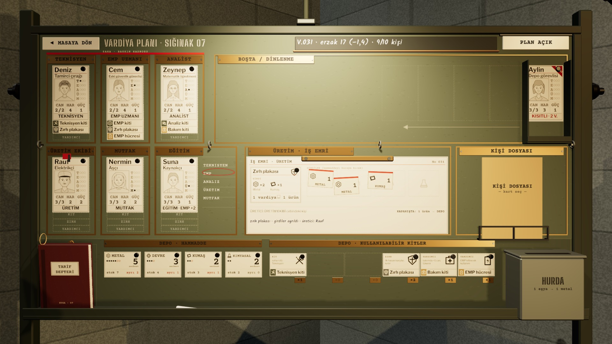

# R15e · Geç harekât panosu
*Pano: `R15e.dc.html` · görüntü: `../panolar/R15e.jpg`*

R15e · PANO · GEÇ HAREKÂT (V.031) DURUMLAR: YARALI · YATIYOR · KISITLI · İNCELE · İŞ EMRİ DOLU

İNCELE BAYRAĞI yeni talimatla eşleşen dosya
İŞ EMRİ DOLU zırh plakası · 2 metal + 1 kumaş ayrıldı
DESTE: 3 KİŞİ Aylin kısıtlı (üstte)
HAMMADDE metal 7 · 2 ayrı → serbest 5
V.031 GEÇ HAREKÂT · 9/10 KİŞİ
Eren kayıp (V.024): kartı panodan çıkar, KAYIPLAR zarfına geçer (R16a). Aylin kısıtlı kabul, 2 vardiya; Rauf kabul edildi, dosyasına yeni talimatla eşleşen inceleme fişi düştü.
BAYRAK YALNIZ DOSYA İŞARETİ
Kırmızı İNCELE bayrağı kişinin robot olduğunu söylemez; yalnız dosyasında yeni talimatla eşleşen bir kayıt olduğunu. Kişi dosyası açılınca izler okunur (R17).
İŞ EMRİ TARİF + FİŞLER
Tarif kartı basılı kutuda, üç hammadde fişi bırakıldıkları açılarla duruyor; formda mavi kalemle durum. Üretici ÜRETİM EKİBİ cebindeki kişi.
DEPO YIĞINLAR
Zırh ×2, bakım ×1, EMP hücresi ×1, Teknisyen kiti ×1. Eşya tavanı 32; dolunca hurda kutusu yer açar.
