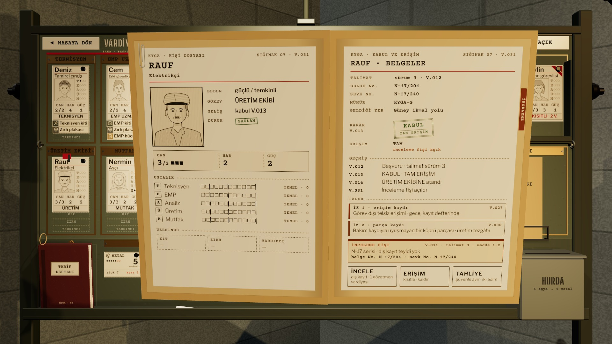

# R15f · Kişi dosyası açık
*Pano: `R15f.dc.html` · görüntü: `../panolar/R15f.jpg`*

R15f · KİŞİ DOSYASI AÇIK (RAUF) MANİLA KLASÖR · 2 × A5 · SAYFALAR R10

AÇMA KLASÖR ÖNE GELİR
Kişi kartına çift tık ya da sepetteki klasöre tık: klasör 0,35 s’de öne gelir ve açılır. Sol sayfa: portre, meslek, beden profili, CAN/HAR/GÜÇ, ustalık çubukları, taşıdığı eşya. Sağ sayfa: belgeler, karar, erişim, geçmiş, izler (R10).
EYLEM İNCELE · ERİŞİM · TAHLİYE
Alt şeritte üç kâğıt sekmesi: İNCELE gözetimli inceleme ister (dosyaya kırmızı fiş tutturur), ERİŞİM tam ↔ kısıtlı değiştirir (pirinç sürgü), TAHLİYE geri dönülmez: basılı tut 1,2 s, damga iner.
ROBOT DOSYA ELE VERMEZ
Rauf’un dosyası iki izi yazar (erişim kaydı, parça kaydı) ve inceleme fişini taşır; “robot” demez. Karar oyuncunun.
