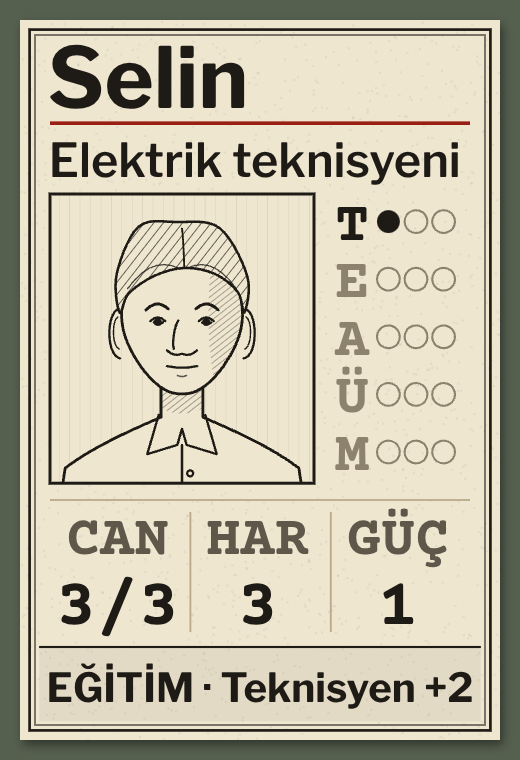
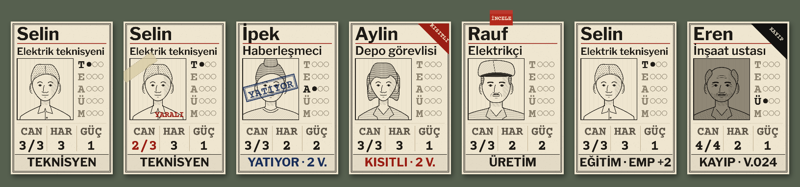
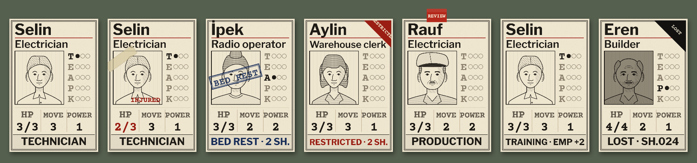

# R16a · Kişi kartı ve durumları
*Pano: `R16a.dc.html` · görüntü: `../panolar/R16a.jpg`*

R16a · KİŞİ KARTI VE DURUMLARI 80 × 120 MM · 0,6 MM · YÜZ DOKUSU 8 PX/MM

DURUMLAR TR
Normal · yaralı (bant + kırmızı CAN) · yatıyor (mavi damga, süre) · kısıtlı (kırmızı köşe, süre) · inceleme bayrağı · eğitimde · kayıp (kararmış portre, yas köşesi, KAYIPLAR zarfında).

- **1** — Ad · Libre Franklin 700, 14 mm (K4’te 21 px). İsimler çevrilmez.
- **2** — Meslek · 600, 9,5 mm; sığmazsa %74’e kadar küçülür.
- **3** — Portre · 44 × 48 mm mürekkep kimlik çizimi (R16c). Durum işaretleri portrenin üstüne biner, portreyi değiştirmez.
- **4** — Ustalık · T · E · A · Ü · M ve üç nokta: Eğitimli 2 · Deneyimli 6 · Uzman 12 deneyim. Açılmamış alan soluk.
- **5** — CAN / HAR / GÜÇ · gerçek değerler; yaralıyken CAN kırmızı “2/3”.
- **6** — Görev / durum şeridi · cebin adı; eğitimde konu ve kazanç, Boşta’da “+1 CAN”, durumlarda süre.
- **7** — Mıknatıs · Ø 10 mm, sağ üst; İNCELE bayrağı üst kenardan taşar.
