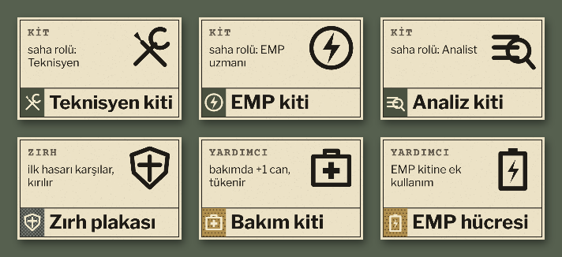
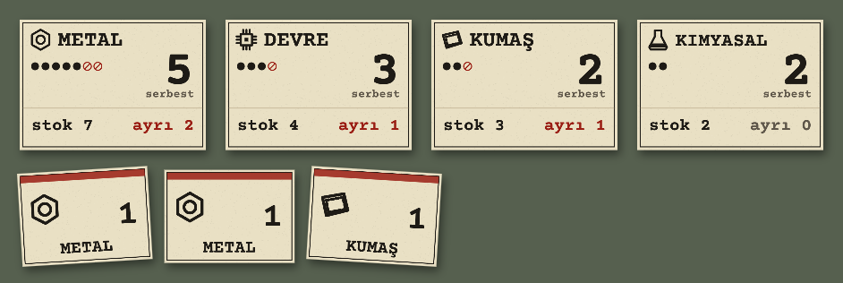
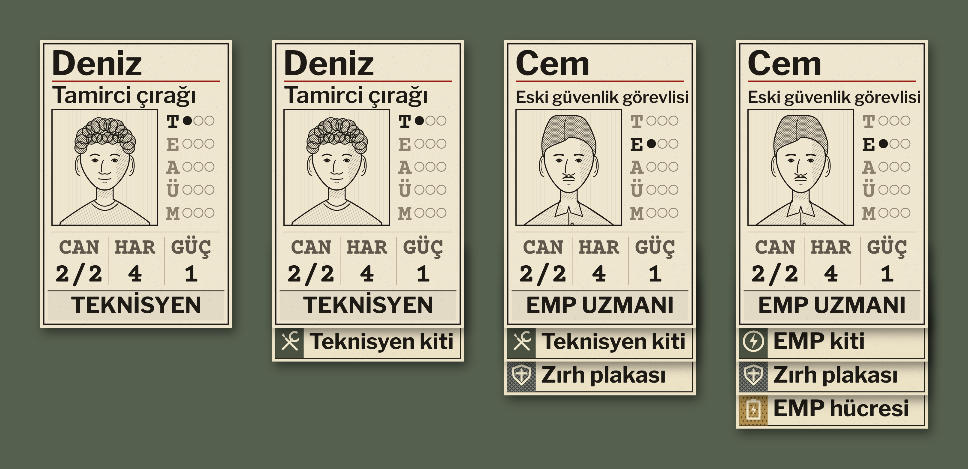
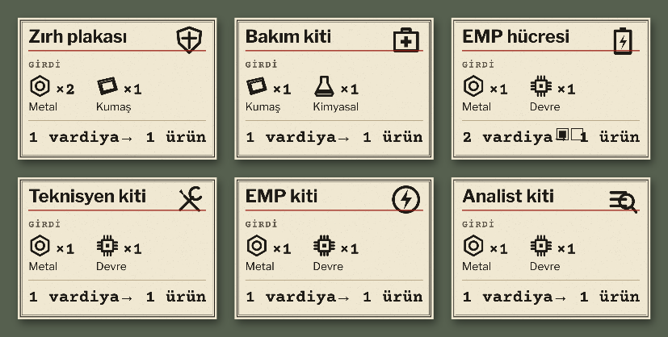

# R16b · Teçhizat, hammadde, tarif
*Pano: `R16b.dc.html` · görüntü: `../panolar/R16b.jpg`*

R16b · TEÇHİZAT, HAMMADDE VE TARİF KARTLARI · KART ÜSTÜNDE TEÇHİZAT HEPSİ AYNI KALINLIK (0,6 MM) · MIKNATIS Ø 10 MM
TEÇHİZAT 80 × 50 MM · ALT ŞERİT
Alt 14 mm kimlik şeridi: yuva deseni (kit düz zeytin, zırh tarama, yardımcı nokta — gri tonda ayrılır), simge, ad 9,4 mm. Üstte yuva, kullanım ve büyük simge.

HAMMADDE STOK KARTI VE FİŞ
Büyük serbest sayı; her birim bir nokta, ayrılmış birim kırmızı halka; altta stok ve ayrı. Sürüklemek 1 adetlik fiş çıkarır (56 × 40, kırmızı üst şerit = ayrılmış); fişi depoya geri sürüklemek ayırmayı kaldırır.

KART ÜSTÜNDE TEÇHİZAT SABİT YIĞIN
Teçhizat kişinin üstüne bırakılır, kartın arkasına sıkışır; şeritler sabit sırayla 14 mm aralıkla görünür: kit, zırh, yardımcı. Kişi taşınınca yığın onunla gider; depoya bırakılan eşya kişiden çıkar. Uyumsuz yuva: önizleme “zırh yuvası dolu: eski zırh depoya”.

TARİF 112 × 80 MM
Defterden sürüklenen kopya: ad, simge, girdiler, süre; iki vardiyalık tarifte ilerleme kutuları.

