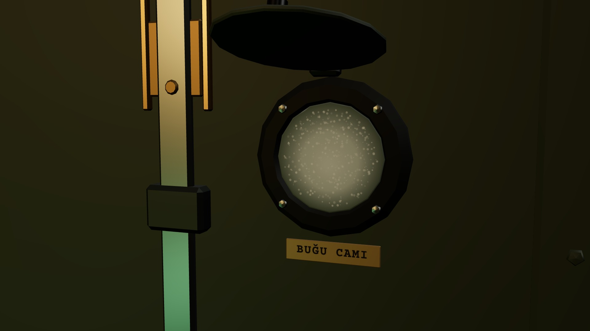
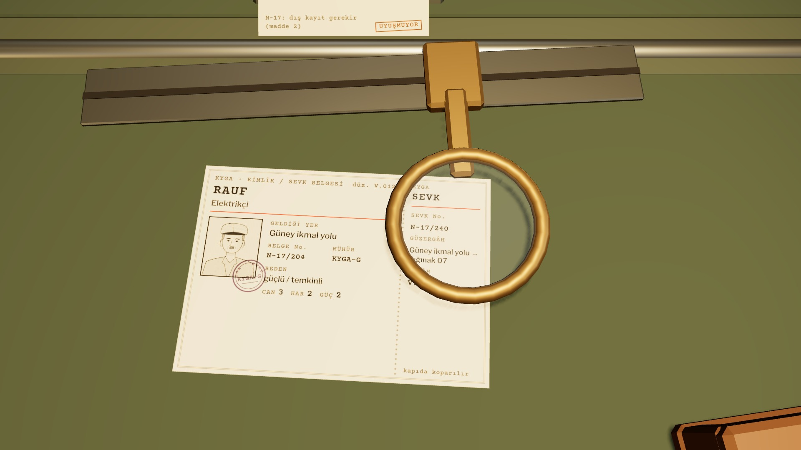

# R17b · İnceleme (V.012, Rauf)
*Pano: `R17b.dc.html` · görüntü: `../panolar/R17b.jpg`*

K8G · SOĞUK GÖZLEM

K8R · OKUMA (tık: kâğıt öne gelir)
R17b · İNCELEME YAPILIYOR · V.012 K8A · K8G · K8R
- 1 | Belge · Rauf: N-17/204 ≠ N-17/240 | 4 | Talimat şeridi · sürüm 3 | 7 | Talep defteri · DIŞ KAYIT
- 2 | Cetvel belgede · mercek SEVK No.’da | 5 | Bulgu fişi çıkıyor · UYUŞMUYOR | 8 | Buğu camı · SOĞUK GÖZLEM
- 3 | İşaretçi madde 2’de · yakut yanık | 6 | İnterkom · GÖRÜŞME (düğme 4 mm) | 9 | Okuma · kâğıt öne gelir

KARŞILAŞTIR: cetveli belgeye yatır, arabayı bir alana getir; eşleşen madde işaretçiyle yanar, fark mercekte büyür, fiş kayar. GÖRÜŞME: interkom düğmesi, döküm fişi. SOĞUK GÖZLEM: kanattaki buğu camının kapağı (kamera 0,45 s K8G’ye). DIŞ KAYIT: talep defteri.
