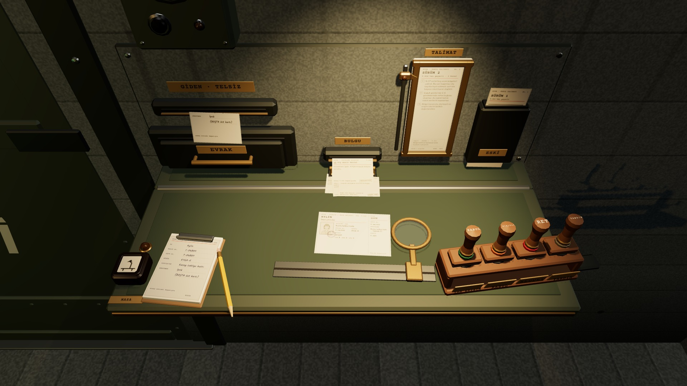
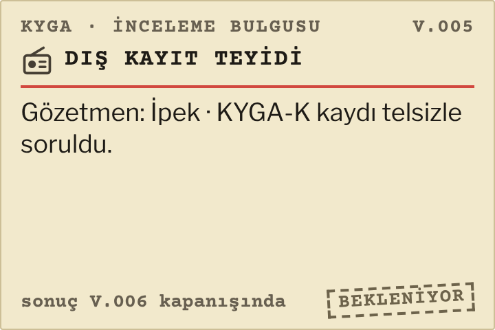
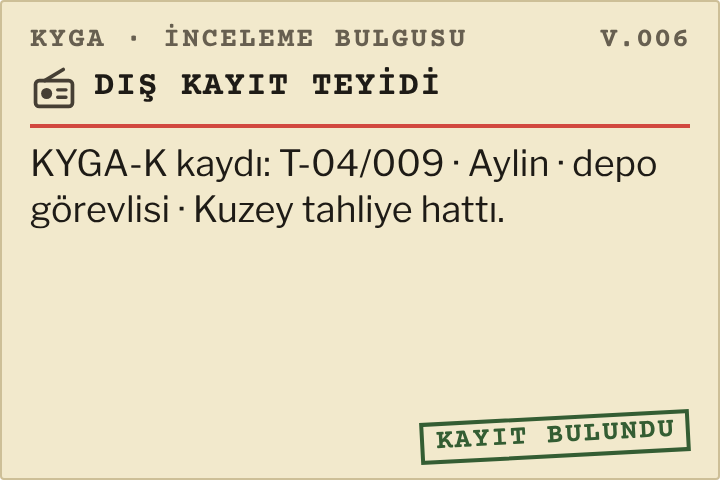

# R17c · Dış kayıt bekliyor
*Pano: `R17c.dc.html` · görüntü: `../panolar/R17c.jpg`*

V.005 · BEKLENİYOR

V.006 KAPANIŞI · SONUÇ
R17c · DIŞ KAYIT BEKLİYOR K8A · V.005 → V.006
- 1 | Üst yaprak GİDEN · TELSİZ ağzında | 3 | BEKLENİYOR fişi çıkıyor | 5 | Belge · Aylin (T-04/009)
- 2 | Karbon kopya defterde | 4 | Önceki üç bulgu kıskaçta | 6 | Talimat · sürüm 2

Gözetmen kuralı (öneri, açık soru): BOŞTA destesinin üst kartı gözetmen olur, adı talebe kendiliğinden yazılır (örnekte İpek); BOŞTA boşsa defter kilitli, “gözetmen yok”. Sonuç sonraki kapanışta BULGU ağzından gelir; aday bir vardiya bekler, başvuru açık kalır.
