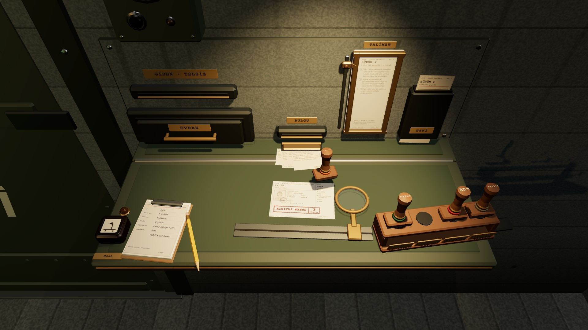
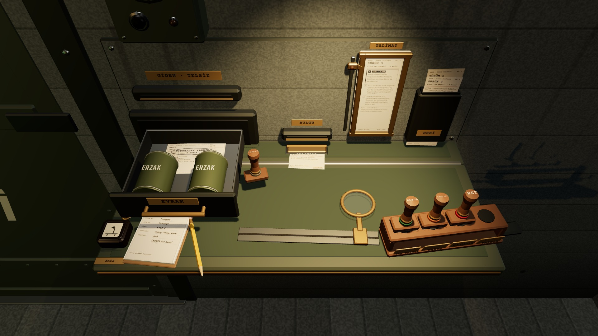

# R17d · Karar damgalandı
*Pano: `R17d.dc.html` · görüntü: `../panolar/R17d.jpg`*

R17d · KARAR DAMGALANDI damga raftan kalkar, belgenin üstüne bırakılınca 0,12 s’de basar · geri alınmaz · iz kalır

VARYANT · DIŞARIDAN YARDIM
DAMGALAMA Damga raftan sürüklenince 25 mm kalkar; belgenin altındaki boş alanın üstünde bırakılınca 0,12 s’de basar, ağır “tak”, mürekkep izi kalır. Başka yere bırakılırsa rafına döner. Kaldırmak ve basmak iki ayrı adım: geri dönülmez iş iki adımlıdır. Basılınca belge ve bulgular kişinin dosyasına geçer (R10).
DÖRT KARAR · DÖRT DAMGA

KABUL · TAM ERİŞİM
Çark döner, kanat koridora açılır (R9b); koridor boş kalır, kişinin kartı panoda BOŞTA’ya düşer. Belge geçerliliği insanlık garantisi değildir.

KISITLI KABUL · 3 VARDİYA
Saha, üretim, dış temas ve gözetim kapalı; uygun işte ayrı gözetmen gerekir. Kişi kartına KISITLI · 3 sekmesi; süre dolunca yenile, kaldır ya da ayır.

REDDET
Damgalı belge evrak gözünden dışarı döner; aday dış tahliye hattına yönlendirilir, kapı açılmaz. Cevapsız başvuru kapanışta ret sayılır.

DIŞARIDAN YARDIM · 2 ERZAK
İki erzak tenekesi belgeyle çekmeceden dışarı (sol alt); ERZAK sayacı 2 düşer, aday içeri girmez.
- **1** — KISITLI KABUL izi · Aylin
- **2** — Kullanılan damga · havada
- **3** — Rafta boş yuva
- **4** — Bulgular · en üstte dış kayıt sonucu
