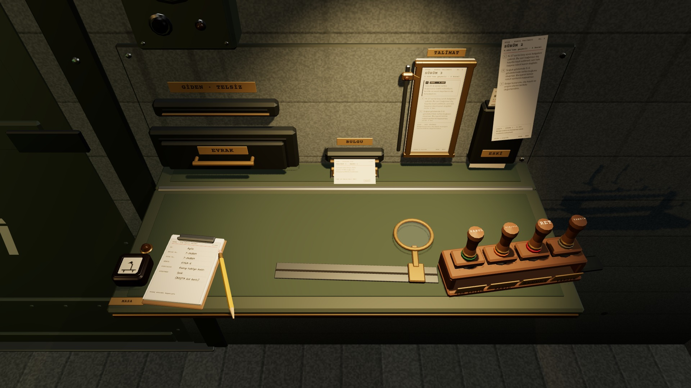
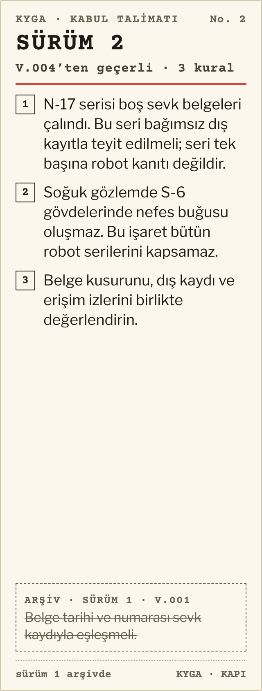
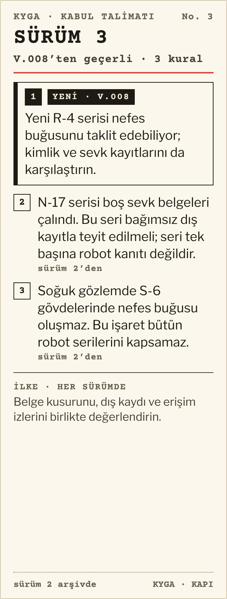

# R17e · Talimat sürüm 2 → 3
*Pano: `R17e.dc.html` · görüntü: `../panolar/R17e.jpg`*

R17e · TALİMAT DEĞİŞTİ · SÜRÜM 2 → 3 (V.008) yeni şerit yuvaya, eski şerit ESKİ cebine; eşleşen eski dosyalara İNCELE

SÜRÜM 2 · ESKİ CEBİNE

SÜRÜM 3 · YUVADA
AN Vardiya açılışında (V.008) teleks “TALİMAT 3” basar; tezgâh başvuru olmasa da iner (0,4 s), eski şerit yuvadan 0,25 s’de kalkıp ESKİ cebine kayar, yenisi 0,3 s’de yerine oturur; işaretçi en üste döner. BULGU ağzından İNCELEME FİŞİ çıkar.
İNCELE Yenilik yalnız ilgili eski dosyalara inceleme fişi açar: örnekte kabulü buğuya da dayanan Aylin (V.006). Panoda kişi kartına ve dosyasına İNCELE sekmesi takılır (R15/R16); karar yeniden açılmaz, inceleme fişi kişinin dosyasında kalır.
ŞERİT R10’un dik şeridi 80 × 210 mm; satır işaretçisi her sürümün madde yüksekliğine kayar, bu yüzden sabit yakut yerine tek kayan işaretçi.
- **1** — Sürüm 3 yuvada
- **2** — Sürüm 2 ESKİ cebine
- **3** — İnceleme fişi
