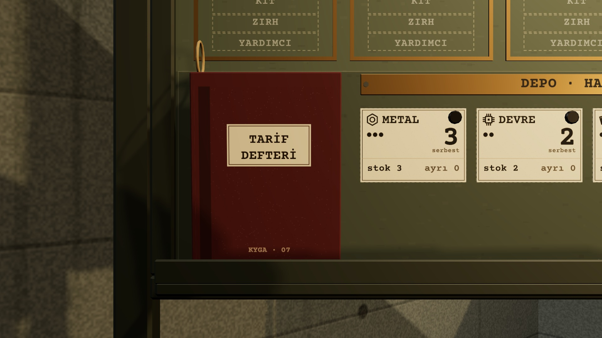
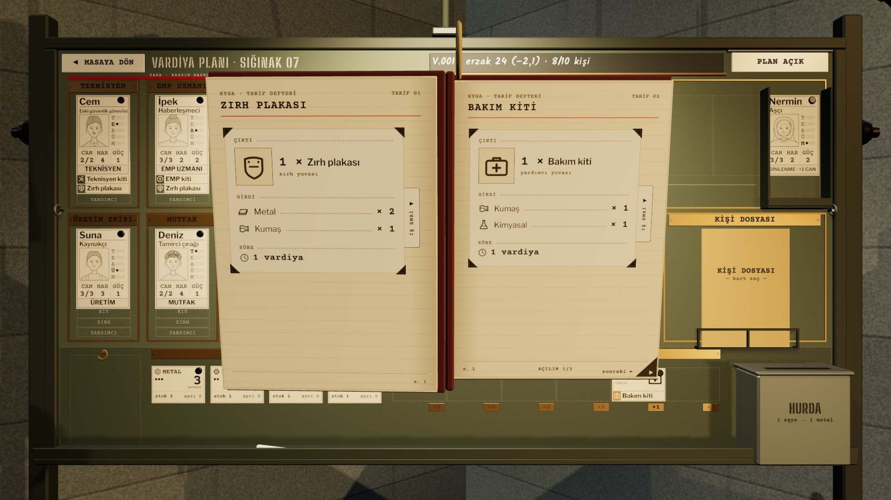
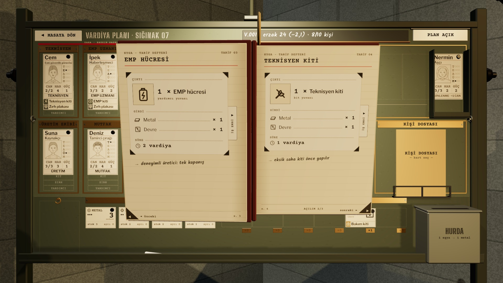
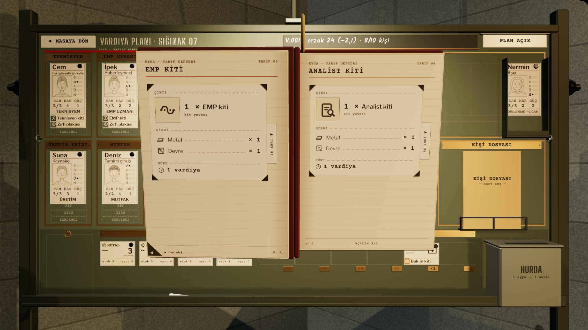

# R18a · Tarif defteri kapalı ve açık
*Pano: `R18a.dc.html` · görüntü: `../panolar/R18a.jpg`*

R18a · TARİF DEFTERİ · KAPALI VE AÇIK (ÜÇ AÇILIM) A6 CİLTLİ · 105 × 148 MM · SAYFALAR R10 TARİF SAYFASI

KAPALI RAFTA
Panonun sol alt rafında bordo bez ciltli A6 defter, kapağı dönük; ip halkası kancada. Üzerine gelince 4 mm öne eğilir, 400 ms sonra etiket “TARİF DEFTERİ · 6 tarif”.

AÇIK ÖNE GELİR · ÜÇ AÇILIM
Tık: defter 0,35 s’de kameranın 0,32 m önüne gelir ve açılır (kapak −178°). Her açılımda iki tarif; sayfa köşesindeki “◄ önceki / sonraki ►” sekmesine tık yaprağı 0,25 s’de çevirir. Kapağa ya da pano boşluğuna tık: kapanır, rafa döner. Arka plan karartılmaz; defter fiziksel olarak önde.

