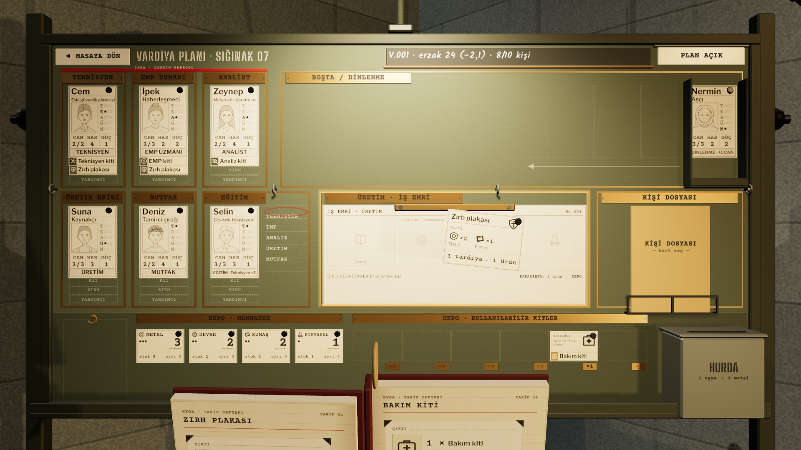

# R18b · Tarif sürükleniyor
*Pano: `R18b.dc.html` · görüntü: `../panolar/R18b.jpg`*

R18b · TARİF SÜRÜKLENİYOR DEFTER AŞAĞI KAYAR · HEDEF: ÜRETİM · İŞ EMRİ

İŞ EMRİ ← ZIRH PLAKASI girdi: 2 metal + 1 kumaş · üretici: Suna
SÜRÜKLE SAYFADAN KOPYA
Tarife basılı tutunca sayfadan tarif kartı (112 × 80) kalkar; defter 0,25 s’de kadrajın altına kayar ki iş emri görünsün. İş emri bölgesi amber çerçeveyle hedef olur.
BIRAK İŞ EMRİNE
Kart bırakıldığı serbest konumda kalır (kayıtla korunur); çoğu oyuncu basılı TARİF kutusuna koyar. Başka yere bırakılırsa deftere döner, defter yeniden öne gelir.
KİLİT TEK İŞ EMRİ
Dolu iş emrine yeni tarif bırakmak eskisini değiştirir: önizleme “başlamamış iş · ücretsiz iptal” der; başlamış işte “harcanan girdi geri gelmez”.
