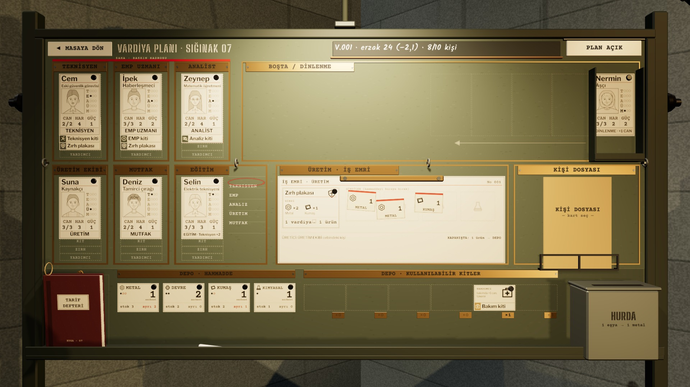
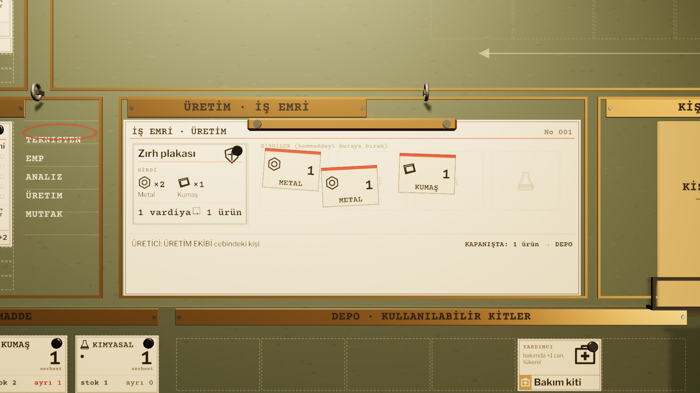

# R18c · İş emri dolu
*Pano: `R18c.dc.html` · görüntü: `../panolar/R18c.jpg`*

R18c · İŞ EMRİ DOLU HER BIRAKIŞ 1 ADET AYIRIR · GERİ SÜRÜKLEMEK 1 ADET SERBEST BIRAKIR

DOLU TARİF + GİRDİ + ÜRETİCİ
Zırh plakası kartı, 2 metal ve 1 kumaş fişi; üretici ÜRETİM EKİBİ cebindeki Suna. Stok kartlarında ayrılmış birimler kırmızı halka (metal serbest 1, kumaş serbest 1). Hiçbir şey kapanışa kadar harcanmaz.

YAKIN FORM OKUNUR
Form: TARİF kutusu, GİRDİLER alanı (dört soluk hammadde simgesi), “ÜRETİCİ: ÜRETİM EKİBİ cebindeki kişi”, “KAPANIŞTA: 1 ürün → DEPO”. Eksikte mavi kalemle “eksik: 1 kumaş”.
- Fiş · hammadde kartından sürüklenen her fiş 1 adet ayırır; depoya geri sürüklemek ayırmayı kaldırır. | Eşleşme · birden çok eşleşmede eksik saha kiti önce, sonra defter sırası. | Durma · üretici yoksa, açlık varsa ya da eşya deposu doluysa iş durur; formda “DURDU” damgası.
