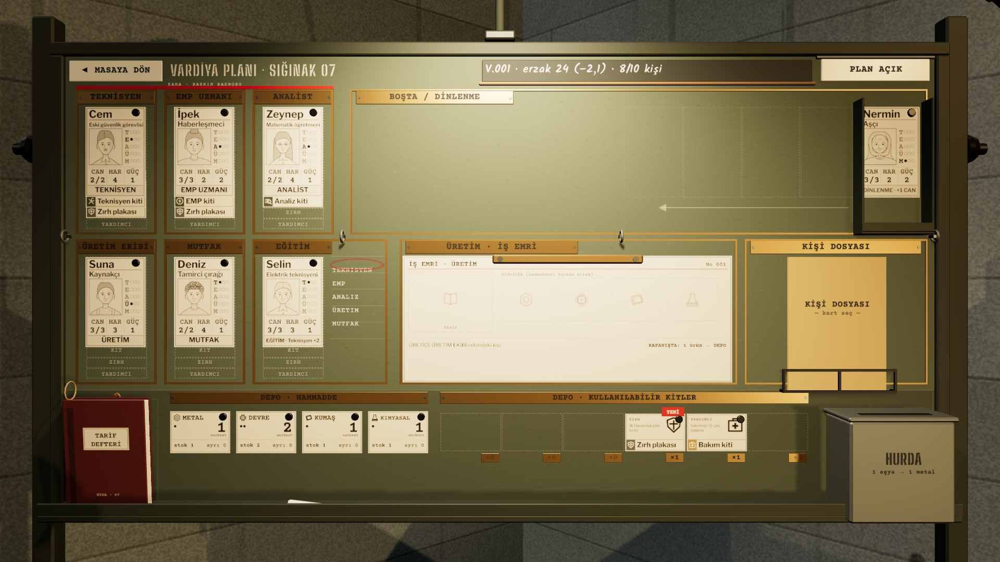

# R18d · Ürün çıktı
*Pano: `R18d.dc.html` · görüntü: `../panolar/R18d.jpg`*

R18d · ÜRÜN ÇIKTI (KAPANIŞTAN SONRA) V.002 · DEPO · YENİ ETİKETİ

ÇIKTI YENİ ÜRÜN DEPODA
Fiş EVRAK’a girip vardiya açıldığında iş emri boşalır, girdiler bir kez düşer (metal 3 → 1, kumaş 2 → 1), zırh plakası kartı depodaki yığına “YENİ” etiketiyle eklenir (etiket ilk dokunuşta düşer).
İKİ VARDİYA EMP HÜCRESİ
İki vardiyalık tarifte ilk kapanışta girdiler ödenir, tarif kartında ilk kutu dolar; ikinci kapanışta ürün çıkar. Deneyimli üretici tek kapanışta bitirebilir.
SES KAPANIŞ SONRASI
Kamera panoya ilk gelişte yeni kart 0,3 s’de yerine kayar, kâğıt “şık”.
