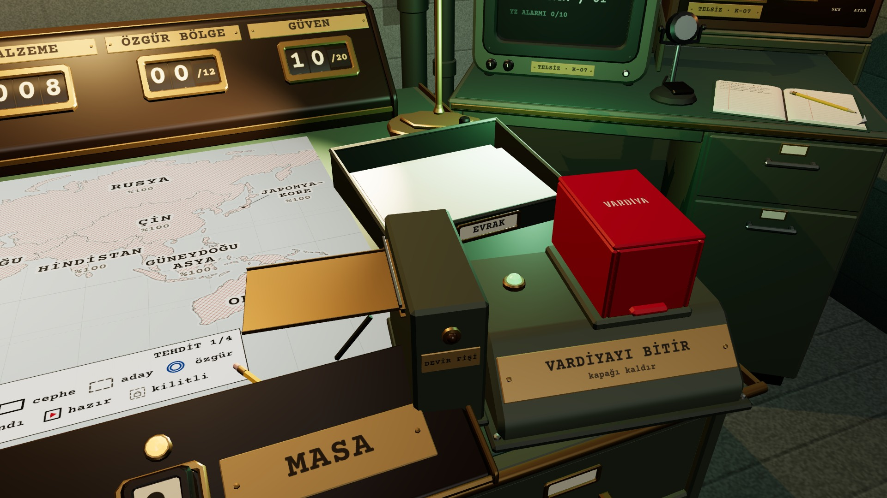
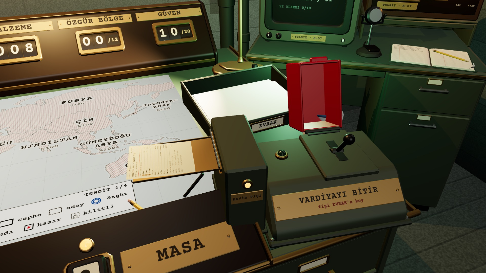
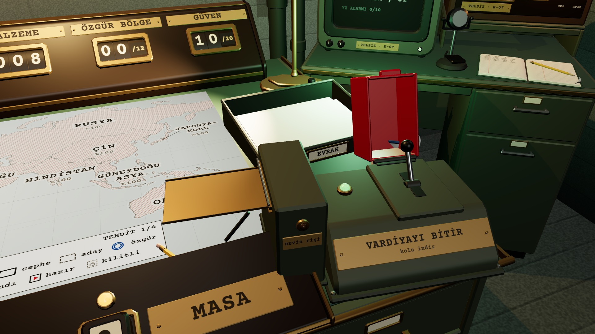
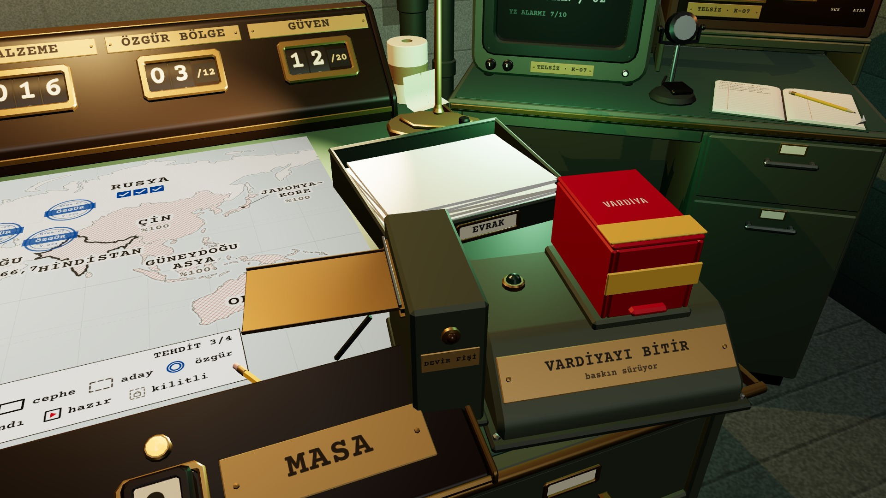

# R19a · Şalterin dört durumu
*Pano: `R19a.dc.html` · görüntü: `../panolar/R19a.jpg`*

R19a · VARDİYA ŞALTERİNİN DÖRT DURUMU (K6) ŞALTER BRİFTEKİ GİBİ · COVER X 0→112° · LEVER X +35→−35° · SOLUNDA FİŞ AĞZI

1 HAZIR
Kapak kapalı, kol yukarıda (+35°), hazır lambası yeşil; plakanın ikinci satırı “kapağı kaldır”. Fiş ağzının lambası sönük.

3 İNİK · FİŞ BEKLİYOR
Kapak açık, kol aşağıda (−35°), hazır lambası sönük, şalter tıklanmaz; ikinci satır “fişi EVRAK’a koy”, fiş ağzının amber lambası yanık. Fiş dilde ya da elde.

2 KAPAK KALKIK
Kapak 0,25 s’de 112° kalkar; ikinci satır “kolu indir”. 4 s içinde ikinci tık yoksa kapak kapanır (0,3 s).

4 KİLİTLİ
Baskın sürerken, açılış ya da emir belgesi açıkken veya plan düzeltilmeliyken: kapakta sarı-siyah KİLİTLİ bandı, ikinci satır nedeni söyler. Tık: kapak 2 mm oynar, “klak”.
