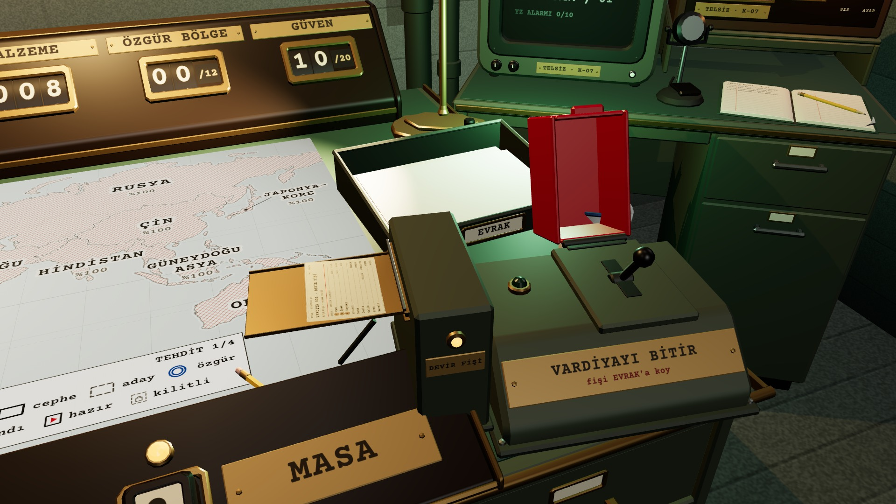
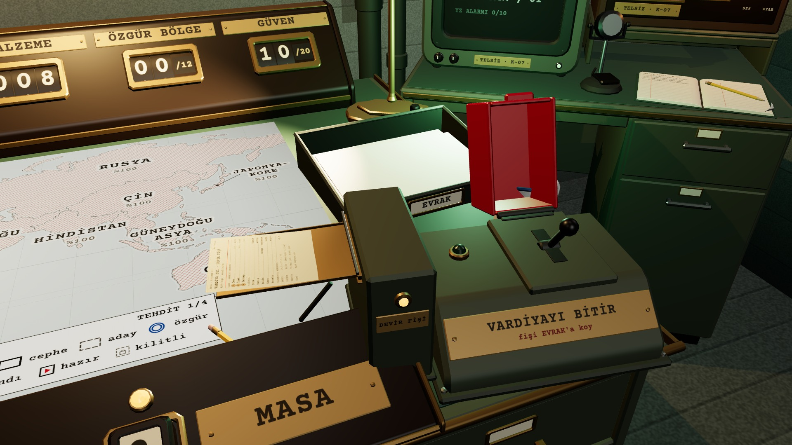
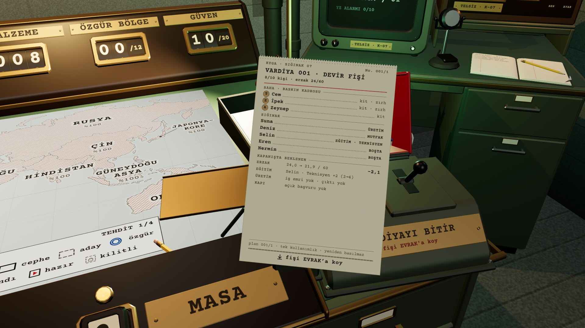
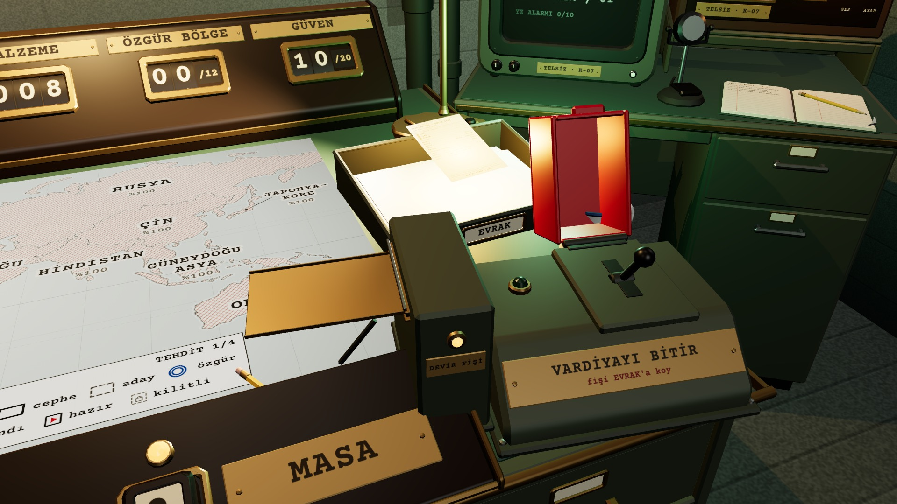
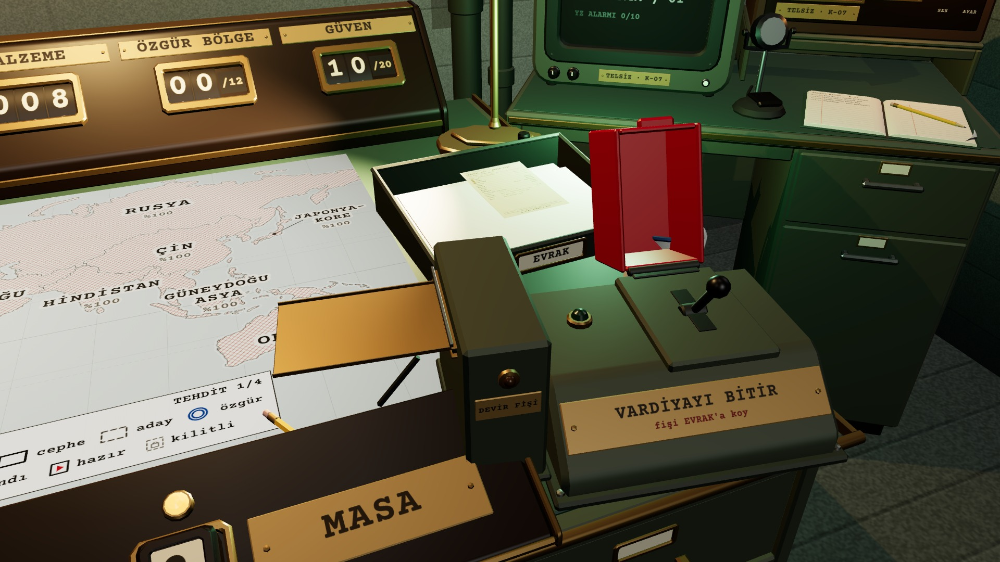

# R19b · Fiş, EVRAK, kararma
*Pano: `R19b.dc.html` · görüntü: `../panolar/R19b.jpg`*

R19b · FİŞİN ÇIKIŞI → EL → EVRAK → KARARMA K6 · FİŞ 100 × 150 MM · ÇIKIŞ NOKTASI ŞALTER YERELİ (−0,30; 0,14; 0,015)

1 ÇIKIŞ · 0,35 S
Kol inince fiş ağızdan 12 cm kayar (x −0,18 → −0,30), ease-out; yazıcı “tırrt” ve kopma “çıt”.

2 DİLDE
Fiş pirinç dilde yatar; okumak ya da almak zamanı ilerletmez. Ağzın amber lambası yanık.

3 ELDE · OKUNUR
Tık ya da sürükleme: fiş kameraya gelir (0,25 s), ekran yüksekliğinin %67’si; gövde yazısı 18 px.

4 EVRAK ÜSTÜNDE
Tepsi hedef olunca dudağı amber parlar (gölgesiz ışık); başka yerde bırakılan fiş dile döner.

5 BIRAKILDI
Fiş tepsiye 0,2 s’de kayar, kâğıt “şap”; aynı fiş yeniden kullanılamaz.

0,2 s · siyah
6 KARARMA · 0,2 S
Ekran 0,1 s’de kararır, Step bir kez çalışır, 0,1 s’de açılır; kararmada tek tok “gong” (kısık).
