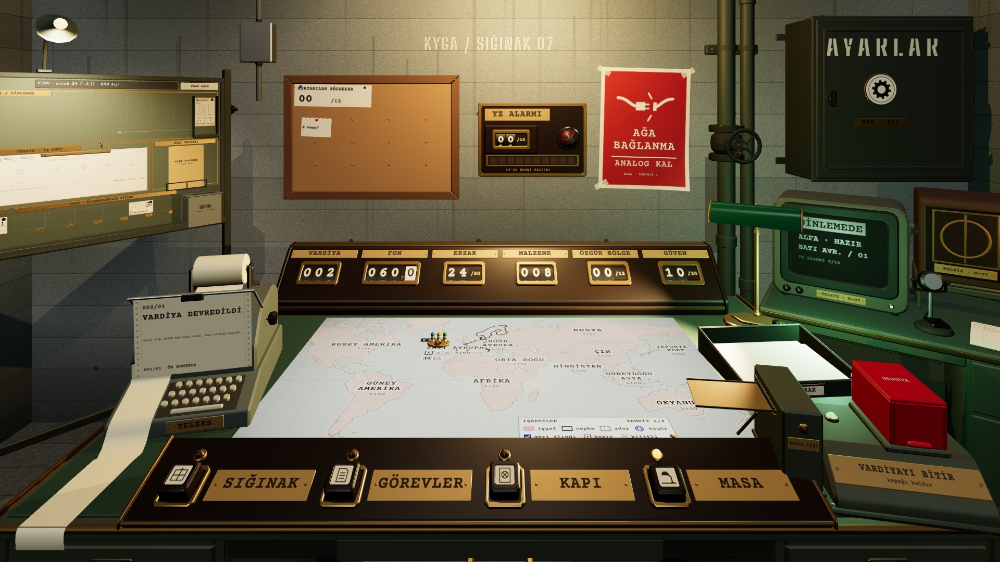

# R19b · Yeni vardiya (K1)
*Pano: `R19b2.dc.html` · görüntü: `../panolar/R19b2.jpg`*

R19b · SON KARE: YENİ VARDİYA (K1) TELEKS · SAYAÇ · ŞALTER HAZIR

TELEKS 002/01 · VARDİYA DEVREDİLDİ
Devir fişi EVRAK kutusuna kondu. Yeni vardiya başladı. Altında bir önceki satır: 001/01 ÖN KONTROL.
SAYAÇ VARDİYA 002
Tekerler 0,4 s’de döner; erzak ve malzeme kapanışın sonucuna göre.
PANO KİLİT AÇILIR
Kilit çubuğu geri kayar, PLAN plakası AÇIK’a döner; tamamlanan ürün depoda “YENİ” etiketiyle (R18).
ŞALTER HAZIR
Kapak kendiliğinden kapanır (0,3 s), kol yukarı, hazır lambası yanar.
