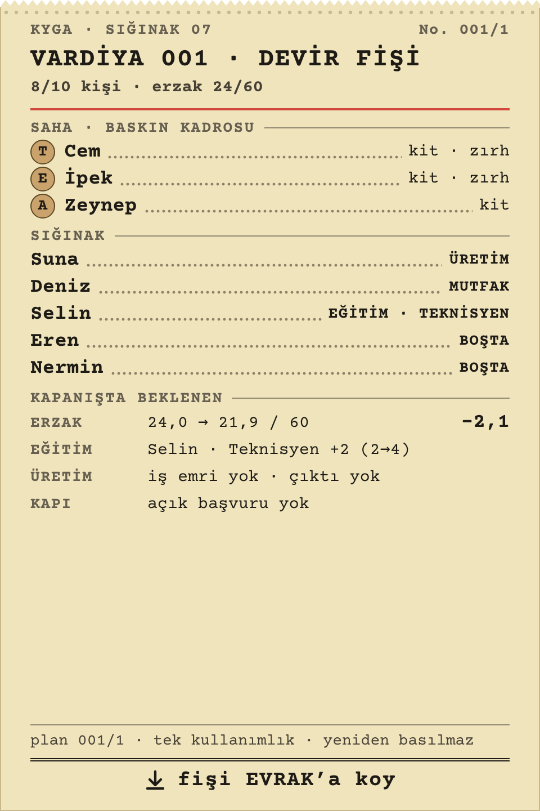
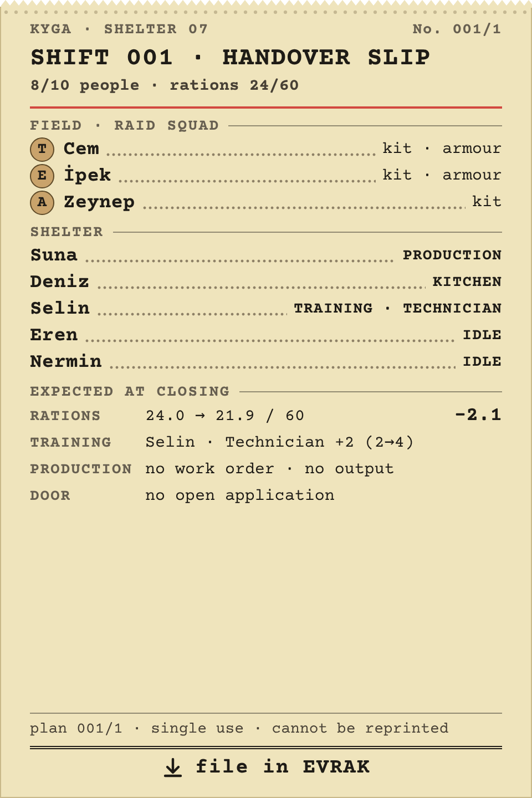
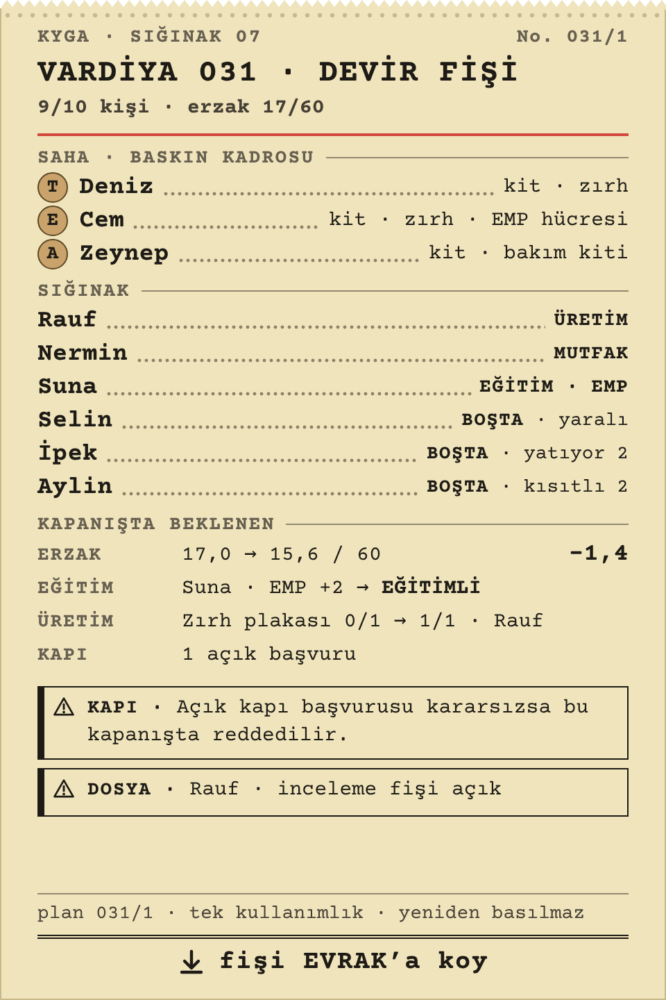
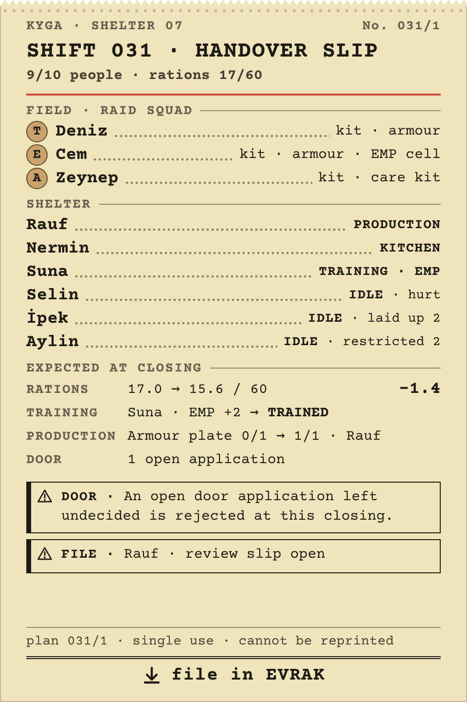

# R19c · Devir fişi düzeni TR/EN
*Pano: `R19c.dc.html` · görüntü: `../panolar/R19c.jpg`*

R19c · DEVİR FİŞİ DÜZENİ (TR / EN) 100 × 150 MM · TELEKS KÂĞIDI · COURIER PRIME · R10 AİLESİ

TR V.001
İlk vardiya: saha kadrosu üç disk, sığınak işleri, kapanışta beklenen (erzak 24,0 → 21,9 / 60), “açık başvuru yok”.

EN V.001
Aynı düzen EN; isimler Türkçe, ondalık nokta.

TR V.031
Geç harekât: yaralı, yatıyor, kısıtlı durumları; iki uyarı kutusu (kapı başvurusu, Rauf · inceleme fişi açık).

EN V.031
Aynı EN.
- Başlık · KYGA · SIĞINAK 07 | No. 001/1 · VARDİYA 001 · DEVİR FİŞİ · kişi ve erzak satırı · kırmızı çizgi. | Gövde · SAHA · BASKIN KADROSU (T/E/A diskleri, ad, eşya) · SIĞINAK (ad, görev, durum) · KAPANIŞTA BEKLENEN (erzak, eğitim, üretim, kapı). | Alt · plan no · tek kullanımlık · yeniden basılmaz · ↓ fişi EVRAK’a koy. Gelecekteki gizli olayı yazmaz.
