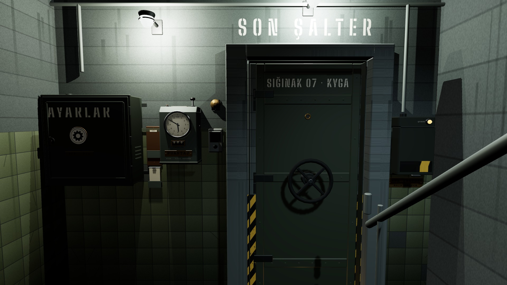

# R1a · Sahanlık · kayıt yok
*Pano: `R1a.dc.html` · görüntü: `../panolar/R1a.jpg`*

R1a · KAYIT YOK İLK AÇILIŞ
Rafın cebi boş; yalnız deste görünür. Desteye tek tık yeni harekâtı başlatır (onay yok, silinecek kayıt yok). Saat tıklanmaz.
Açılış: siyah → lambalar 0,6 s'de iki kırpışmayla yanar; uzak uğultu ve damla.
YENİ HAREKÂT boş kartı saate bas · içeri gir
cep boş
