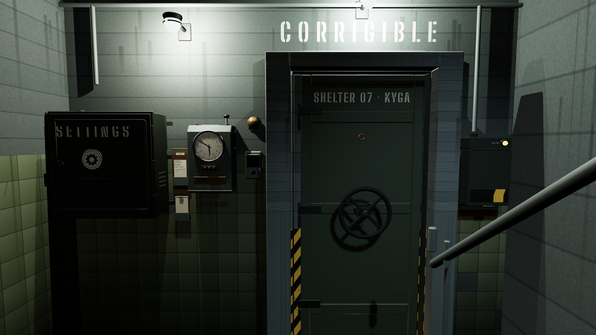

# R1b · Sahanlık · kayıt var
*Pano: `R1b.dc.html` · görüntü: `../panolar/R1b.jpg`*

R1b · SAHANLIK · KAYIT VAR M0 · 56°
- 1 | Dolap · AYARLAR, dişli rozet | 6 | Dış çark · Ø 0,36 dökme demir
- 2 | Kart rafı · komutanın kartı | 7 | Başlık · betona şablon
- 3 | Deste · YENİ HAREKÂT | 8 | Son şalter · kapak kapalı
- 4 | Puantaj saati · V.014 | 9 | Saat lambası (L2)
- 5 | Interkom ve zil (süs) | 10 | Kapı altından sıcak şerit (L3)

Soğuk sahanlık, sıcak içerisi: kapı hedef olur. Kart cepteyken 4 mm öne gelir, etiket: KAYITTAN DEVAM · V.014 · özgür 3/12.
KAYITTAN DEVAM V.014 · özgür 3/12 · karta tıkla

EN · CORRIGIBLE · SHELTER 07
