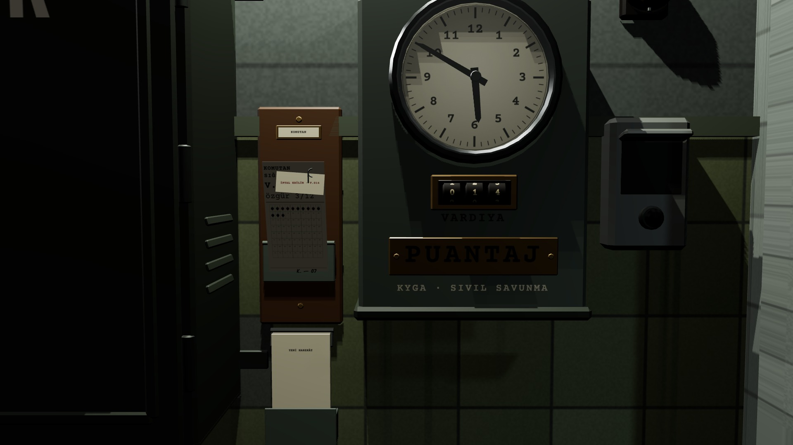

# R1c · Yeni harekât onayı
*Pano: `R1c.dc.html` · görüntü: `../panolar/R1c.jpg`*

R1c · ONAY M2 · İKİ ADIM
- **1** — Eski kart yerel x'te −14° öne devrilir; ataşlı fiş: kırmızı çift çizgi İPTAL EDİLİR · V.014.
- **2** — Destenin kıskacı −70° kalkık (vardiya şalterinin kapağı gibi).
- **3** — 4 s içinde ikinci tık onaylar; süre dolarsa kıskaç kapanır, kart doğrulur.

Eski kayıt bugünkü gibi ilk komutta silinir (Karar 12).
YENİ HAREKÂT · 2. TIK 4 sn içinde onayla · eski kayıt silinir
