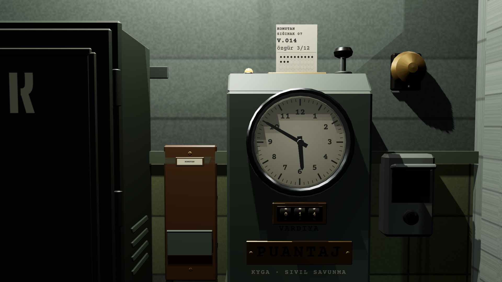

# R1d · Kart saate basılıyor
*Pano: `R1d.dc.html` · görüntü: `../panolar/R1d.jpg`*

R1d · KART SAATTE M2 · KAMERA +0,18
- **1** — Kart yarığa 70 mm girer; başlık ve özet dışarıda okunur.
- **2** — Piston −12 mm iner: “ka-çunk”, yeni delik 0,3 s'de açılır.
- **3** — Amber lamba yanar (emission, gölgesiz).
- **4** — Zil çalar; kamera M0'a döner (R4).
