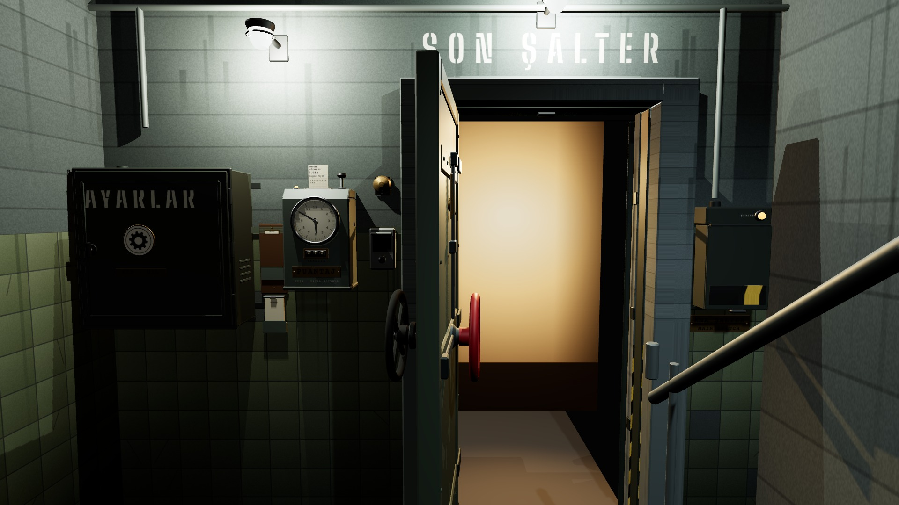

# R1e · Kapı açık, içeriden sıcak ışık
*Pano: `R1e.dc.html` · görüntü: `../panolar/R1e.jpg`*

R1e · KAPI AÇIK 3 GÖLGELİ IŞIK
- **1** — Kanat (Hinge, yerel y) +95° sahanlığa açılır; iç yüzde kırmızı çark görünür.
- **2** — İçeriden sıcak spot (#FFCF86, gölgeli): zemine ışık şeridi; saat lambasının gölgesi kapanır.
- **3** — İçerisi görünmez, sıcaklığı görünür: kamera eşiğe yürür, kararır (R4).
