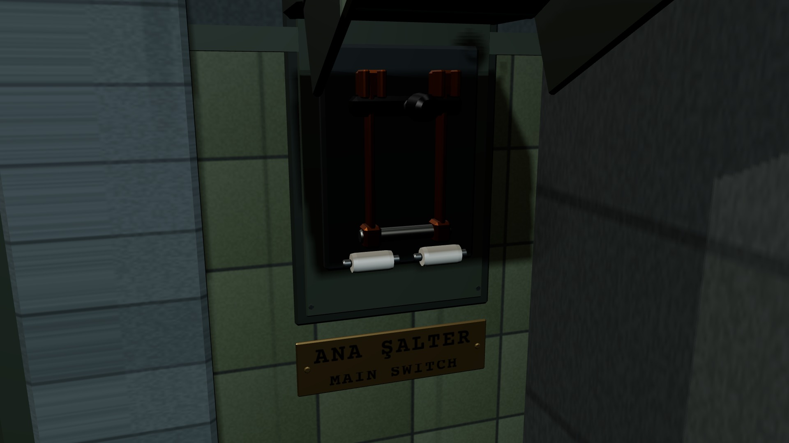

# R1f · Son şalterin kapağı kalkık
*Pano: `R1f.dc.html` · görüntü: `../panolar/R1f.jpg`*

R1f · SON ŞALTER MS · İKİ ADIM
- **1** — Kapak (yerel x) 115° kalkık; kol hâlâ yukarıda (+55°).
- **2** — İki kutuplu bıçaklı şalter: bakır bıçak, seramik sigorta, arduvaz taban. Masadaki vardiya şalterinden biçimce ayrı.
- **3** — ANA ŞALTER (22 mm) · MAIN SWITCH (12 mm): iki dil birlikte, sabit.
- **4** — 4 s içinde ikinci tık kolu −55°'ye indirir: lambalar 0,6 s'de söner, jeneratör susar, çıkış.

ANA ŞALTER · 2. TIK ışıkları kes · oyundan çık · 4 sn
